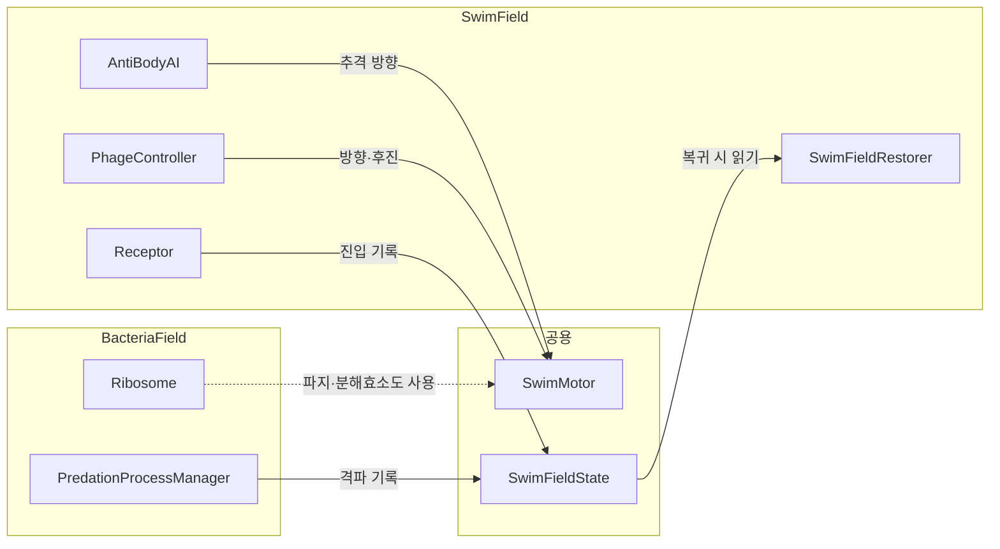
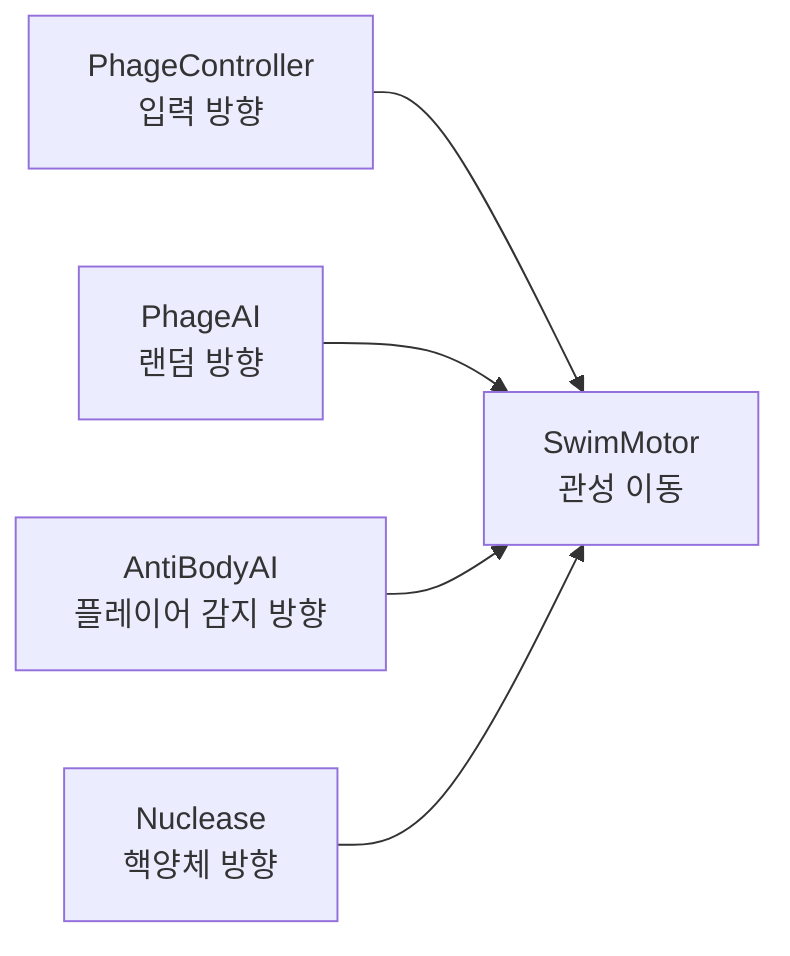
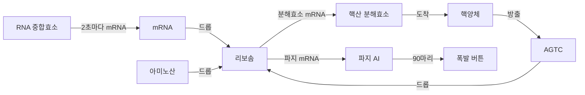
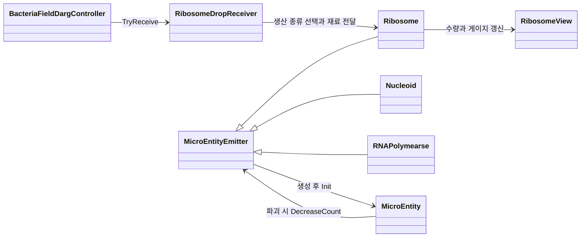
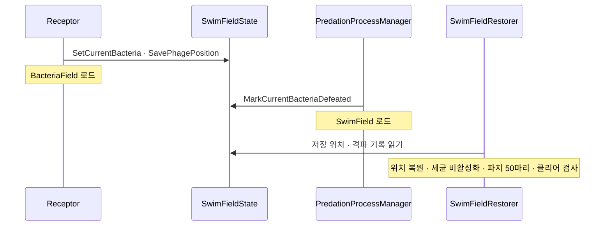

# Super Phage 기술 문서

> **박테리오파지가 세균에 침투해 증식하는 과정을 플레이로 옮긴 2D 탑뷰 게임**

> 📷 **이미지 자리** `images/cover.png` — 대표 화면 1장(유영 필드나 세균 내부에서 파지가 가득한 장면). 포트폴리오 문서와 발표 덱 표지에 크게 나옵니다.

| 항목      | 내용                                                                                                                                                               |
| --------- | ------------------------------------------------------------------------------------------------------------------------------------------------------------------ |
| 장르      | 2D 탑뷰 · 유영(회피) + 증식(드래그 앤 드롭 생산)                                                                                                                   |
| 개발 기간 | 2주 (커밋 기준 2026.06.24 ~ 2026.07.09)                                                                                                                            |
| 인원      | 개인 프로젝트                                                                                                                                                      |
| 담당      | 기획, Unity 개발, 에셋 제작(이미지는 AI 이미지 생성으로 직접 제작)                                                                                                 |
| 개발 환경 | Unity 6000.3.15f1 · C# · URP · Unity Input System · JetBrains Rider 2026.2.1                                                                                       |
| 주요 기술 | 공통 이동 컴포넌트(`SwimMotor`) · 상속 기반 생성기(`MicroEntityEmitter`) · 싱글톤 + `DontDestroyOnLoad` 씬 간 상태 · 드래그 앤 드롭 생산 · 에너지 단계별 이동 속도 |
| 링크      | [시연 영상](https://www.youtube.com/watch?v=ffu6aTLB6I0) · [프로젝트 저장소](https://github.com/KooHoo-Dev/3rd-2D-Project-Lets-Gitit)                              |

## 목차

1. [개요](#1-개요)
2. [전체 시스템 구조](#2-전체-시스템-구조)
3. [유영 필드 · 이동과 생존](#3-유영-필드--이동과-생존)
4. [세균 내부 · 드롭에서 파지 배출까지](#4-세균-내부--드롭에서-파지-배출까지)
5. [씬 간 상태 관리 · 유영과 증식 연결하기](#5-씬-간-상태-관리--유영과-증식-연결하기)
6. [트러블슈팅](#6-트러블슈팅)
7. [결과 및 회고](#7-결과-및-회고)

---

## 1. 개요

### 1.1 프로젝트 소개

**What — 무엇을 만들었나**

박테리오파지가 세균에 침투해 증식하는 과정을 플레이로 옮긴 2D 탑뷰 게임이다. 유영 필드에서 항체를 피해 세균에 접근하고, 세균 내부에서 리보솜에 mRNA와 재료를 공급해 파지를 증식시킨다. 세균을 터뜨리면 유영 필드로 돌아와 다음 대상을 찾는다.

**Why — 게임 기획 의도**

**《경험을 먼저 설계하고, 그 의도에 맞게 구현하려 노력했다.》**\
출발점은 박테리오파지 영상에서 빠르게 증식하는 모습에 느낀 흥미였다. 과정을 조사하면서 주목한 것은 포식 과정의 구조였다. 앞 단계의 산물이 다음 단계의 재료가 되고, 이 연결이 반복되면서 증식이 완료된다. 그래서 의도한 경험은 복잡한 현실의 증식 과정을 추상화해, 직관적인 조작만으로 체험하게 하는 것이었다. [아이디어 참고 영상](https://www.youtube.com/shorts/AszJQo2DlNc)

구조와 수치는 이 의도에 맞춰 정했다. 여러 단계가 맞물리는 모습을 직접 체험할 수 있도록 세균 내부를 별도의 플레이 공간으로 구성했고([§5.3](#53-고민과-선택-⑦-두-파트를-한-씬에-둘-것인가)), 다음 단계가 열리는 지점에 플레이어의 개입을 배치했다([§4.1](#41-개요)). 에너지는 스트레스가 아니라 짧은 목표를 주도록([§3.7](#37-에너지와-이동-속도)), 파지 생산은 반복할수록 속도가 붙도록([§4.5](#45-고민과-선택-⑤-파지-생산-간격을-고정할-것인가)) 설계했다.

에셋도 같은 기준으로 만들었다. 실제 분자의 생김새를 최대한 반영해 이미지 에셋을 만드는 것에 집중했다. 다만 실제 모습은 분자의 연결에 불과하다. 그래서 사람들이 받아들일 수 있는 '전형적인 이미지'를 찾아내는 것이 중요했다. 이렇게 정한 이미지를 AI 이미지 생성으로 제작했다.

**Why — 기술 설계 의도**

**《여러 객체가 똑같이 하는 동작은 공통 클래스 하나로 묶어 재사용하고, 객체마다 다른 판단만 각자에게 맡겼다.》**\
 이동은 `SwimMotor` 하나를 플레이어·항체·파지 AI·분해효소가 함께 쓰고, 어디로 갈지는 각 객체가 정한다([§2.3](#23-공통-클래스와-객체별-판단-무엇을-묶고-무엇을-남겼나)). 기능을 하나의 단위로 나눠 서로 영향을 끼치지 않게 하고, 수정과 재사용을 쉽게 하기 위해서다.

개발자로서의 목표는 2주라는 한정된 시간 안에 핵심 루프를 구현해 하나의 완성된 프로젝트를 만들어 보는 것이었다. 그 안에서 2D 탑뷰 게임의 여러 기능을 최대한 다양하게 넣어 보며 개발 경험을 늘리고 싶었다. 자유 유영, 씬마다 확실히 구별되는 플레이 방식, 후진·드래그처럼 서로 다른 조작, 자동으로 진행되는 공장 시스템이 그 예다.

이 문서는 **두 씬이 공유하는 이동 컴포넌트, 드롭에서 파지 배출까지 이어지는 생산 구조, 씬을 오가도 진행이 남는 상태 관리** 세 가지를 중심으로 다룬다.

### 1.2 핵심 플레이 루프


_유영 필드(A~C)와 세균 내부(D~G)가 번갈아 반복된다. 세균 내부에서 파지 수가 90마리에 도달해야 폭발 버튼이 열리고, 유영 필드의 세균 세 개를 모두 처리하면 클리어 UI가 열린다._

> 📷 **이미지 자리** `images/loop_swim_to_bacteria.gif` — 수용체에 붙어 세균 내부로 들어가는 장면부터 폭발 뒤 유영 필드로 돌아오는 장면까지(짧게 편집)

### 1.3 콘텐츠 구성

| 구분      | 유영 필드 (`SwimField`)                                                           | 세균 내부 (`BacteriaField`)                                |
| --------- | --------------------------------------------------------------------------------- | ---------------------------------------------------------- |
| 목표      | 항체를 피해 세균의 수용체에 3초간 부착한다                                        | 리보솜에 mRNA와 재료를 공급해 파지를 90마리까지 증식시킨다 |
| 조작      | 키보드 이동 · 후진                                                                | 마우스 드래그 앤 드롭 · 폭발 버튼 클릭                     |
| 위협      | 항체 25개(감지 반경 7, 이동 속도 3) · 시간에 따라 줄어드는 에너지                 | 없음 (생산 순서와 재료 공급이 과제)                        |
| 보조      | 에너지 오브(+5) · 가장 가까운 세균을 가리키는 추적기                              | 화면 가장자리에 마우스를 두면 카메라 이동                  |
| 끝나는 때 | 수용체 부착 → 세균 내부 / 항체 접촉 2초 → 사망 후 재시작 / 세균 3개 처리 → 클리어 | 폭발 버튼 → 유영 필드 복귀                                 |

[항체 프리팹](https://github.com/KooHoo-Dev/3rd-2D-Project-Lets-Gitit/blob/eae150e07462fd1182b42051f80d290e7cc21a23/Assets/Prefabs/SwimField/AntiBody.prefab#L110) · [유영 필드의 세균 배치](https://github.com/KooHoo-Dev/3rd-2D-Project-Lets-Gitit/blob/eae150e07462fd1182b42051f80d290e7cc21a23/Assets/Scenes/SwimField.unity#L1252) · [폭발 기준](https://github.com/KooHoo-Dev/3rd-2D-Project-Lets-Gitit/blob/eae150e07462fd1182b42051f80d290e7cc21a23/Assets/Scenes/BacteriaField.unity#L1433)

### 1.4 조작법

| 씬        | 입력                        | 동작                                                            |
| --------- | --------------------------- | --------------------------------------------------------------- |
| 유영 필드 | `W` `A` `S` `D`             | 입력 방향으로 머리를 돌리며 전진한다. 입력을 떼면 서서히 멈춘다 |
| 유영 필드 | `Space` + 이동 키           | 후진한다. 머리는 입력 방향을 향한 채 반대쪽으로 느리게 물러난다 |
| 세균 내부 | 마우스 왼쪽 버튼 드래그     | mRNA·아미노산·AGTC를 집어 리보솜 위에 놓는다                    |
| 세균 내부 | 화면 가장자리로 마우스 이동 | 카메라가 그 방향으로 이동한다(가장자리 32px, 이동 범위 제한)    |
| 세균 내부 | 폭발 버튼 클릭              | 파지 90마리 이후 나타나며, 누르면 유영 필드로 돌아간다          |

### 1.5 기술 핵심 요약

| 핵심               | 무엇을 했나                                                                                        | 자세히                                                  |
| ------------------ | -------------------------------------------------------------------------------------------------- | ------------------------------------------------------- |
| 공통 이동 컴포넌트 | 입력·AI는 목표 방향만 정하고, `SwimMotor`가 물리 이동을 맡아 플레이어·항체·파지 AI·분해효소가 공유 | [§3.2](#32-핵심-동작-swimmotor의-회전-속도-제한과-감속) |
| 에너지 단계별 속도 | 에너지 구간(40·20)에 따라 이동 속도를 5 → 3 → 2로 낮춰 항체(3)와의 추격 관계를 바꿈                | [§3.7](#37-에너지와-이동-속도)                          |
| 드롭 기반 생산     | 드롭한 오브젝트를 생산 종류 선택·재료 추가로 바꾸고, 재료가 모이면 타이머로 생산                   | [§4](#4-세균-내부--드롭에서-파지-배출까지)              |
| 상속 기반 생성기   | 리보솜·핵양체·RNA 중합효소가 `MicroEntityEmitter`의 생성·배출·상한 관리를 공유                     | [§4.6](#46-핵심-동작-공통-생성기-microentityemitter)    |
| 씬 간 상태 유지    | `SwimFieldState`를 싱글톤 + `DontDestroyOnLoad`로 두고 진입·격파 기록을 씬 전환 너머로 전달        | [§5](#5-씬-간-상태-관리--유영과-증식-연결하기)          |

### 1.6 구현 범위

| 기획 항목                                | 구현 | 비고                                                        |
| ---------------------------------------- | ---- | ----------------------------------------------------------- |
| 자유 유영 (전진·회전·감속)               | ✅   | `SwimMotor` 공유                                            |
| 후진 조작                                | ✅   | `Space` 입력, 후진 속도 2                                   |
| 에너지 소모와 오브 회복                  | ✅   | 초당 3 감소, 오브 하나당 +5                                 |
| 항체 추격과 사망                         | ✅   | 감지 반경 7, 접촉 2초 유지 시 사망                          |
| 수용체 부착 → 세균 내부 진입             | ✅   | 3초 부착                                                    |
| 드래그 앤 드롭 생산                      | ✅   | mRNA로 생산 종류 선택, 재료 공급                            |
| 자동으로 진행되는 공장(리보솜 생산 가속) | ✅   | 생산할수록 파지 생산 간격 단축(1.2초 → 최저 0.45초)         |
| 리보솜으로부터 파지 재생산               | ✅   | 리보솜에서 완전체가 바로 나오도록 단순화 ([§4.1](#41-개요)) |
| 씬 간 진행 저장 · 엔딩 · 재시작          | ✅   | `SwimFieldState`, `EndingUI`                                |

---

## 2. 전체 시스템 구조

### 2.1 두 씬과 공용 계층

이 그림에서 볼 것은 **두 씬의 스크립트가 서로를 직접 부르지 않고, 공용 계층(`SwimMotor`, `SwimFieldState`)을 통해서만 이어진다는 점**이다.



_실선은 메서드 호출, 점선은 리보솜이 만든 파지 AI·분해효소가 같은 `SwimMotor`를 쓴다는 뜻이다._

### 2.2 클래스 역할

| 클래스                    | 하는 일                                                               | 하지 않는 일                                          |
| ------------------------- | --------------------------------------------------------------------- | ----------------------------------------------------- |
| `SwimMotor`               | `FixedUpdate`에서 회전·이동·감속을 `Rigidbody2D`에 적용               | 어디로 갈지 정하지 않는다(방향은 호출하는 쪽이 넘김)  |
| `PhageController`         | 이동·후진 입력을 읽어 모터에 방향 또는 `Brake()`를 지시               | 속도를 정하지 않는다                                  |
| `PhageEnergy`             | 에너지 소모·회복, 단계가 바뀔 때 모터에 이동 속도 전달                |
| `PhageDeathController`    | 항체 접촉 시간 추적, 사망 연출과 씬 재시작                            |
| `AntiBodyAI`              | 0.5초마다 감지 반경 검사, 추격 중 모터에 플레이어 방향 전달           | 플레이어에게 피해를 주지 않는다(판정은 사망 컨트롤러) |
| `Receptor`                | 파지 다리의 부착 시간 측정, 진입 기록 후 세균 씬 로드                 |
| `SwimFieldState`          | 저장 위치·현재 대상·격파 기록을 씬 전환 너머로 보관                   | 씬의 오브젝트를 직접 바꾸지 않는다                    |
| `SwimFieldRestorer`       | 유영 씬 로드 직후 기록을 읽어 위치·세균·파지 무리·클리어를 반영       |                                                       |
| `Ribosome`                | 생산 종류·재료·타이머 관리, 조건이 맞으면 생산                        |
| `PredationProcessManager` | 파지 생산 수를 세고 90마리에서 폭발 버튼 활성화, 격파 기록 후 씬 전환 |

### 2.3 공통 클래스와 객체별 판단: 무엇을 묶고 무엇을 남겼나

여러 객체가 함께 쓰는 공통 클래스는 네 개다. 각 클래스가 묶은 동작과 객체마다 남긴 판단은 다음과 같다.

| 공통 클래스          | 함께 묶은 동작                                         | 객체마다 정하는 것                                                           | 쓰는 곳                                                             | 자세히                                                                                                                                                                              |
| -------------------- | ------------------------------------------------------ | ---------------------------------------------------------------------------- | ------------------------------------------------------------------- | ----------------------------------------------------------------------------------------------------------------------------------------------------------------------------------- |
| `SwimMotor`          | 회전·이동·감속을 `Rigidbody2D`에 적용                  | 언제, 어디로 움직일지(입력 방향 · 무작위 방향 · 플레이어 방향 · 핵양체 방향) | `PhageController` · `PhageAI` · `AntiBodyAI` · `Nuclease`           | [§3.2](#32-핵심-동작-swimmotor의-회전-속도-제한과-감속) · 결정 [①](#33-고민과-선택-①-이동-로직을-어디에-둘-것인가) · 대가 [§3.4](#34-①이-낳은-문제-분해효소가-핵양체-안으로-파고듦) |
| `MicroEntityEmitter` | 생성기 단위 상한 확인, 생성·초기화, 배출               | 어떤 프리팹을 낼지(생산 종류 · AGTC와 방향 · 무작위 mRNA)                    | `Ribosome` · `Nucleoid` · `RNAPolymearse`                           | [§4.6](#46-핵심-동작-공통-생성기-microentityemitter) · 결정 [⑥](#고민과-선택-⑥-어떤-프리팹을-낼지는-누가-정하는가)                                                                  |
| `MicroEntity`        | 종류와 생성 주체 기록, 파괴될 때 생성 주체의 수량 감소 | 생성 주체가 `MicroEntityEmitter`인지 `RandomAreaSpawner`인지                 | mRNA · 아미노산 · AGTC 등 생성물                                    | 대가 [§6.1 (a)](#a-mrna-파괴-후-생성-수량이-줄지-않던-문제)                                                                                                                         |
| `SingletonBase<T>`   | 인스턴스 하나만 유지, `.Instance`로 접근               | 씬을 넘어 유지할지(공통 `Awake` 사용), 한 씬 안에서만 쓸지(`Awake`를 덮어씀) | `SwimFieldState` · `PredationProcessManager` · `NucleoidContext` · `BacteriaContext` | 결정 [⑧](#54-고민과-선택-⑧-진행-기록을-어디에-둘-것인가) · 대가 [§6.1 (b)](#b-세균-내부를-다시-들어가면-싱글톤이-동작하지-않던-문제)                                                |

스크립트를 나누는 기준은 "**하나의 기능 단위로 구분할 수 있는가**"였다. 두 개 이상의 기능이 과도하게 연결되어 서로에게 영향을 끼치지 않도록 하기 위해서다.

예를 들어 에너지 섭취에 따른 파지의 행동 규칙을 바꾸고 싶다면 `PhageEnergy`만 수정하면 된다.

---

## 3. 유영 필드 · 이동과 생존

### 3.1 개요

유영 필드는 이동과 추격 회피가 중심이다. 플레이어 파지는 입력, 물리 이동, 에너지, 사망을 네 컴포넌트로 나눴다.

| 컴포넌트               | 담당하는 기능                         | 코드에서 하는 일                                                                    |
| ---------------------- | ------------------------------------- | ----------------------------------------------------------------------------------- |
| `PhageController`      | 유저의 입력 처리                      | 이동·후진 입력을 읽고 모터에 목표 방향 또는 감속을 지시한다.                        |
| `SwimMotor`            | 실제 물리 움직임                      | `FixedUpdate`에서 `Rigidbody2D`의 이동과 회전을 적용하고 속도를 감쇠시킨다.         |
| `PhageEnergy`          | 에너지 섭취에 따른 파지의 데이터 변화 | 에너지 소모와 회복을 처리하고, 에너지 단계가 바뀌면 모터에 새 이동 속도를 전달한다. |
| `PhageDeathController` | 파지 사망과 관련된 연출과 시스템      | 항체와의 접촉 시간을 추적하고, 사망 시 조작 중지와 연출 및 씬 재시작을 처리한다.    |

[입력을 모터 명령으로 변환](https://github.com/KooHoo-Dev/3rd-2D-Project-Lets-Gitit/blob/eae150e07462fd1182b42051f80d290e7cc21a23/Assets/Scripts/SwimField/Player/PhageController.cs#L21) · [에너지 단계 적용](https://github.com/KooHoo-Dev/3rd-2D-Project-Lets-Gitit/blob/eae150e07462fd1182b42051f80d290e7cc21a23/Assets/Scripts/SwimField/Player/PhageEnergy.cs#L35) · [공통 물리 이동](https://github.com/KooHoo-Dev/3rd-2D-Project-Lets-Gitit/blob/eae150e07462fd1182b42051f80d290e7cc21a23/Assets/Scripts/Common/SwimMotor.cs#L30)

> 📷 **이미지 자리** `images/player_components.png` — 플레이어 파지 인스펙터에서 네 컴포넌트(`PhageController`·`SwimMotor`·`PhageEnergy`·`PhageDeathController`)가 보이는 화면

> 📷 **이미지 자리** `images/swim_move.gif` — 유영 필드에서 WASD로 회전하며 이동하다가 `Space`로 후진하는 장면

### 3.2 핵심 동작: `SwimMotor`의 회전 속도 제한과 감속

#### 사용법

| 호출                                | 입력                 | 효과                                                                                        |
| ----------------------------------- | -------------------- | ------------------------------------------------------------------------------------------- |
| `SetGoalDirection(dir)`             | 목표 방향            | 전진 이동. AI(항체·파지 AI·분해효소)가 쓴다                                                 |
| `SetGoalDirection(dir, isBackward)` | 목표 방향, 후진 여부 | 방향을 정규화해 저장하고, 전진/후진에 따라 속도(5 또는 2)와 회전 속도(180 또는 50)를 정한다 |
| `Brake()`                           | 없음                 | 목표 방향으로 회전하는 동작을 멈춘다. 남은 속도는 이후 물리 프레임에서 감쇠된다             |
| `SetMoveSpeed(speed)`               | 새 전진 속도         | 0 미만이면 0으로 고정한다. `PhageEnergy`가 단계별 속도를 넘길 때 쓴다                       |

입력과 AI는 공통으로 `SetGoalDirection`을 호출한다. AI는 방향만 전달하고, 플레이어는 `SetGoalDirection(direction, isBackward)`로 후진 여부까지 함께 전달한다. `Brake()`를 호출하면 목표 방향으로 회전하는 동작이 멈추고, 모터는 이후 물리 프레임에서 남은 속도를 감쇠시킨다. [모터의 이동 명령](https://github.com/KooHoo-Dev/3rd-2D-Project-Lets-Gitit/blob/eae150e07462fd1182b42051f80d290e7cc21a23/Assets/Scripts/Common/SwimMotor.cs#L58)

#### 이동 명령 · 액셀과 브레이크

```csharp
public void SetGoalDirection(Vector2 dir)
{
    SetGoalDirection(dir, false);
}

/// <summary>
/// 후진 전용 메서드
/// </summary>
public void SetGoalDirection(Vector2 dir, bool isBackward)
{
    goalDirection = dir.normalized;
    hasGoalDirection = true;
    isBackwardMove = isBackward;
    currentSpeed = isBackward ? backwardMoveSpeed : moveSpeed;
    currentRotationSpeed = isBackward ? backwardRotationSpeed : rotationSpeed;
}

public void Brake()
{
    hasGoalDirection = false;
}
```

호출하는 쪽이 운전자라면, `SwimMotor`는 액셀(`SetGoalDirection`)과 브레이크(`Brake`)를 제공하는 자동차다. 운전자는 어디로 갈지만 정하고, 회전 속도·이동 속도·관성은 모터가 정한다.

#### 핵심 코드 · 회전, 이동, 감속

```csharp
private void FixedUpdate()
{
    if (hasGoalDirection)
    {
        float targetAngle = Mathf.Atan2(goalDirection.y, goalDirection.x) * Mathf.Rad2Deg;
        currentAngle = Mathf.MoveTowardsAngle(currentAngle, targetAngle, currentRotationSpeed * Time.fixedDeltaTime);
    }

    float currentRadian = currentAngle * Mathf.Deg2Rad;
    Vector2 headDirection = new Vector2(
        Mathf.Cos(currentRadian),
        Mathf.Sin(currentRadian)
    );

    currentDirection = isBackwardMove ? -headDirection : headDirection;

    Vector2 movePosition = rb.position + (currentDirection * currentSpeed * Time.fixedDeltaTime);

    float visualAngle = currentAngle + angleOffset;

    rb.MovePosition(movePosition);
    rb.MoveRotation(visualAngle);

    currentSpeed = Mathf.MoveTowards(currentSpeed, 0f, deceleration * Time.fixedDeltaTime);
}
```

1. **머리 방향을 목표 방향으로 회전 속도만큼만 돌린다.** `Mathf.MoveTowardsAngle`로 한 물리 프레임에 돌 수 있는 각도를 제한해, 입력 방향이 바뀌어도 몸이 한 번에 꺾이지 않고 돌면서 방향을 바꾼다.
2. **후진은 머리 방향의 반대쪽으로 이동한다.** 회전은 같은 목표 각도를 쓰고, 이동 방향만 뒤집는다.
3. **매 물리 프레임 속도를 줄인다.** 이동 명령(`SetGoalDirection`)이 속도를 다시 채우지 않으면 `deceleration`만큼씩 줄어 멈춘다. `Brake()` 뒤에 미끄러지듯 멈추는 움직임이 여기서 나온다.

[`FixedUpdate` 원문](https://github.com/KooHoo-Dev/3rd-2D-Project-Lets-Gitit/blob/eae150e07462fd1182b42051f80d290e7cc21a23/Assets/Scripts/Common/SwimMotor.cs#L30)

### 3.3 고민과 선택 ① 이동 로직을 어디에 둘 것인가

> **결정 대상** 플레이어·항체·파지 AI·분해효소가 모두 "방향을 바꾸며 헤엄치는" 움직임을 가진다. 이동 코드를 객체마다 둘지, 하나를 공유할지.

|      | [A] 객체마다 이동 코드 작성                      | [B] 공통 `SwimMotor` + 방향만 넘기기 ✓                                                                         |
| ---- | ------------------------------------------------ | -------------------------------------------------------------------------------------------------------------- |
| 방식 | 각 스크립트의 `Update`에서 위치·회전을 직접 바꿈 | 입력·AI는 `SetGoalDirection`/`Brake`만 호출, 이동은 `[RequireComponent(typeof(SwimMotor))]`로 붙은 모터가 처리 |
| 장점 | 객체별로 움직임을 따로 손보기 쉽다               | 회전·감속·후진 규칙이 한곳에 있고, 새 객체는 방향만 정하면 된다                                                |
| 단점 | 같은 회전·감속 코드가 네 곳에 생긴다             | 모터를 고치면 모든 객체의 움직임이 함께 바뀐다                                                                 |

**[최종 결정]** [B]. 목표 방향을 **언제, 어디로** 보낼지는 입력이나 AI가 정하고, 그 방향으로 **어떻게** 움직일지는 `SwimMotor`가 맡는다. 이 경계 덕분에 플레이어 입력 외에도 세 곳에서 같은 모터를 사용할 수 있었다(아래 그림).



_왼쪽은 언제, 어디로 움직일지를 정하고, `SwimMotor`는 어떻게 움직일지를 정한다. 플레이어 파지 외에도 세 곳에서 재사용했다._

**[감수한 대가]** 핵산 분해효소가 핵양체 안으로 파고드는 문제가 생겼을 때 모터를 고치면 파지와 항체의 움직임에도 영향을 줄 수 있었다. 그래서 모터 대신 분해효소 프리팹의 콜라이더 앞부분을 늘렸다([§3.4](#34-①이-낳은-문제-분해효소가-핵양체-안으로-파고듦)).

### 3.4 ①이 낳은 문제: 분해효소가 핵양체 안으로 파고듦

**증상** 의도한 것은 분해효소가 핵양체 표면에 딱 걸려 붙는 모습이었다. 실제로는 콜라이더로 핵양체를 감지하고 멈추더라도, 관성 때문에 안쪽으로 파고들어 가듯 이동했다.

> 📷 **이미지 자리** `images/nuclease_attach_normal.png` — 의도했던 정상적인 부착(분해효소가 핵양체 표면에 붙은 화면)

> 📷 **이미지 자리** `images/nuclease_attach_problem.png` — 관성 이동으로 핵양체 안으로 파고든 화면

**원인** 분해효소도 공통 모터 `SwimMotor`로 움직인다. 모터는 이동 명령이 끊긴 뒤에도 남은 속도를 감쇠시키며 계속 이동한다([§3.2](#32-핵심-동작-swimmotor의-회전-속도-제한과-감속) ③). 그래서 도착을 감지한 순간 방향 갱신을 멈춰도, 남은 관성만큼 더 밀려 들어갔다.

|      | [A] 분해효소 전용 이동 로직      | [B] 관성 정도를 수치로 빼서 모터 수정                                     | [C] 콜라이더 앞부분 늘리기 ✓                       |
| ---- | -------------------------------- | ------------------------------------------------------------------------- | -------------------------------------------------- |
| 방식 | 관성이 없는 이동을 따로 구현     | 관성 정도를 조절할 수 있는 수치로 빼고 `SwimMotor` 코드를 수정            | 프리팹의 콜라이더 앞부분을 늘려 핵양체를 일찍 감지 |
| 부담 | 분해효소만을 위한 새 코드를 작성 | 플레이어·항체·파지 AI가 함께 쓰는 모터를 고치고, 생길 수 있는 변경에 대응 | 프리팹 하나에서 콜라이더를 드래그해 조정           |

**선택 이유** 관성 없이 표면에서 멈추는 움직임은 기획상 분해효소 하나에만 필요한 동작이었다. 이 동작 하나를 위해 새 코드를 작성하거나 공통 관성 이동 로직을 수정하는 것은 감수하고 싶지 않았다. 반면 이 문제는 콜라이더를 드래그해 적절하게 늘리는 정도로 해결할 수 있었다. 코드를 수정하고, 그로 인한 변경에 대응하며 고민하는 시간이 상대적으로 훨씬 오래 걸린다고 판단했다.

**해결** 콜라이더 앞부분을 늘려 핵양체를 더 일찍 감지하게 했다. 감지한 뒤에는 남은 관성으로 자연스럽게 미끄러져 핵양체 표면에서 멈춘다. 현재 관성 이동 정도에 맞춰, 표면의 적절한 위치에 붙도록 콜라이더 길이를 조정하는 간단한 작업이었다. [도착 시 방향 갱신 중단](https://github.com/KooHoo-Dev/3rd-2D-Project-Lets-Gitit/blob/eae150e07462fd1182b42051f80d290e7cc21a23/Assets/Scripts/Bacteria%20Elements/NucleicAcid/Nuclease.cs#L25) · [분해효소 프리팹의 콜라이더 형상](https://github.com/KooHoo-Dev/3rd-2D-Project-Lets-Gitit/blob/eae150e07462fd1182b42051f80d290e7cc21a23/Assets/Prefabs/BacteriaField/Nuclease.prefab#L265)

> 📷 **이미지 자리** `images/nuclease_trigger_collider.png` — Nuclease 프리팹의 Scene 뷰. 스프라이트보다 앞쪽으로 늘린 콜라이더 외곽선이 보이게

**결과** 코드는 바꾸지 않고 프리팹 하나만 조정해, 분해효소가 의도대로 핵양체 표면에 붙게 됐다.

**배운 점** 문제를 꼭 코드로 해결해야 하는 것은 아니었다. 이번에는 이동 로직을 고치는 대신 콜라이더 모양을 바꾸는 것만으로 충분했다. 관점을 조금 달리 보면 더 간단한 방법이 있을 수도 있다는 것을 실제 사례로 경험했다.

### 3.5 고민과 선택 ② 이동을 `MovePosition`으로 처리

물리 시뮬레이션의 불필요한 미끄러짐과 관성은 빼고, 속도와 감속은 코드에서 직접 제어하고 싶었다. 동시에 벽이나 장애물과의 충돌은 물리 엔진이 막아 주기를 원했다.

| 다른 방법                                       | 문제                                                                                                                         | `MovePosition`을 쓰면                                                                                 |
| ----------------------------------------------- | ---------------------------------------------------------------------------------------------------------------------------- | ----------------------------------------------------------------------------------------------------- |
| `transform.position += …`                       | 물리 엔진을 거치지 않고 위치를 순간이동시킨다. 콜라이더가 있어도 벽을 뚫거나, 벽 안에 끼었다가 튕겨 나가며 떨릴 수 있다      | 이동이 물리 단계에서 처리되어, 경로에 콜라이더가 있으면 충돌 반응이 정상적으로 처리된다               |
| `rb.linearVelocity` · `AddForce` (속도·힘 기반) | 질량·마찰·저항(Drag)·반발력의 영향을 받는다. 벽에 비스듬히 부딪히면 튀어 나가거나, 회전 토크가 걸려 의도치 않게 밀릴 수 있다 | 코드에서 계산한 `currentSpeed`와 `deceleration`대로 움직여, 원하는 속도로 딱 떨어지는 조작감을 만든다 |

탑다운 뷰나 아케이드성 액션 게임에서 정해진 속도로 정확히 움직이는 조작감을 만들 때 많이 쓰는 방식이다.

### 3.6 ②가 낳은 문제: 카메라를 따라가는 화면이 떨림

**증상** 카메라가 파지를 따라갈 때, 카메라와 이미지 렌더링 시점 차이로 이미지가 떨리는 것처럼 보였다.

**원인** 파지가 움직이는 시점과 화면을 그리는 시점이 어긋나 있었다.

- 파지는 `SwimMotor`가 `FixedUpdate`에서 `MovePosition`으로 움직인다. `FixedUpdate`는 물리 계산 주기라 정해진 간격으로만 불린다.
- 카메라(`FollowCamera`)는 `Update`에서 매 프레임 파지를 따라갔다. 프레임은 물리 주기와 간격이 다르다.

그래서 어떤 프레임에서는 파지가 움직였고 어떤 프레임에서는 그대로였다. 그런데 카메라는 매 프레임 따라가므로, 화면에서 파지와 배경의 위치가 프레임마다 들쭉날쭉해져 떨려 보였다. **물리로 움직이는 대상을 일반 프레임에서 따라가게 만들어, 움직이는 시점과 보여 주는 시점이 다르다는 것을 고려하지 않은 것**이 문제였다.

**해결** 커밋 `dfdde44`에서 두 방향으로 시점을 맞췄다.

| 바뀐 곳                                  | Before   | After        | 효과                                                           |
| ---------------------------------------- | -------- | ------------ | -------------------------------------------------------------- |
| `FollowCamera`의 위치 갱신               | `Update` | `LateUpdate` | 그 프레임의 이동이 끝난 뒤에 카메라가 따라감                   |
| 파지(`PlayerPhage`)의 `Rigidbody2D` 보간 | None     | Interpolate  | 물리 주기 사이의 프레임에서도 파지의 그림 위치를 부드럽게 채움 |

같은 커밋에서 세균 프리팹의 스프라이트 정렬 순서(`m_SortingOrder`)도 0에서 1로 바꿨다.

```csharp
// Before
private void Update()
// After (dfdde44)
private void LateUpdate()
{
    switch (State)
    {
        // ...
        case States.Following:
            Vector3 lerpPos  = Vector3.Lerp(transform.position, Target.position + offset, lerpSpeed * Time.deltaTime);
            lerpPos.z = transform.position.z;
            transform.position = lerpPos;
            break;
    }
}
```

**결과** 수정한 뒤 파지를 움직여도 화면이 떨리지 않는 것을 확인했다.

**배운 점** Unity에서는 움직임을 처리하는 시점(`FixedUpdate`, `Update`, `LateUpdate`)이 저마다 다르다. 물리로 움직이는 대상을 따라가는 카메라는 대상의 이동이 끝난 뒤에 갱신해야 하고, 물리 이동은 보간으로 프레임 사이를 채워야 화면이 부드럽게 보인다는 것을 배웠다.

### 3.7 에너지와 이동 속도

에너지는 시간이 지나면 줄어들고, 현재 수치에 따라 **두 번에 걸쳐** 이동 속도가 낮아진다. 속도는 항체의 이동 속도(3)를 기준으로 정했다. 에너지가 떨어지면 파지의 속도가 항체와 비슷해지거나 훨씬 느려진다. 그만큼 항체의 위협이 커진다.

| 에너지 구간 | 단계     | 파지 전진 속도 | 항체(3)와 비교 | 100에서 시작해 도달하는 시간(초당 3 감소) |
| ----------- | -------- | -------------- | -------------- | ----------------------------------------- |
| 40 초과     | `High`   | 5              | 더 빠름        | 시작 ~ 20초                               |
| 20 초과     | `Medium` | 3              | 같음           | 20초 ~ 약 26.7초                          |
| 20 이하     | `Low`    | 2              | 더 느림        | 약 26.7초 이후 (약 33.3초에 0)            |

에너지가 0이 되어도 사망하지는 않는다. 0에서 멈추고 가장 느린 속도(2)가 유지된다. 유영 필드의 사망 조건은 항체 접촉뿐이다. 후진 속도는 단계와 관계없이 2다.

```csharp
private void Update()
{
    currentEnergy = Mathf.Clamp(currentEnergy - energyUse * Time.deltaTime, 0f, maxEnergy);
    UpdateEnergyState();
}

private void UpdateEnergyState()
{
    EnergyStage nextStage = EvaluateEnergyStage(); // 40·20 경계로 High·Medium·Low 판정

    if (currentStage == nextStage) return; // 단계가 바뀔 때만 모터에 전달

    currentStage = nextStage;

    switch (currentStage)
    {
        case EnergyStage.High:
            swimMotor.SetMoveSpeed(5f);
            break;
        // Medium → 3f, Low → 2f
    }
}
```

[에너지 코드 원문](https://github.com/KooHoo-Dev/3rd-2D-Project-Lets-Gitit/blob/eae150e07462fd1182b42051f80d290e7cc21a23/Assets/Scripts/SwimField/Player/PhageEnergy.cs#L29) · [씬의 에너지 설정(소모량 3)](https://github.com/KooHoo-Dev/3rd-2D-Project-Lets-Gitit/blob/eae150e07462fd1182b42051f80d290e7cc21a23/Assets/Scenes/SwimField.unity#L3607) · [항체 이동 속도](https://github.com/KooHoo-Dev/3rd-2D-Project-Lets-Gitit/blob/eae150e07462fd1182b42051f80d290e7cc21a23/Assets/Prefabs/SwimField/AntiBody.prefab#L124)

> 📷 **이미지 자리** `images/energy_gauge.gif` — 에너지 게이지가 줄어들며 파지가 느려지고, 오브를 먹어 회복하는 장면

#### 에너지 오브

| 설정           | 값  | 의미                                                                         |
| -------------- | --- | ---------------------------------------------------------------------------- |
| 회복량         | 5   | 파지에 닿을 만큼 가까워지면 에너지 +5                                        |
| 끌려오는 속도  | 6   | 파지(최대 5)보다 빠르다 ([§3.7](#에너지-오브가-파지를-끝없이-쫓아오던-문제)) |
| 동시 최대 개수 | 5   | 플레이어 주변 30×18 범위에 0.1초 간격으로 다시 채운다                        |
| 사라지는 거리  | 12  | 플레이어에게서 12 이상 멀어지면 제거                                         |

```csharp
private void Update()
{
    DespawnIfTooFar();

    if (isAttracted == false || target == null) return;

    transform.position = Vector2.MoveTowards(
        transform.position, target.position, speed * Time.deltaTime);

    float sqrDist = (target.position - transform.position).sqrMagnitude;
    if (sqrDist < offset * offset)
    {
        phageEnergy.GainEnergy(energyAmount);
        Destroy(this.gameObject);
    }
}
```

오브의 트리거에 `Player` 태그가 들어오면 끌려오기 시작하고, 거리가 `offset`(0.2)보다 가까워지면 에너지를 주고 사라진다. 사라질 때는 등록된 스포너의 개수를 줄여 빈자리를 다시 채우게 한다. [오브 코드](https://github.com/KooHoo-Dev/3rd-2D-Project-Lets-Gitit/blob/eae150e07462fd1182b42051f80d290e7cc21a23/Assets/Scripts/SwimField/EnergyOrb.cs#L21) · [오브 스포너 설정](https://github.com/KooHoo-Dev/3rd-2D-Project-Lets-Gitit/blob/eae150e07462fd1182b42051f80d290e7cc21a23/Assets/Scenes/SwimField.unity#L579)

#### 고민과 선택 ③ 에너지에 따라 속도를 어떻게 낮출 것인가

> **결정 대상** 에너지가 줄어들 때 이동 속도를 어떤 방식으로 낮출지.

|      | [A] 에너지 비율만큼 연속으로 감속                                            | [B] 구간 3단계로 끊어서 감속 ✓                                                                          |
| ---- | ---------------------------------------------------------------------------- | ------------------------------------------------------------------------------------------------------- |
| 방식 | 매 프레임 `속도 = 최대 × 에너지 비율`                                        | 40·20을 경계로 5 → 3 → 2, 단계가 바뀔 때만 `SetMoveSpeed` 호출                                          |
| 장점 | 변화가 부드럽다                                                              | 구간 안에서는 속도가 그대로라, 에너지가 줄 때마다 느려지지 않는다. 항체(3)와의 관계도 단계마다 분명하다 |
| 단점 | 에너지가 줄어드는 내내 계속 느려진다. 항체보다 빠른지 느린지 경계가 흐릿하다 | 경계에서 속도가 한 번에 바뀐다                                                                          |

**[최종 결정]** [B]. 에너지는 밋밋할 수 있는 이동에 짧은 목표를 계속 부여해, 플레이어가 끊임없이 움직일 동기를 얻게 하려는 장치다. 에너지를 챙기는 과정에서 계속 느려지며 지속적인 스트레스를 받는 경험은 원하지 않았다. 첫 감속 구간을 40%(에너지 40)로 둔 것도 에너지를 먹으려는 노력을 거의 하지 않은 상황에 대한 패널티일 뿐이다. 속도를 계속 줄이며 플레이어를 괴롭히려는 시스템이 아니다.

#### 에너지 오브가 파지를 끝없이 쫓아오던 문제

이 문제는 코드 오류가 아니라, 수치가 기획 의도와 맞지 않았던 밸런스 문제다.

**증상** 플레이 테스트 도중, 플레이어가 에너지를 먹으려고 충분히 다가갔는데도 먹지 못하는 경우가 생겼다. 오브 옆을 스쳐 지나가면 오브가 파지를 뒤쫓아 오기만 하고 끝내 따라잡지 못했다.

**원인** 오브는 파지가 트리거에 들어온 순간부터 파지 쪽으로 끌려온다. 그런데 오브의 이동 속도(4)가 파지의 최고 전진 속도(5)보다 느렸다. 그래서 파지가 계속 움직이면 오브가 거리를 좁히지 못했다.

이것은 에너지 시스템의 의도와 맞지 않았다. 에너지는 이동에 짧은 목표를 계속 주어 플레이어가 움직일 동기를 얻게 하는 장치이고, 플레이어에게 스트레스를 주려는 시스템이 아니다([고민과 선택 ③](#고민과-선택-③-에너지에-따라-속도를-어떻게-낮출-것인가)). 충분히 노력했는데도 오브 속도 때문에 에너지를 먹지 못하는 것은 플레이어 입장에서 불합리한 경험이었다.

**해결** 커밋 `3047067`에서 오브 속도를 4 → 6으로 올려, 파지의 최고 속도보다 빠르게 했다(`EnergyOrb.cs` 기본값과 프리팹 둘 다). [오브 속도 변경](https://github.com/KooHoo-Dev/3rd-2D-Project-Lets-Gitit/commit/3047067)

> 📷 **이미지 자리** `images/energy_orb_before.gif` — 고치기 전(오브 속도 4): 오브가 파지를 따라오기만 하고 먹히지 못하는 모습
>
> 📷 **이미지 자리** `images/energy_orb_after.gif` — 고친 뒤(오브 속도 6): 오브가 파지를 따라잡아 에너지가 섭취되는 모습
>
> 두 GIF는 같은 상황(오브 옆을 스쳐 지나가기)으로 찍어 나란히 비교되게 해 주세요.

**결과** 오브가 파지를 따라잡게 되어, 플레이어가 원활하게 에너지를 섭취할 수 있게 됐다.

**배운 점** 의도를 정해 두고 수치를 넣어도, 실제로 플레이해 보기 전까지는 그 수치가 의도대로 느껴지는지 알 수 없다. 이 문제도 코드만 봐서는 드러나지 않았고, 플레이 테스트에서 발견했다. 기획 의도를 구현하려면 플레이 테스트로 직접 확인하는 과정이 꼭 필요하다는 것을 배웠다.

### 3.8 항체의 추격

항체는 **0.5초마다** 플레이어가 감지 반경 안에 있는지 거리로 검사한다. 거리는 루트 연산이 필요한 실제 거리 대신, 벡터의 각 성분을 제곱해 더한 `sqrMagnitude`를 감지 반경의 제곱과 비교한다. 판정 결과는 같으면서 더 가볍다. 콜라이더 대신 거리를 쓴 이유와 검사 간격을 정한 이유는 아래 고민과 선택 ④에 정리했다.

추격 중에는 프레임마다 플레이어 방향을 모터에 전달한다. 실제 접촉은 별도 트리거로 처리해 감속을 지시한다. 검사 사이에 플레이어가 범위에 들어오거나 나가면, 추격 상태는 다음 검사에서 바뀐다. [범위 검사와 접촉 처리](https://github.com/KooHoo-Dev/3rd-2D-Project-Lets-Gitit/blob/eae150e07462fd1182b42051f80d290e7cc21a23/Assets/Scripts/SwimField/Enemy/AntiBodyAI.cs#L24)

```csharp
[SerializeField] private float detectDistance = 5.0f; // 프리팹에서 7로 설정
private float detectInterval = 0.5f;

private void OnEnable()
{
    detectRutine = StartCoroutine(DetectPhage());
}

private void Update()
{
    if (isTouchingTarget)
    {
        swimMotor.Brake();
        return;
    }

    if (isChasing)
    {
        Vector2 directionToTarget = target.position - transform.position;
        swimMotor.SetGoalDirection(directionToTarget.normalized);
    }
    else
    {
        swimMotor.Brake();
    }
}

private IEnumerator DetectPhage()
{
    while (true)
    {
        Vector3 offset = transform.position - target.transform.position;
        isChasing = offset.sqrMagnitude <= (detectDistance * detectDistance); // 제곱거리 비교

        yield return new WaitForSeconds(detectInterval); // 0.5초
    }
}
```

| 설정      | 값    | 위치                            |
| --------- | ----- | ------------------------------- |
| 감지 반경 | 7     | `AntiBody.prefab`               |
| 검사 간격 | 0.5초 | `AntiBodyAI.cs`                 |
| 이동 속도 | 3     | `AntiBody.prefab`의 `SwimMotor` |
| 배치 수   | 25    | `SwimField.unity`               |

> 📷 **이미지 자리** `images/antibody_chase.gif` — 감지 반경에 들어가자 항체가 따라오고, 파지가 따돌리는 장면

#### 고민과 선택 ④ 항체의 감지를 어떻게, 얼마나 자주 할 것인가

이 결정은 실제 성능 측정에서 나온 것이 아니다. 2D 프로젝트에서 콜라이더 하나를 줄인다고 의미 있는 성능 차이가 생기지는 않을 것이다. 그보다 **어떤 요인이 부하를 만들 수 있는지 파악하고, 그것을 줄일 아이디어를 떠올려 보는 것**에 의미를 뒀다.

**④-1 무엇으로 감지할까**

> **결정 대상** 플레이어가 감지 반경 안에 들어왔는지를 콜라이더로 알아낼지, 거리 계산으로 알아낼지.

|      | [A] 감지 반경 크기의 트리거 콜라이더                            | [B] 타겟과의 거리 계산 ✓                                                 |
| ---- | --------------------------------------------------------------- | ------------------------------------------------------------------------ |
| 방식 | 항체마다 감지용 트리거를 붙이고, 플레이어가 드나들 때 추격 전환 | `sqrMagnitude`를 감지 반경의 제곱과 비교                                 |
| 장점 | 범위 진입·이탈을 물리 엔진이 알려 준다                          | 대상이 하나라 계산이 간단하고, 물리 엔진이 검사할 콜라이더가 늘지 않는다 |
| 단점 | 항체마다 큰 콜라이더가 하나씩 늘어난다                          | 검사 시점을 직접 정해야 한다(→ ④-2)                                      |

**[최종 결정]** [B]. 감지 대상이 플레이어 하나뿐이고, 단순히 가까운지 여부만 판단하면 되기 때문에 간단한 거리 계산만으로 구현했다. 두 방식을 실제로 비교해 보지는 않았다.

**④-2 얼마나 자주 검사할까**

> **결정 대상** 항체가 플레이어가 감지 반경 안에 있는지를 언제 검사할지.

|      | [A] 매 프레임 거리 검사      | [B] 0.5초 간격 코루틴 + 제곱거리 비교 ✓                                      |
| ---- | ---------------------------- | ---------------------------------------------------------------------------- |
| 방식 | `Update`에서 거리 비교       | `DetectPhage` 코루틴이 0.5초마다 `isChasing`만 갱신, `Update`는 그 값만 읽음 |
| 장점 | 범위 진입·이탈에 바로 반응   | 매 프레임 검사할 때보다 연산량이 줄어든다.                                   |
| 단점 | 항체 수 × 프레임 수만큼 검사 | 범위에 들어오거나 나간 뒤 최대 0.5초 늦게 반응한다                           |

**[최종 결정]** [B]. 항체는 여러 마리가 있고, 각자 플레이어가 범위 안에 있는지만 간단히 검사한다. 그래서 모든 항체가 매 프레임 정밀하게 플레이어를 확인할 필요는 없다고 생각했다. 0.5초마다 검사해도 플레이 체감에는 아무런 변화가 없어, 이 방식으로 충분하다고 판단했다.

단순 계산으로 떠올려 보면, 항체 25마리가 60fps에서 매 프레임 검사할 때는 초당 약 1,500번이다. 0.5초마다 검사하면 초당 50번이 된다. 이 정도면 계산 횟수를 충분히 줄일 수 있겠다고 판단했다.

### 3.9 세부 기능

#### 플레이어 입력 `PhageController`

```csharp
private void Update()
{
    Vector2 moveDirection = moveActionRefence.action.ReadValue<Vector2>().normalized;

    if (moveDirection.sqrMagnitude <= 0.001f)
    {
        swimMotor.Brake();
        return;
    }

    bool isBackward = backwardActionRefence.action.IsPressed();
    swimMotor.SetGoalDirection(moveDirection, isBackward);
}
```

입력이 없으면 `Brake()`, 있으면 후진 여부와 함께 방향을 넘긴다. 컨트롤러는 **입력이 있는지와 후진 키가 눌렸는지**만 판단하고, 속도·회전은 모두 모터에 맡긴다. [입력 처리 원문](https://github.com/KooHoo-Dev/3rd-2D-Project-Lets-Gitit/blob/eae150e07462fd1182b42051f80d290e7cc21a23/Assets/Scripts/SwimField/Player/PhageController.cs#L20)

#### 후진 속도를 낮춘 이유

후진은 머리 방향은 그대로 둔 채 이동만 반대 방향으로 한다. 그래서 플레이어에게는 조작이 반전된 것처럼 느껴진다. 테스트 플레이에서 후진을 원래 속도대로 두자 조작이 급격히 어려워졌다. 입력까지 반전시키는 방법은 오히려 더 헷갈릴 수 있다고 판단했다. 대신 후진 이동 속도를 줄여(전진 5 → 후진 2) 더 정밀하게 조작할 수 있게 했다.

#### 사망 판정 `PhageDeathController`

항체의 트리거에 머무는 동안 마지막 접촉 시각을 갱신하고, 마지막 접촉 후 0.6초 안이면 접촉이 이어지는 것으로 본다. 트리거가 잠깐 떨어졌다 다시 붙는 경우에도 접촉 시간이 끊기지 않게 하려는 것이다. 이 상태가 **2초** 이어지면 사망한다. 사망하면 조작과 모터를 끄고, 머리를 떼어 날려 보낸 뒤 화면을 어둡게 하고 진행 기록을 초기화해 씬을 다시 불러온다.

```csharp
private void Update()
{
    if (isDead) return;

    bool recentlyTouched = Time.time - lastContactTime <= contactGraceTime; // 0.6초

    if (recentlyTouched)
    {
        contactTimer += Time.deltaTime;

        if (contactTimer >= requiredContactTime) // 2초
        {
            Die();
        }
    }
    else
    {
        contactTimer = 0f;
    }
}
```

[사망 판정 원문](https://github.com/KooHoo-Dev/3rd-2D-Project-Lets-Gitit/blob/eae150e07462fd1182b42051f80d290e7cc21a23/Assets/Scripts/SwimField/Player/PhageDeathController.cs#L28) · [사망 연출](https://github.com/KooHoo-Dev/3rd-2D-Project-Lets-Gitit/blob/eae150e07462fd1182b42051f80d290e7cc21a23/Assets/Scripts/SwimField/Player/PhageDeathController.cs#L76)

> 📷 **이미지 자리** `images/phage_death.gif` — 항체에 2초 붙잡혀 머리가 떨어져 나가고 화면이 어두워지는 장면

#### 가장 가까운 세균을 가리키는 추적기

플레이어 주변의 추적기는 매 프레임 활성화된 세균 가운데 가장 가까운 것을 찾아 그쪽으로 회전한다.

```csharp
private Transform FindNearestBacteria()
{
    Transform[] bacterias = BacteriaContext.Instance.Bacterias; // 필요한 것은 위치 정보뿐이라 Transform으로 받음
    if (bacterias == null || bacterias.Length == 0) return null;

    Transform nearest = null;
    float nearestSqrDistance = float.MaxValue;
    Vector2 currentPosition = transform.position;

    foreach (Transform bacteria in bacterias)
    {
        if (bacteria == null) continue;
        // 격파한 세균은 배열에서 빼지 않고 비활성 여부로 거름
        // (배열에서 빼면 null·순서 관리가 따로 필요할 것으로 판단)
        if (bacteria.gameObject.activeInHierarchy == false) continue;

        float sqrDisatance = ((Vector2)bacteria.position - currentPosition).sqrMagnitude;

        if (sqrDisatance < nearestSqrDistance)
        {
            nearestSqrDistance = sqrDisatance;
            nearest = bacteria;
        }
    }

    return nearest;
}
```

[추적기 원문](https://github.com/KooHoo-Dev/3rd-2D-Project-Lets-Gitit/blob/eae150e07462fd1182b42051f80d290e7cc21a23/Assets/Scripts/SwimField/Player/PhageBacteriaTracker.cs#L31)

> 📷 **이미지 자리** `images/bacteria_tracker.png` — 플레이어 주변 화살표가 가장 가까운 세균을 가리키는 화면

#### 카메라

유영 필드의 카메라(`FollowCamera`)는 `LateUpdate`에서 플레이어 위치로 보간 이동한다(보간 속도 5). 처음에는 `Update`였는데, 화면이 떨려 보이는 문제 때문에 바꿨다([§3.6](#36-②가-낳은-문제-카메라를-따라가는-화면이-떨림)). [카메라 원문](https://github.com/KooHoo-Dev/3rd-2D-Project-Lets-Gitit/blob/eae150e07462fd1182b42051f80d290e7cc21a23/Assets/Scripts/Common/FollowCamera.cs#L26)

---

## 4. 세균 내부 · 드롭에서 파지 배출까지

### 4.1 개요

**다음 단계가 열리는 지점에 플레이어의 개입을 배치했다.** 실제 포식 과정을 최대한 온전히 담으면서, 세균 내부에서 상태 변화가 일어나는 지점을 플레이어가 무언가 해야 하는 지점으로 정했다. 예를 들어 플레이어가 리보솜에 mRNA를 넣어야 리보솜에서 핵산 분해효소나 파지가 증식한다. 이렇게 개입하는 순간 다음 변화가 일어나므로, 플레이어는 그 변화를 바로 체감한다.

리보솜에 mRNA를 드롭하면 생산 대상이 정해지고, 필요한 재료를 공급하면 생산이 진행된다. 먼저 만든 핵산 분해효소가 핵양체에 도달하면 유전 물질(AGTC)이 방출된다. 그 재료를 다시 리보솜에 넣어 파지를 만든다. 드래그 앤 드롭으로 조작을 통일하면서 앞에서 만든 것이 다음 생산에 쓰이는 관계를 유지했다. [리보솜 입력 처리](https://github.com/KooHoo-Dev/3rd-2D-Project-Lets-Gitit/blob/eae150e07462fd1182b42051f80d290e7cc21a23/Assets/Scripts/Bacteria%20Elements/Ribosome/RibosomeDropReceiver.cs#L9) · [분해효소 도착 처리](https://github.com/KooHoo-Dev/3rd-2D-Project-Lets-Gitit/blob/eae150e07462fd1182b42051f80d290e7cc21a23/Assets/Scripts/Bacteria%20Elements/NucleicAcid/Nuclease.cs#L34)

동시에 포식 과정을 단계적 절차로 단순화하는 것도 꼭 필요했다. 실제 과정은 훨씬 길고 복잡해서, 모두 체험하게 하면 지루해할 것이라 생각했다. 원래 박테리오파지는 머리·몸통·다리 같은 파츠로 따로 생산된 뒤 조립된다. 이 조립 단계를 생략하고, 게이지가 차면 완성체가 리보솜에서 튀어나와 바로 세균 내부를 돌아다니게 했다. 재료를 넣은 결과를 화면에서 바로 보며, 내가 파지를 증식시켰다는 감각을 직관적으로 느끼게 하려는 것이다. 같은 리보솜에서 파지 생산을 반복할수록 다음 생산까지 걸리는 시간도 줄였다. 과정을 반복할수록 증식에 속도가 붙는 느낌을 주기 위해서다(아래 고민과 선택 ⑤). [생산 간격 계산](https://github.com/KooHoo-Dev/3rd-2D-Project-Lets-Gitit/blob/eae150e07462fd1182b42051f80d290e7cc21a23/Assets/Scripts/Bacteria%20Elements/Ribosome/Ribosome.cs#L84) · [파지 배회](https://github.com/KooHoo-Dev/3rd-2D-Project-Lets-Gitit/blob/eae150e07462fd1182b42051f80d290e7cc21a23/Assets/Scripts/Bacteria%20Elements/MicroEntities/PhageAI.cs#L17)



_세균 내부의 재료 흐름. 분해효소를 먼저 만들어야 AGTC가 생기고, AGTC가 있어야 파지를 만들 수 있다._

> 📷 **이미지 자리** `images/bacteria_overview.png` — 세균 내부 전체 화면(리보솜·핵양체·RNA 중합효소·아미노산이 함께 보이게)

### 4.2 증식 시스템의 클래스와 책임

이 그림에서 볼 것은 **드롭한 오브젝트가 리보솜의 생산 설정이나 재료로 바뀌고, 각 생산자가 공통 배출 로직을 이용하는 경계**다.



관계도는 증식과 직접 연결되는 여덟 클래스로 좁혔다. 씬 상태의 수명과 `SwimMotor` 재사용은 각각 씬 간 상태 관리와 유영 필드 장에서 다룬다.

| 클래스                        | 맡은 일과 분리한 이유                                                                                                                                         |
| ----------------------------- | ------------------------------------------------------------------------------------------------------------------------------------------------------------- |
| `BacteriaFieldDargController` | 포인터 좌표를 월드 좌표로 바꾸고, 드래그할 오브젝트와 드롭 대상을 찾는다. 입력이나 레이어를 변경할 때 생산 규칙을 건드릴 필요가 없다.                         |
| `RibosomeDropReceiver`        | 드롭된 `EntityType`을 생산 종류 선택 또는 재료 추가로 변환한다. 처리 여부를 반환해 드래그 컨트롤러가 드롭된 오브젝트를 소비할지 판단하게 한다.                |
| `Ribosome`                    | 리보솜 하나의 생산 종류, 재료 수량, 타이머를 관리한다. 생산 조건과 재료 차감, 생산 주기, 배출할 프리팹을 한곳에서 결정한다.                                   |
| `RibosomeView`                | 리보솜이 전달한 재료 수량과 진행도를 표시한다. 생산 판단과 화면 표현이 분리돼 게이지나 수량 표시를 독립적으로 조정할 수 있다.                                 |
| `RNAPolymearse` · `Nucleoid`  | 각각 mRNA 공급과 AGTC 방출을 맡는다. RNA 중합효소는 일정 간격으로 mRNA를 고르고, 핵양체는 분해효소가 도착한 위치를 기준으로 AGTC의 배출 위치와 방향을 정한다. |
| `MicroEntityEmitter`          | 생성기 단위의 오브젝트 수를 확인한 뒤, 생산자가 넘긴 프리팹을 생성·초기화하고 배출한다.                                                                       |
| `MicroEntity`                 | 오브젝트의 종류와 생성 주체를 기록한다. 파괴될 때 등록된 생성 주체의 카운터를 감소시킨다.                                                                     |

### 4.3 핵심 동작: 드롭이 생산 설정으로 바뀌는 경계

#### 사용법

| 호출                                                        | 입력                                    | 반환값 또는 효과                                                                                                       |
| ----------------------------------------------------------- | --------------------------------------- | ---------------------------------------------------------------------------------------------------------------------- |
| 드래그 컨트롤러 → `RibosomeDropReceiver.TryReceive(entity)` | 리보솜 위에서 놓은 `MicroEntity`        | 지원하는 mRNA·재료면 리보솜 상태를 갱신하고 `true`를 반환한다. 호출한 컨트롤러는 `true`일 때 원본 오브젝트를 파괴한다. |
| 드롭 수신기 → `Ribosome.SelectFactoryType(type)`            | mRNA에 대응하는 `Nuclease` 또는 `Phage` | 생산 종류와 mRNA 스프라이트를 바꾸고 해당 생산에 필요한 재료 UI를 표시한다.                                            |
| 드롭 수신기 → `Ribosome.AddAminoAcid()` / `AddAGTC()`       | 드롭된 재료 종류에 대응하는 메서드 호출 | 해당 재료 수량을 프리팹 설정 기준 3만큼 올리고 표시를 갱신한다.                                                        |

```csharp
private void EndDrag()
{
    if (currentEntity == null) return;

    Collider2D hit = Physics2D.OverlapPoint(currentEntity.transform.position, dropTargetLayer);
    if (hit != null && hit.TryGetComponent(out RibosomeDropReceiver receiver))
    {
        bool accepted = receiver.TryReceive(currentEntity);

        if (accepted) // 받아들인 경우에만 원본을 소비
        {
            Destroy(currentEntity.gameObject);
            currentEntity = null;
            return;
        }
    }

    currentEntity = null;
}
```

```csharp
public bool TryReceive(MicroEntity entity)
{
    if (entity == null) return false;

    switch (entity.entityType)
    {
        case EntityType.AminoAcid:
            ribosome.AddAminoAcid();
            return true;
        case EntityType.AGTC:
            ribosome.AddAGTC();
            return true;
        case EntityType.mRNA_Nuclease:
            ribosome.SelectFactoryType(RibosomeFactoryType.Nuclease);
            return true;
        case EntityType.mRNA_Phage:
            ribosome.SelectFactoryType(RibosomeFactoryType.Phage);
            return true;
        default : return false;
    }
}
```

드래그 컨트롤러는 **드롭 대상 레이어에 무엇이 있는지**만 알고, 그 오브젝트가 생산 종류인지 재료인지는 수신기가 판단한다. 수신기가 `false`를 돌려주면(파지 AI나 분해효소를 놓은 경우) 오브젝트는 그 자리에 남는다. [드롭 성공 처리](https://github.com/KooHoo-Dev/3rd-2D-Project-Lets-Gitit/blob/eae150e07462fd1182b42051f80d290e7cc21a23/Assets/Scripts/Bacteria%20Elements/Input/BacteriaFieldDargController.cs#L53) · [수신기 원문](https://github.com/KooHoo-Dev/3rd-2D-Project-Lets-Gitit/blob/eae150e07462fd1182b42051f80d290e7cc21a23/Assets/Scripts/Bacteria%20Elements/Ribosome/RibosomeDropReceiver.cs#L9)

> 📷 **이미지 자리** `images/drag_drop.gif` — mRNA를 집어 리보솜에 놓아 생산 종류가 바뀌고, 아미노산을 놓아 수량이 오르는 장면

### 4.4 핵심 동작: 리보솜의 생산 조건과 타이머

파지 mRNA를 드롭하면 바로 바뀌는 것은 **리보솜의 생산 종류**다. 아미노산과 AGTC가 모두 충분해진 프레임부터 생산 타이머가 진행된다. 다음 표의 수량과 시간은 리보솜 프리팹 기준이다. [생산 종류 선택](https://github.com/KooHoo-Dev/3rd-2D-Project-Lets-Gitit/blob/eae150e07462fd1182b42051f80d290e7cc21a23/Assets/Scripts/Bacteria%20Elements/Ribosome/Ribosome.cs#L124) · [리보솜 프리팹 설정](https://github.com/KooHoo-Dev/3rd-2D-Project-Lets-Gitit/blob/eae150e07462fd1182b42051f80d290e7cc21a23/Assets/Prefabs/BacteriaField/Ribosome.prefab#L915)

| 생산 종류     | 한 회차의 소비      | 한 회차의 배출 요청 | 생산 간격               |
| ------------- | ------------------- | ------------------- | ----------------------- |
| 핵산 분해효소 | 아미노산 1          | 분해효소 2개        | 3초                     |
| 파지          | 아미노산 1 + AGTC 1 | 파지 5마리          | 초기 1.2초, 최저 0.45초 |

#### 핵심 코드 · 생산 조건, 타이머, 가속

`Ribosome.cs`의 44줄 발췌다. 드롭으로 바뀐 상태가 어떤 조건을 거쳐 실제 생산 호출로 이어지는지 보여준다.

```csharp
private void Update()
{
    if (FactoryType == RibosomeFactoryType.None) return;
    if (CanProduce() == false) return;

    float currentProduceInterval = GetCurrentProduceInterval();

    produceTimer += Time.deltaTime;
    view.RefreshGauge(produceTimer / currentProduceInterval);

    if (produceTimer >= currentProduceInterval)
    {
        produceTimer = 0f;
        view.RefreshGauge(0f);
        Produce();
    }
}

private bool CanProduce()
{
    if (FactoryType == RibosomeFactoryType.Nuclease)
    {
        return aminoAcidCount >= RequiredAminoAcidForNuclease;
    }

    if (FactoryType == RibosomeFactoryType.Phage)
    {
        return (aminoAcidCount >= RequiredAminoAcidForPhage)
            && (AGTCCount >= RequiredAGTCForPhage);
    }

    return false;
}

private float GetCurrentProduceInterval()
{
    if (FactoryType != RibosomeFactoryType.Phage)
    {
        return ProduceInterval;
    }

    float acceleratedInterval = PhageProduceInterval - producedPhageCount * PhageProduceAcceleration;
    return Mathf.Max(MinimumPhageProduceInterval, acceleratedInterval);
}
```

1. **생산 조건을 시간 누적 전에 검사한다.** mRNA가 지정한 생산 종류와 그 종류에 필요한 재료가 모두 갖춰진 프레임에만 타이머를 진행한다. 이렇게 하면 재료를 구하는 동안 흘러간 시간이 생산 시간에 합산되지 않는다.
2. **게이지와 완료 조건에 같은 생산 간격을 쓴다.** 생산 간격이 짧아지면 게이지가 차는 속도와 실제 배출 시점이 함께 바뀐다. 파지의 다음 생산 간격은 생산량 변수에 따라 줄이고, `Mathf.Max`로 하한을 둔다.
3. **주기를 완료하면 타이머와 게이지를 초기화하고 `Produce()`를 호출한다.** `Produce()`는 재료 차감, 수량 표시 갱신, 배출 요청을 순서대로 수행한다. 다음 회차는 다시 0에서 시작한다.

[발췌한 생산 코드](https://github.com/KooHoo-Dev/3rd-2D-Project-Lets-Gitit/blob/eae150e07462fd1182b42051f80d290e7cc21a23/Assets/Scripts/Bacteria%20Elements/Ribosome/Ribosome.cs#L50) · [재료 차감과 배출](https://github.com/KooHoo-Dev/3rd-2D-Project-Lets-Gitit/blob/eae150e07462fd1182b42051f80d290e7cc21a23/Assets/Scripts/Bacteria%20Elements/Ribosome/Ribosome.cs#L95)

> 📷 **이미지 자리** `images/ribosome_produce.gif` — 게이지가 차서 파지 5마리가 튀어나오고, 반복할수록 게이지가 빨리 차는 장면

### 4.5 고민과 선택 ⑤ 파지 생산 간격을 고정할 것인가

> **결정 대상** 같은 리보솜에서 파지를 반복 생산할 때 생산 간격을 어떻게 둘지.

|      | [A] 고정 간격 (`ProduceInterval`)                                 | [B] 생산할수록 간격 단축 + 하한 ✓                                                         |
| ---- | ----------------------------------------------------------------- | ----------------------------------------------------------------------------------------- |
| 방식 | 모든 생산에 같은 간격                                             | `PhageProduceInterval - producedPhageCount × 가속`, `Mathf.Max`로 하한 0.45초             |
| 장점 | 계산이 단순하다                                                   | 반복할수록 증식에 속도가 붙는다. 후반에 파지가 대량으로 불어나는 순간의 쾌감을 줄 수 있다 |
| 단점 | 처음부터 90마리까지 같은 속도라, 증식의 규모가 커지는 느낌이 없다 | 하한에 걸린 뒤로는 더 빨라지지 않는다                                                     |

**[최종 결정]** [B]. 목표는 '증식에 속도가 붙는 느낌'이었다. 증식은 과정을 반복할수록 더 큰 규모로 이루어져야, 대량 증식이 일어날 때의 쾌감이 생긴다고 생각했다. 그래서 커밋 `8631236`("리보솜이 더 많은 파지를 내뱉을 수 있도록 수정")에서 생산 간격 계산을 `GetCurrentProduceInterval()`로 분리하고 파지에만 가속을 넣었다. 이 커밋 전에는 모든 생산이 같은 `ProduceInterval`을 썼다.

| 파지 생산 회차 | 그때까지 요청한 파지 수 | 다음 생산 간격                           |
| -------------- | ----------------------- | ---------------------------------------- |
| 1회차          | 0                       | 1.2초                                    |
| 2회차          | 5                       | 1.2 − 5 × 0.08 = 0.8초                   |
| 3회차          | 10                      | 1.2 − 10 × 0.08 = 0.4 → **0.45초**(하한) |

_가속값 0.08은 리보솜 프리팹 설정값이다. 3회차부터는 하한 0.45초로 고정된다._

### 4.6 핵심 동작: 공통 생성기 `MicroEntityEmitter`

| 호출                                                                     | 입력                                      | 반환값 또는 효과                                                                                                                                                                                     |
| ------------------------------------------------------------------------ | ----------------------------------------- | ---------------------------------------------------------------------------------------------------------------------------------------------------------------------------------------------------- |
| 생산자 → `MicroEntityEmitter.Emit(prefab)` / `Emit(prefab, direction)`   | 생성할 프리팹과 선택적인 배출 방향        | 상한에 여유가 있으면 오브젝트를 생성하고 `Init(this)`로 생성 주체를 등록한 뒤, 카운터를 올리고 배출을 시작한다. 방향을 생략하면 무작위로 정한다. 하위 클래스에서 호출하는 `protected void` 메서드다. |
| `Nuclease` → `Nucleoid.EmitAGTC(nucleasePosition)`                       | 핵양체에 도달한 분해효소의 위치           | 접촉 위치 쪽으로 배출 지점과 방향을 정한 뒤 AGTC 프리팹의 생성을 요청한다.                                                                                                                           |
| `PhageAI.Init(emitter)` → `PredationProcessManager.IncreasePhageCount()` | 리보솜에서 생성되어 초기화된 파지 한 마리 | 세균 내부의 누적 생산 수가 1 증가한다. 씬 설정값인 90에 도달하면 폭발 버튼이 활성화된다.                                                                                                             |

```csharp
protected void Emit(GameObject prefab, Vector2 direction)
{
    if (prefab == null) return;
    if (currentEntities >= maxEntities) return; // 생성기 단위 상한

    GameObject spawnedObject = Instantiate(prefab, emitPoint.position, Quaternion.identity);

    MicroEntity entity = spawnedObject.GetComponent<MicroEntity>();
    if (TryGetParent(entity.entityType, out Transform parent))
    {
        spawnedObject.transform.SetParent(parent);
    }
    entity.Init(this); // 생성 주체 등록 → 파괴 시 DecreaseCount

    currentEntities += 1;

    // Emit(prefab, Vector2.zero)같이 호출하는 경우를 방지
    Vector2 emitDirection = direction.sqrMagnitude > 0f
        ? direction.normalized
        : GetEmitDirection();

    StartCoroutine(Eject(spawnedObject.transform, emitDirection));
}
```

생성된 오브젝트는 `Eject` 코루틴에서 `emitDuration`(1초) 동안 배출 속도가 0까지 줄어들며 밀려난다. 생성된 오브젝트는 종류별 부모 아래로 정리된다(커밋 `300afba`). [배출 오버로드](https://github.com/KooHoo-Dev/3rd-2D-Project-Lets-Gitit/blob/eae150e07462fd1182b42051f80d290e7cc21a23/Assets/Scripts/Bacteria%20Elements/MicroEntities/MicroEntityEmitter.cs#L28) · [배출 코루틴](https://github.com/KooHoo-Dev/3rd-2D-Project-Lets-Gitit/blob/eae150e07462fd1182b42051f80d290e7cc21a23/Assets/Scripts/Bacteria%20Elements/MicroEntities/MicroEntityEmitter.cs#L64) · [파지 초기화](https://github.com/KooHoo-Dev/3rd-2D-Project-Lets-Gitit/blob/eae150e07462fd1182b42051f80d290e7cc21a23/Assets/Scripts/Bacteria%20Elements/MicroEntities/PhageAI.cs#L27)

#### 고민과 선택 ⑥ 어떤 프리팹을 낼지는 누가 정하는가

> **결정 대상** 리보솜·핵양체·RNA 중합효소가 같은 배출 절차를 쓰는데, 무엇을 낼지(프리팹 선택)를 어디에 둘지.

|      | [A] 기반 클래스가 `emitPrefabs` 배열을 보유 (`f972a74` 이전) | [B] 하위 클래스가 프리팹을 보유하고 `Emit(prefab)`에 넘김 ✓     |
| ---- | ------------------------------------------------------------ | --------------------------------------------------------------- |
| 방식 | `EmitRandom()`이 배열에서 무작위로 골라 생성                 | 리보솜은 생산 종류로, 핵양체는 AGTC와 방향으로 골라 호출        |
| 장점 | 무작위 배출(RNA 중합효소)은 따로 코드가 필요 없다            | 프리팹 선택 규칙이 생산자에 있어 기반 클래스는 생성·배출만 안다 |
| 단점 | 하위 클래스의 프리팹 필드와 기반 클래스의 배열이 중복된다    | 무작위 선택도 하위 클래스(`RNAPolymearse`)가 직접 해야 한다     |

**[최종 결정]** [B]. 커밋 `f972a74`에서 기반 클래스의 프리팹 배열과 하위 클래스의 프리팹 필드가 중복되는 문제를 정리해, 각 생산자가 자신의 프리팹을 `Emit`에 넘기도록 바꿨다. 그 결과 프리팹 선택 규칙은 생산자에 두면서 생성과 배출 절차를 공유할 수 있었다. [리보솜의 배출 호출](https://github.com/KooHoo-Dev/3rd-2D-Project-Lets-Gitit/blob/eae150e07462fd1182b42051f80d290e7cc21a23/Assets/Scripts/Bacteria%20Elements/Ribosome/Ribosome.cs#L95) · [핵양체의 배출 호출](https://github.com/KooHoo-Dev/3rd-2D-Project-Lets-Gitit/blob/eae150e07462fd1182b42051f80d290e7cc21a23/Assets/Scripts/Bacteria%20Elements/NucleicAcid/Nucleoid.cs#L14) · [프리팹 선택 책임을 옮긴 커밋](https://github.com/KooHoo-Dev/3rd-2D-Project-Lets-Gitit/commit/f972a74)

```csharp
// As-Is (f972a74 이전) — 기반 클래스가 프리팹 배열을 들고 무작위로 고름
public void EmitRandom()
{
    if (emitPrefabs == null || emitPrefabs.Length == 0) return;
    if (currentEntities >= maxEntities) return;

    int randIdx = Random.Range(0, emitPrefabs.Length);
    Emit(emitPrefabs[randIdx]);
}

// To-Be — 하위 클래스가 고른 프리팹을 넘김
protected void Emit(GameObject prefab)
{
    Emit(prefab, GetEmitDirection());
}
```

### 4.7 세부 기능

#### mRNA 공급과 AGTC 방출

RNA 중합효소는 2초마다 mRNA 프리팹(파지용·분해효소용) 가운데 하나를 무작위로 골라 배출한다.

```csharp
private IEnumerator Test()
{
    while (true)
    {
        int randIdx = Random.Range(0, mRNAPrefabs.Length);
        Emit(mRNAPrefabs[randIdx]);

        yield return waitTime; // new WaitForSeconds(2f)를 필드에 한 번만 만들어 재사용
    }
}
```

2초마다 한 번 하는 일이라, `Update`에서 매 프레임 시간을 누적하지 않고 코루틴으로 처리했다. 대기에 쓰는 `WaitForSeconds`는 필드에 한 번만 만들어 재사용한다. `new WaitForSeconds`는 호출할 때마다 새 객체를 할당하므로, 계속 반복되는 코루틴에서는 캐싱해 두면 가비지 생성을 줄일 수 있다.

핵산 분해효소는 생성되면 핵양체 쪽으로 방향을 넘기며 이동하고, 핵양체의 트리거에 닿으면 방향 갱신을 멈춘다. 2초 뒤 핵양체에 AGTC 방출을 요청하고 사라진다. 핵양체는 자신과 분해효소 사이 80% 지점을 배출 위치로, 분해효소 쪽을 배출 방향으로 정한다.

```csharp
// Nuclease
private void Update()
{
    if (target == null) return;
    if (isArrived) return; // 도착 후에는 방향 갱신 중단 → 모터가 남은 속도를 감쇠

    Vector2 directionToTarget = target.transform.position - transform.position;
    swimMotor.SetGoalDirection(directionToTarget.normalized);
}

private void OnTriggerEnter2D(Collider2D collision)
{
    if (collision.TryGetComponent<Nucleoid>
        (out Nucleoid nucleoid) == false) return;

    isArrived = true;
    StartCoroutine(EmitAGTC());
}

// Nucleoid
public void EmitAGTC(Vector2 nucleasePosition)
{
    Vector3 emitPosition = Vector2.Lerp(transform.position, nucleasePosition, emitPositionRatio); // 0.8
    base.SetEmitPoint(emitPosition);

    Vector2 direction = nucleasePosition - (Vector2)transform.position;
    base.Emit(AGTCPrefab, direction);
}
```

[mRNA 공급](https://github.com/KooHoo-Dev/3rd-2D-Project-Lets-Gitit/blob/eae150e07462fd1182b42051f80d290e7cc21a23/Assets/Scripts/Bacteria%20Elements/MicroEntities/RNAPolymearse.cs#L16) · [분해효소 이동과 도착](https://github.com/KooHoo-Dev/3rd-2D-Project-Lets-Gitit/blob/eae150e07462fd1182b42051f80d290e7cc21a23/Assets/Scripts/Bacteria%20Elements/NucleicAcid/Nuclease.cs#L25) · [AGTC 방출](https://github.com/KooHoo-Dev/3rd-2D-Project-Lets-Gitit/blob/eae150e07462fd1182b42051f80d290e7cc21a23/Assets/Scripts/Bacteria%20Elements/NucleicAcid/Nucleoid.cs#L14)

> 📷 **이미지 자리** `images/nuclease_agtc.gif` — 분해효소가 핵양체에 붙고 AGTC가 튀어나오는 장면

#### 파지 배회와 폭발

리보솜에서 나온 파지는 3초(±0.5초)마다 무작위 방향을 골라 같은 `SwimMotor`로 헤엄친다. 배회 범위를 벗어나면 중심 쪽으로 방향을 돌린다. 생성될 때 `Init`에서 `PredationProcessManager`의 파지 수를 1 올리고, 이 수가 90에 도달하면 폭발 버튼이 나타난다.

```csharp
// PhageAI
private void Update()
{
    changeDirectionTimer += Time.deltaTime;

    if (isOutsideWanderArea())
    {
        MoveTowardCenter();
    }

    if (changeDirectionTimer >= changeDirectionInterval)
    {
        ChangeDirection();
    }

    swimMotor.SetGoalDirection(moveDirection);
}

// PredationProcessManager
private void Update()
{
    if (canExplode) return;

    if (phageAICount >= phageThreshold) // 씬 설정 90
    {
        canExplode = true;
        EnableExplodeButton();
    }
}
```

[파지 배회](https://github.com/KooHoo-Dev/3rd-2D-Project-Lets-Gitit/blob/eae150e07462fd1182b42051f80d290e7cc21a23/Assets/Scripts/Bacteria%20Elements/MicroEntities/PhageAI.cs#L33) · [폭발 버튼 활성화](https://github.com/KooHoo-Dev/3rd-2D-Project-Lets-Gitit/blob/eae150e07462fd1182b42051f80d290e7cc21a23/Assets/Scripts/Bacteria%20Elements/PredationProcessManager.cs#L29)

> 📷 **이미지 자리** `images/phage_explode.gif` — 세균 내부가 파지로 가득 차 폭발 버튼이 나타나고 누르는 장면

#### 세균 내부 카메라

세균 내부는 플레이어 캐릭터가 없어서, 마우스가 화면 가장자리(32px)에 닿으면 카메라가 그 방향으로 움직인다(속도 10). 목표 위치는 정해 둔 최소·최대 좌표 안으로 제한하고, 실제 카메라는 그 목표로 보간 이동한다. [가장자리 이동](https://github.com/KooHoo-Dev/3rd-2D-Project-Lets-Gitit/blob/eae150e07462fd1182b42051f80d290e7cc21a23/Assets/Scripts/Common/FreeCamera.cs#L25) · [씬 설정](https://github.com/KooHoo-Dev/3rd-2D-Project-Lets-Gitit/blob/eae150e07462fd1182b42051f80d290e7cc21a23/Assets/Scenes/BacteriaField.unity#L921)

### 4.8 예외 처리와 현재 구현의 한계

| 상황                                                    | 코드에서 처리하는 방식                                                                           |
| ------------------------------------------------------- | ------------------------------------------------------------------------------------------------ |
| 드롭 위치에 수신기가 없거나 수신할 수 없는 종류를 놓음  | 드래그 상태를 해제한다. 원본 오브젝트의 파괴는 `TryReceive`가 `true`를 반환한 경우에만 실행된다. |
| 생산 종류 미선택 또는 재료 부족                         | `Update()`가 타이머 누적 전에 반환한다. 필요한 조건이 갖춰질 때까지 생산을 대기한다.             |
| 프리팹 참조가 비어 있거나 생성기의 상한에 도달함        | `Emit()`이 `Instantiate` 전에 반환한다.                                                          |
| 배출 방향으로 영벡터를 받거나 배출 중 오브젝트가 파괴됨 | 방향이 0이면 임의의 방향을 사용한다. 배출 코루틴은 대상이 파괴되면 다음 검사에서 종료한다.       |

**생성 상한에 걸렸을 때 재료를 이미 차감하는 한계가 있다.** `Produce()`는 재료를 먼저 차감하고, 반환값이 없는 `Emit()`을 배치 크기만큼 호출한다. 파지의 다음 생산 간격을 계산하는 `producedPhageCount`에도 요청한 배치 크기가 더해진다. 따라서 상한에 걸려 실제 배출이 일부 생략돼도 재료는 차감되고 생산 가속에는 요청량이 반영된다. 폭발 기준의 생산 수는 실제 생성된 파지의 `Init()`에서 증가한다. [생성 상한 검사](https://github.com/KooHoo-Dev/3rd-2D-Project-Lets-Gitit/blob/eae150e07462fd1182b42051f80d290e7cc21a23/Assets/Scripts/Bacteria%20Elements/MicroEntities/MicroEntityEmitter.cs#L33) · [배출 중 파괴 처리](https://github.com/KooHoo-Dev/3rd-2D-Project-Lets-Gitit/blob/eae150e07462fd1182b42051f80d290e7cc21a23/Assets/Scripts/Bacteria%20Elements/MicroEntities/MicroEntityEmitter.cs#L64) · [파지 생산의 차감 순서](https://github.com/KooHoo-Dev/3rd-2D-Project-Lets-Gitit/blob/eae150e07462fd1182b42051f80d290e7cc21a23/Assets/Scripts/Bacteria%20Elements/Ribosome/Ribosome.cs#L108)

---

## 5. 씬 간 상태 관리 · 유영과 증식 연결하기

### 5.1 개요와 전환 흐름

`SwimField`는 이동과 추격 회피, `BacteriaField`는 드래그와 생산이 중심이다. 두 파트는 각각의 Unity 씬으로 구성했고, 이 장은 두 씬을 오갈 때 진행 기록을 어떻게 이어 가는지 다룬다.



### 5.2 누가 언제 상태를 읽고 쓰는가

| 시점                          | 호출 주체                                        | 기록하거나 읽는 정보와 결과                                                                                                                                                                                                           |
| ----------------------------- | ------------------------------------------------ | ------------------------------------------------------------------------------------------------------------------------------------------------------------------------------------------------------------------------------------- |
| `SwimField` → `BacteriaField` | `Receptor`                                       | 파지 다리가 수용체에 3초간 접촉을 유지하면 `SetCurrentBacteria(id, position)`과 `SavePhagePosition(position)`으로 대상 세균의 ID·위치와 플레이어 위치를 기록한다. 그 뒤 내부 씬을 로드한다. 접촉이 끊기면 부착 시간을 0으로 되돌린다. |
| `BacteriaField` → `SwimField` | `PredationProcessManager.ExplodeButtonPressed()` | `MarkCurrentBacteriaDefeated()`가 현재 대상의 ID와 위치를 격파 기록에 추가하고 현재 대상 ID를 비운다. 그 뒤 유영 씬을 다시 로드한다.                                                                                                  |
| `SwimField` 로드 직후         | `SwimFieldRestorer.Start()`                      | 저장 플래그가 있으면 플레이어 위치를 복원한다. 격파 ID에 해당하는 세균을 비활성화하고, 기록된 격파 위치마다 유영하는 파지 50마리를 새로 생성한다. 마지막에 클리어 여부를 검사한다.                                                    |
| 유영 중 사망                  | `PhageDeathController`                           | 사망 연출 후 `SwimFieldState.Clear()`로 저장한 위치와 격파 기록을 초기화하고 현재 씬을 다시 로드한다.                                                                                                                                 |
| 엔딩에서 다시 시작            | `EndingUI.Restart()`                             | `Clear()`로 진행 기록을 초기화하고 `SwimField`를 로드한다.                                                                                                                                                                            |

```csharp
// Receptor — 3초 부착 후 기록하고 씬 전환
private void Update()
{
    if (isStaying == false || isBound) return;

    stayingTime += Time.deltaTime;

    if (stayingTime >= requiredStayTime)
    {
        isBound = true;

        BacteriaIdentity bacteria = GetComponentInParent<BacteriaIdentity>();

        if (bacteria != null && phageTransform != null)
        {
            SwimFieldState.Instance.SetCurrentBacteria(bacteria.ID, bacteria.transform.position);
            SwimFieldState.Instance.SavePhagePosition(phageTransform.position);
        }

        SceneManager.LoadScene(BACTERIA_SCENE_NAME);
    }
}
```

```csharp
// SwimFieldState — 씬 전환 너머로 남는 기록
public void SetCurrentBacteria(string bacteriaID, Vector3 bacteriaPosition)
{
    CurrentBacteriaID = bacteriaID;
    CurrentBacteriaPosition = bacteriaPosition;
}

public void MarkCurrentBacteriaDefeated()
{
    if (string.IsNullOrEmpty(CurrentBacteriaID)) return;

    defeatedBacteriaIDs.Add(CurrentBacteriaID);       // HashSet — 격파 여부 조회, 격파 수
    defeatedBacteriaPositions.Add(CurrentBacteriaPosition); // List — 파지 무리 배치 위치

    CurrentBacteriaID = null;
}
```

```csharp
// SwimFieldRestorer — 유영 씬 로드 직후 기록 반영
private void Start()
{
    RestorePhagePosition();
    RestoreBacterias();
    SpawnPendingPhageAIs();
    CheckGameClear();
}
```

> 📷 **이미지 자리** `images/receptor_attach.gif` — 파지 다리가 수용체에 붙어 3초 뒤 세균 내부로 넘어가는 장면

> 📷 **이미지 자리** `images/return_swarm.png` — 폭발 후 유영 필드로 돌아와 세균이 사라진 자리에 파지 무리가 퍼져 있는 화면

### 5.3 고민과 선택 ⑦ 두 파트를 한 씬에 둘 것인가

> **결정 대상** 유영 필드와 세균 내부를 한 씬 안에서 전환할지, 서로 다른 씬으로 나눌지.

|      | [A] 한 씬 안에서 오브젝트 묶음을 켜고 끄기 | [B] 별도의 Unity 씬 두 개 ✓                                                   |
| ---- | ------------------------------------------ | ----------------------------------------------------------------------------- |
| 방식 | 두 파트의 오브젝트를 한 씬에 두고 전환     | `SceneManager.LoadScene`으로 `SwimField` ↔ `BacteriaField`                    |
| 장점 | 상태가 씬 안에 그대로 남는다               | 각 씬이 필요한 입력(이동 키 / 포인터)과 카메라(추적 / 가장자리 이동)만 가진다 |
| 단점 | 입력·카메라·오브젝트가 한 씬에 섞인다      | 씬을 다시 불러오면 오브젝트가 새로 만들어져, 진행 기록을 따로 보관해야 한다   |

**[최종 결정]** [B]. 두 파트는 넘어갈 때마다 조작·목표·진행 규칙이 한꺼번에 바뀐다. 그래서 각 파트에 필요한 입력과 오브젝트를 씬 단위로 나눠 구성할 이유가 있었다.

**[감수한 대가]** 진행 기록을 씬 밖에 둘 곳이 필요해 `SwimFieldState`를 만들었고(아래 ⑧), 씬 전환 때 싱글톤이 사라지는 문제를 겪었다([§6.1](#b-세균-내부를-다시-들어가면-싱글톤이-동작하지-않던-문제)).

### 5.4 고민과 선택 ⑧ 진행 기록을 어디에 둘 것인가

> **결정 대상** 씬을 다시 불러와도 남아야 하는 기록(저장 위치·현재 대상·격파 기록)을 어디에 보관할지.

|      | [A] 정적(static) 필드만 가진 클래스 | [B] `SingletonBase<SwimFieldState>` + `DontDestroyOnLoad` ✓                                                          |
| ---- | ----------------------------------- | -------------------------------------------------------------------------------------------------------------------- |
| 방식 | `static` 변수에 기록                | 처음 만들어진 인스턴스를 씬 전환 중에도 유지, 중복 인스턴스는 파괴                                                   |
| 장점 | 오브젝트가 필요 없다                | 다른 싱글톤(`PredationProcessManager` 등)과 같은 기반 클래스를 쓴다                                                  |
| 단점 | 초기화 시점을 직접 관리해야 한다    | 씬 전환·종료 시점의 인스턴스 수명을 신경 써야 한다([§6.1](#b-세균-내부를-다시-들어가면-싱글톤이-동작하지-않던-문제)) |

**[최종 결정]** [B]. 씬을 넘나들어도 인스턴스가 하나만 존재해야 하는 기록이므로 싱글톤으로 두었다. 다른 매니저와 같은 `SingletonBase`를 상속해 접근 방식(`.Instance`)을 통일했고, `DontDestroyOnLoad`로 씬 전환 중에도 유지한다. 기록은 `Receptor`와 `PredationProcessManager`가 남기고, `SwimFieldRestorer`가 읽어 새로 로드된 씬에 반영한다([§5.2](#52-누가-언제-상태를-읽고-쓰는가)).

**[감수한 대가]** 씬 전환·종료 시점의 인스턴스 수명을 관리해야 했다. 이 과정에서 공통 부모의 `OnDestroy`가 씬 전환을 앱 종료로 처리하는 문제가 생겼다([§6.1](#b-세균-내부를-다시-들어가면-싱글톤이-동작하지-않던-문제)). 기록만 보관하는 현재 용도에서는 static 필드 클래스로도 충분하다. 종료 시 진행 저장처럼 Unity 생명주기(`OnApplicationQuit`, 코루틴)가 필요한 기능이 추가되면 `MonoBehaviour` 기반 싱글톤의 이점이 생긴다.

[진입 시 기록](https://github.com/KooHoo-Dev/3rd-2D-Project-Lets-Gitit/blob/eae150e07462fd1182b42051f80d290e7cc21a23/Assets/Scripts/SwimField/Receptor.cs#L16) · [격파 기록과 초기화](https://github.com/KooHoo-Dev/3rd-2D-Project-Lets-Gitit/blob/eae150e07462fd1182b42051f80d290e7cc21a23/Assets/Scripts/SwimField/SwimFieldState.cs#L20) · [씬 전환 시 인스턴스 유지](https://github.com/KooHoo-Dev/3rd-2D-Project-Lets-Gitit/blob/eae150e07462fd1182b42051f80d290e7cc21a23/Assets/Scripts/Common/SingletonBase.cs#L46) · [복귀 시 상태 반영](https://github.com/KooHoo-Dev/3rd-2D-Project-Lets-Gitit/blob/eae150e07462fd1182b42051f80d290e7cc21a23/Assets/Scripts/SwimField/SwimFieldRestorer.cs#L14) · [사망 후 초기화](https://github.com/KooHoo-Dev/3rd-2D-Project-Lets-Gitit/blob/eae150e07462fd1182b42051f80d290e7cc21a23/Assets/Scripts/SwimField/Player/PhageDeathController.cs#L76) · [엔딩 재시작](https://github.com/KooHoo-Dev/3rd-2D-Project-Lets-Gitit/blob/eae150e07462fd1182b42051f80d290e7cc21a23/Assets/Scripts/SwimField/EndingUI.cs#L19)

```csharp
protected virtual void Awake()
{
    if (instance == null)
    {
        instance = this as T;
        DontDestroyOnLoad(gameObject); // 씬 전환 중에도 유지 (씬 전용 싱글톤은 Awake를 덮어써 이 줄을 거치지 않음)

        OnInitialize();
        isInitialized = true;
    }
    else if (instance != this)
    {
        Debug.LogWarning($"[Singleton] 중복 인스턴스 감지됨: {gameObject.name} 파괴");
        Destroy(gameObject);
    }
}
```

### 5.5 고민과 선택 ⑨ 복귀한 파지의 에너지

> **결정 대상** 세균을 터뜨리고 유영 필드로 돌아왔을 때 에너지를 이어갈지, 새로 시작할지.

|      | [A] 진입 직전 에너지 유지                                                                       | [B] 초기값 100에서 새로 시작 ✓                           |
| ---- | ----------------------------------------------------------------------------------------------- | -------------------------------------------------------- |
| 방식 | `SwimFieldState`에 에너지도 기록                                                                | 유영 씬의 초기값을 그대로 사용                           |
| 장점 | 이전 유영 파트에서의 긴장감이 유지된다                                                          | 진행이 끊기지 않는다                                     |
| 단점 | 부착 중에는 에너지를 먹을 수 없어, 아슬아슬한 에너지로 들어갔다면 복귀 후가 불합리하게 느껴진다 | 진입 전 에너지 관리의 의미가 복귀 후에는 이어지지 않는다 |

**[최종 결정]** [B]. 복귀하면 에너지를 새로 채우도록 의도했다. 유영 씬에서 수용체에 부착해 있는 동안에는 에너지를 먹을 수 없어서, 에너지가 아슬아슬한 상태로 세균에 들어가는 경우가 많았다. 이 에너지를 복귀 후에도 그대로 유지하면 불합리하게 느껴질 것이라 생각해, 유영 씬의 초기값 **100**에서 새로 출발하게 했다.

서사적으로도 새로 시작하는 것이 맞다. 실제로 파지는 세균에 침투하면서 죽는다. 머리에 담고 있던 DNA를 세균 안으로 주입하고 껍데기만 남기 때문이다. 복귀한 플레이어는 세균 내부에서 새로 태어난 파지 중 한 마리가 되어 다시 조종을 시작한다.

리보솜의 재료·타이머와 파지 생산 수는 증식 씬에서 관리하고, 유영 씬에서 보이는 파지 무리는 기록된 격파 위치를 기준으로 다시 구성한다. [유영 복귀 연출](https://github.com/KooHoo-Dev/3rd-2D-Project-Lets-Gitit/blob/eae150e07462fd1182b42051f80d290e7cc21a23/Assets/Scripts/SwimField/SwimFieldRestorer.cs#L47) · [유영 씬의 초기 에너지](https://github.com/KooHoo-Dev/3rd-2D-Project-Lets-Gitit/blob/eae150e07462fd1182b42051f80d290e7cc21a23/Assets/Scenes/SwimField.unity#L3608)

### 5.6 전환 시 전제하는 씬 설정

`Receptor`는 대상 세균과 파지 참조가 있을 때만 위치를 기록한다. 씬 로드 호출은 그 조건 밖에 있다. 진행 기록을 남기려면 수용체가 속한 세균 계층에 `BacteriaIdentity`가 있어야 하고, 파지의 접촉 콜라이더에는 `PhageLeg` 태그가 있어야 한다. 현재 대상 ID가 비어 있을 때는 `MarkCurrentBacteriaDefeated()`가 격파 기록 추가를 건너뛴다. [진입 시 참조 검사](https://github.com/KooHoo-Dev/3rd-2D-Project-Lets-Gitit/blob/eae150e07462fd1182b42051f80d290e7cc21a23/Assets/Scripts/SwimField/Receptor.cs#L24) · [빈 대상 ID 처리](https://github.com/KooHoo-Dev/3rd-2D-Project-Lets-Gitit/blob/eae150e07462fd1182b42051f80d290e7cc21a23/Assets/Scripts/SwimField/SwimFieldState.cs#L32)

---

## 6. 트러블슈팅

선택의 대가로 생긴 문제는 각 장에서 다뤘다([§3.4](#34-①이-낳은-문제-분해효소가-핵양체-안으로-파고듦), [§3.6](#36-②가-낳은-문제-카메라를-따라가는-화면이-떨림), [§3.7](#에너지-오브가-파지를-끝없이-쫓아오던-문제)). 아래 표는 전체 목록이다.

| 위치                                                             | 문제                                             | 원인                                                                        | 해결                                                                        |
| ---------------------------------------------------------------- | ------------------------------------------------ | --------------------------------------------------------------------------- | --------------------------------------------------------------------------- |
| [§6.1](#a-mrna-파괴-후-생성-수량이-줄지-않던-문제)               | mRNA 파괴 후 생성 수량이 줄지 않음               | 공통 클래스의 `OnDestroy`에서 서로 다른 두 경우를 하나의 종료 조건으로 묶음 | 두 참조를 따로 검사                                                         |
| [§6.1](#b-세균-내부를-다시-들어가면-싱글톤이-동작하지-않던-문제) | 세균 내부에 다시 들어가면 싱글톤이 동작하지 않음 | 공통 클래스의 `OnDestroy`가 씬 전환으로 인한 파괴를 앱 종료로 처리          | `OnDestroy`의 `applicationIsQuitting = true` 제거, 스포너를 싱글톤에서 해제 |
| [§6.2](#62-항체가-파지-주변을-공전하던-문제)                     | 항체가 파지 주변을 공전함                        | 스프라이트 위치가 원점에서 벗어나 있음                                      | 스프라이트 위치를 원점으로                                                  |
| [§3.6](#36-②가-낳은-문제-카메라를-따라가는-화면이-떨림)          | 화면이 떨려 보임                                 | 카메라와 이미지 렌더링 시점 차이                                            | `FollowCamera`를 `LateUpdate`로                                             |
| [§3.7](#에너지-오브가-파지를-끝없이-쫓아오던-문제)               | 에너지 오브가 파지를 끝없이 쫓아옴               | 오브(4)가 파지(5)보다 느림                                                  | 오브 속도 6                                                                 |
| [§3.4](#34-①이-낳은-문제-분해효소가-핵양체-안으로-파고듦)        | 분해효소가 핵양체 안으로 파고듦                  | 감지 후에도 관성으로 밀려 들어감                                            | 분해효소 콜라이더 앞부분을 늘림(코드 수정 없음)                             |

### 6.1 공통 클래스의 삭제·종료 처리 문제 2건

#### (a) mRNA 파괴 후 생성 수량이 줄지 않던 문제

**증상** mRNA는 최대 생성 개수가 정해져 있다. 그래서 mRNA 하나가 파괴되면 현재 개수를 1 줄여 빈자리를 만들어야, 그 자리에 새 mRNA가 생성된다. 그런데 리보솜에 넣어 mRNA가 파괴돼도 개수가 줄지 않았다. 개수가 최대치에 한 번 도달하면 그대로 남아, 이후로는 mRNA가 더 생성되지 않았다. [드롭 성공 후 파괴](https://github.com/KooHoo-Dev/3rd-2D-Project-Lets-Gitit/blob/eae150e07462fd1182b42051f80d290e7cc21a23/Assets/Scripts/Bacteria%20Elements/Input/BacteriaFieldDargController.cs#L52) · [생성 상한 검사](https://github.com/KooHoo-Dev/3rd-2D-Project-Lets-Gitit/blob/eae150e07462fd1182b42051f80d290e7cc21a23/Assets/Scripts/Bacteria%20Elements/MicroEntities/MicroEntityEmitter.cs#L33)

**원인** `MicroEntity`는 mRNA, 아미노산 등 모든 생성물이 함께 쓰는 공통 클래스다. 파괴될 때 `OnDestroy`에서 자신을 만든 쪽의 개수를 1 줄인다. 그런데 만든 쪽은 오브젝트마다 다르고, 오브젝트 하나에는 둘 중 한쪽만 들어 있다.

| 생성물      | 만든 쪽                                                   | `emitter` | `spawner` |
| ----------- | --------------------------------------------------------- | --------- | --------- |
| mRNA 등     | 다른 오브젝트가 직접 만들어 내보냄 (`MicroEntityEmitter`) | 있음      | 없음      |
| 아미노산 등 | 영역에 무작위로 배치 (`RandomAreaSpawner`)                | 없음      | 있음      |

이 삭제 처리에 조건을 추가하면서, 따로 처리해야 할 두 경우를 `emitter == null || spawner == null` 하나의 종료 조건으로 묶었다. 이 조건은 "둘 다 있어야 개수를 줄인다"는 뜻이 된다. 하지만 어떤 오브젝트든 둘 중 하나는 비어 있으므로, 조건은 항상 참이 되어 개수를 줄이는 줄까지 내려가지 못했다. mRNA는 `spawner`가 비어 있어서 이 조건에 걸렸다.

**해결** if문을 둘로 나눠, 들어 있는 쪽의 개수만 각각 줄이도록 바꿨다. [참조 관리 변경](https://github.com/KooHoo-Dev/3rd-2D-Project-Lets-Gitit/commit/dcfabc46ffb666bb4306f71f712eaaeadc10c293) · [수량 갱신 수정](https://github.com/KooHoo-Dev/3rd-2D-Project-Lets-Gitit/commit/294e3cb65cdcc80e0eb8d55e64c2917927d6b60d)

```csharp
// Before — 둘 중 하나라도 없으면 아무것도 줄이지 않음
private void OnDestroy()
{
    if (emitter == null || spawner == null)
    {
        return;
    }

    emitter.DecreaseCount();
    spawner.DecreaseCount();
}

// After — 등록된 쪽만 각각 줄임
private void OnDestroy()
{
    if (emitter != null)
    {
        emitter.DecreaseCount();
    }

    if (spawner != null)
    {
        spawner.DecreaseCount();
    }
}
```

**결과** 삭제 조건을 수정한 뒤, 오브젝트가 삭제되면 그 자리에 새 오브젝트가 정상적으로 생성되는 것을 확인했다.

**배운 점** 여러 오브젝트가 함께 쓰는 클래스에서는, 삭제 조건 하나가 모든 오브젝트에 영향을 준다. 조건을 추가할 때 "이 클래스를 쓰는 모든 경우에 이 조건이 맞는가"를 확인해야 한다는 것을 배웠다.

#### (b) 세균 내부를 다시 들어가면 싱글톤이 동작하지 않던 문제

**증상** 박테리아 필드에 처음 들어갔을 때는 정상이었다. 그런데 유영 필드로 나갔다가 다시 박테리아 필드로 들어오면, 박테리아 필드의 싱글톤들이 작동하지 않았다.

**원인** 이 프로젝트의 싱글톤은 모두 공통 부모 클래스 `SingletonBase<T>`를 상속한다. 그런데 쓰임이 두 종류로 나뉜다.

| 종류                | 클래스                                                                          | `Awake`                                                   | 씬을 나가면 |
| ------------------- | ------------------------------------------------------------------------------- | --------------------------------------------------------- | ----------- |
| 씬을 넘어 유지      | `SwimFieldState`                                                                | 공통 부모의 `Awake`를 그대로 사용(`DontDestroyOnLoad`)    | 남아 있음   |
| 한 씬 안에서만 사용 | `PredationProcessManager` · `NucleoidContext`(세균 내부), `BacteriaContext`(유영 필드) | `Awake`를 덮어써 `DontDestroyOnLoad`를 거치지 않음        | 파괴됨      |

공통 부모의 `OnDestroy`는 파괴될 때 `applicationIsQuitting = true`, 즉 "앱이 종료 중"이라는 표시를 켰다. 이 표시가 켜지면 `Instance`는 그 뒤로 계속 `null`을 돌려준다. **오브젝트가 파괴되는 것을 앱이 종료되는 것으로 가정한 실수**였다.

이 가정은 씬을 넘어 유지되는 싱글톤에만 맞다. 씬 전용 싱글톤은 씬을 나갈 때마다 파괴되므로, 씬 전환이 앱 종료로 처리됐다. 그래서 다시 들어오면 싱글톤 오브젝트는 새로 생기지만, 켜진 표시 때문에 `Instance`가 `null`을 돌려줬다. 예를 들어 `PhageAI`의 `PredationProcessManager.Instance`가 그렇다.

**해결** `OnDestroy`의 `applicationIsQuitting = true`를 제거했다. 앱 종료 처리는 이미 앱이 끝날 때만 불리는 `OnApplicationQuit`에 있었다. 같은 커밋에서 `RandomAreaSpawner`도 싱글톤에서 일반 `MonoBehaviour`로 바꿨다.

```csharp
protected virtual void OnDestroy()
{
    if (instance == this)
    {
        OnDispose();
        instance = null;
        isInitialized = false;
        //
        // applicationIsQuitting = true;   ← dcfabc4에서 제거
    }
}
```

**결과** 수정한 뒤 유영 필드와 박테리아 필드를 여러 번 드나들어도 싱글톤이 정상적으로 동작하는 것을 확인했다.

**배운 점** `OnDestroy`는 앱이 종료될 때만이 아니라 씬이 바뀔 때도 불린다. 종료에만 해야 할 처리는 `OnApplicationQuit`처럼 그 시점에만 불리는 곳에 두어야 한다. 또 공통 클래스를 작성할 때는 삭제·종료 같은 주요 처리 방식을 그 클래스의 쓰임새에 맞게 미리 명확하게 설계해 둬야 한다는 것을 배웠다.

### 6.2 항체가 파지 주변을 공전하던 문제

**증상** 항체가 파지에 가까워지면 파지에 다가오지 않고 그 주변을 빙빙 돌았다.

**원인** 항체 스프라이트(자식 오브젝트)의 위치가 원점에서 (-0.68, -2.56)만큼 어긋나 있었다. 추적 로직은 항체 오브젝트의 위치를 기준으로 움직이고 회전하는데, 화면에 보이는 그림은 그 위치에서 떨어져 있었다. 그래서 항체가 회전할 때마다 그림이 기준 위치를 중심으로 원을 그리며 돌아, 파지 주변을 공전하는 것처럼 보였다.

**원인을 찾은 과정** 항체가 파지를 제대로 쫓아오지 못하는 모습이었기 때문에, 처음에는 추적 로직에 문제가 있다고 판단했다. 그래서 `AntiBodyAI`와 `SwimMotor`의 방향·회전 계산을 한참 동안 고쳤지만 공전은 사라지지 않았다. 알고 보니 로직에는 문제가 없었고, 원인은 코드 바깥에 있었다.

**해결** 스프라이트의 로컬 위치를 원점 (0, 0, 0)으로 맞췄다.

| 바뀐 곳                          | Before            | After     |
| -------------------------------- | ----------------- | --------- |
| 항체 스프라이트 자식의 로컬 위치 | (-0.68, -2.56, 0) | (0, 0, 0) |

**결과** 스프라이트 위치를 원점으로 맞추자 공전이 사라지고, 항체가 파지를 향해 곧바로 쫓아오게 됐다.

**배운 점** 문제가 해결되지 않을 때 한 곳만 깊이 파고들면 시간을 오래 쓰게 된다. 문제가 없는 로직을 한참 고치다가, 원인이 코드가 아닌 스프라이트 배치에 있다는 것을 뒤늦게 알았다. 같은 방법으로 풀리지 않으면 코드뿐 아니라 오브젝트 구성·에셋 설정처럼 다른 요인도 점검해 봐야 한다는 것을 배웠다.

> 📷 **이미지 자리** `images/antibody_orbit_compare.gif` — 고치기 전 공전하던 모습과 고쳐진 이후의 모습 비교 gif

---

## 7. 결과 및 회고

### 7.1 구현 결과

2주 안에 핵심 플레이 루프를 처음부터 끝까지 구현했다([§1.2](#12-핵심-플레이-루프)). 유영 필드에서 항체를 피해 세균에 부착하고, 세균 내부에서 파지를 **90마리**까지 증식시킨 뒤 폭발시키면 유영 필드로 돌아온다. 이 과정을 유영 필드의 세균 세 개에 반복하면 클리어 UI가 열린다. 한 판이 처음부터 끝까지 끊기지 않고 이어진다. [폭발 버튼 활성화 기준](https://github.com/KooHoo-Dev/3rd-2D-Project-Lets-Gitit/blob/eae150e07462fd1182b42051f80d290e7cc21a23/Assets/Scenes/BacteriaField.unity#L1433) · [유영 필드의 세균 배치](https://github.com/KooHoo-Dev/3rd-2D-Project-Lets-Gitit/blob/eae150e07462fd1182b42051f80d290e7cc21a23/Assets/Scenes/SwimField.unity#L1252) · [클리어 판정](https://github.com/KooHoo-Dev/3rd-2D-Project-Lets-Gitit/blob/eae150e07462fd1182b42051f80d290e7cc21a23/Assets/Scripts/SwimField/SwimFieldRestorer.cs#L70)

> 📷 **이미지 자리** `images/ending_clear.png` — 세균 세 개를 처리한 뒤 클리어 UI 화면

#### 플레이어 반응

| 좋았던 점                                               | 아쉬웠던 점                                                    |
| ------------------------------------------------------- | -------------------------------------------------------------- |
| 콘셉트가 신선하다. 박테리오파지라는 콘셉트를 잘 살렸다. | 콘셉트에 맞는 에셋을 구하기 어려워, 알아보기 힘든 UI가 있었다. |

### 7.2 기획 축 돌아보기: 목표 경험 → 구현한 시스템

#### 목표 vs 구현

| 개발 목표 (§1.1)              | 구현 결과                                                                         | 어디서     |
| ----------------------------- | --------------------------------------------------------------------------------- | ---------- |
| 2주 안에 핵심 루프 완성       | 유영 → 부착 → 증식 → 폭발 → 복귀 → 클리어까지 한 판이 이어짐                      | §1.2       |
| 자유 유영                     | 회전 속도 제한 + 감속이 있는 공통 이동 컴포넌트                                   | §3.2       |
| 씬마다 구별되는 플레이 방식   | 유영(키보드 이동·회피) / 세균 내부(마우스 드래그·생산), 카메라 방식도 씬마다 다름 | §1.3, §5.3 |
| 후진·드래그 등 다양한 조작    | `Space` 후진, 마우스 드래그 앤 드롭, 화면 가장자리 카메라 이동                    | §1.4       |
| 자동으로 진행되는 공장 시스템 | 재료가 모이면 리보솜이 스스로 생산, 반복할수록 생산 간격 단축                     | §4.4       |

#### 플레이테스트와 수치 조정

| 항목                              | 변경 전      | 변경 후             | 근거                                                                                                                        |
| --------------------------------- | ------------ | ------------------- | --------------------------------------------------------------------------------------------------------------------------- |
| 에너지 오브 속도                  | 4            | 6                   | 오브가 파지를 끝없이 쫓아옴 (`3047067`)                                                                                     |
| 파지 생산 간격                    | 고정         | 1.2초 → 최저 0.45초 | 리보솜이 더 많은 파지를 내도록 (`8631236`)                                                                                  |
| 항체 이동 속도                    | 5            | 3                   | 세균 부착을 방해하는 끈질긴 추적자가 되지 않도록 (`7c902a0`)                                                                |
| 에너지 소모(초당)                 | 1            | 3                   | 이동에 짧은 목표를 주도록 ([고민과 선택 ③](#고민과-선택-③-에너지에-따라-속도를-어떻게-낮출-것인가)) (`4c58484` → `76e29ca`) |
| 리보솜 생산에 필요한 재료         | 종류마다 3개 | 종류마다 1개        | 포식 과정의 템포를 빠르게 (`df355d2`)                                                                                       |
| 아미노산 최대 스폰 수 · 스폰 간격 | 10개 · 1초   | 50개 → 30개 · 0.5초 | 너무 많으면 식별이 어려워서 (`8631236` → `5f9703c`)                                                                         |

### 7.3 기술 축 돌아보기: 공통 클래스의 이점과 비용

스크립트를 나누는 기준은 "**하나의 기능 단위로 구분할 수 있는가**"였다. 두 개 이상의 기능이 과도하게 연결되어 서로에게 영향을 끼치지 않게 하기 위해서다. 이렇게 나눈 결과로 수정과 재사용이 쉬워지는 두 가지 이점을 얻었다. 실제로 나눈 결과는 [§3.1](#31-개요)에 정리했다.

#### 이점 1 · 수정이 쉽다

기능마다 스크립트가 나뉘어 있어, 고칠 곳이 한 스크립트로 모인다. 예를 들어 에너지 섭취에 따른 파지의 행동 규칙을 바꾸고 싶다면 `PhageEnergy`만 수정하면 된다. 입력(`PhageController`), 이동(`SwimMotor`), 사망(`PhageDeathController`)은 건드리지 않는다.

#### 이점 2 · 재사용이 쉽다: `SwimMotor` 사례

이동을 둘로 나눴다. 운전자의 행동(언제, 어디로 움직일지)과 자동차의 액셀·브레이크(어떻게 움직일지)다. `SwimMotor`는 "어떻게"만 맡아 회전과 관성이 있는 이동을 제공한다. 그래서 "언제, 어디로"만 새로 정하면, 플레이어 파지 외에도 세 곳에서 그대로 재사용할 수 있었다.

| 객체                         | 언제, 어디로 (각자 정함)                       | 어떻게 (`SwimMotor` 공통)  |
| ---------------------------- | ---------------------------------------------- | -------------------------- |
| `PhageController` (플레이어) | 키보드 입력 방향으로, 후진 키를 누르면 후진    | 회전 속도 제한 · 관성 이동 |
| `PhageAI`                    | 약 3초 안팎의 무작위 간격마다 무작위 방향으로  | 〃                         |
| `AntiBodyAI`                 | 감지 거리 안에 플레이어가 들어오면 그 방향으로 | 〃                         |
| `Nuclease`                   | 핵양체를 목표로 그 방향으로                    | 〃                         |

새 객체는 이동을 다시 만들지 않고, 방향을 정해 `SetGoalDirection()`·`Brake()`만 호출하면 된다. 플레이어 입력 코드는 [§3.2](#32-핵심-동작-swimmotor의-회전-속도-제한과-감속), 재사용 구조 그림은 [§3.3](#33-고민과-선택-①-이동-로직을-어디에-둘-것인가)에 있다.

#### 단점 · 공통 클래스는 바꾸기 어렵다

여러 객체가 함께 쓰는 만큼, 공통 클래스는 한 객체를 위해 쉽게 바꿀 수 없다. 분해효소가 관성 때문에 핵양체 안으로 파고들던 문제([§3.4](#34-①이-낳은-문제-분해효소가-핵양체-안으로-파고듦))가 그 예다. 분해효소 하나 때문에 `SwimMotor`의 관성 처리를 바꾸면, 같은 모터를 쓰는 다른 객체의 움직임까지 달라질 수 있었다. 그래서 모터는 그대로 두고 분해효소의 콜라이더를 조정하는 방법을 택했다.

이런 공통 클래스는 기획 단계에서 공통으로 쓰일 기능이 명확하게 정의되어 있을 때 유용하다. 반대로 기능의 수정이나 변경이 잦은 상황에서는 오히려 단점으로 작용할 수 있다.

### 7.4 아쉬운 점과 개선 계획

개선 목표는 **파지의 침투 → 증식 → 폭발 루프를 플레이어가 더 명확하게 이해하고, 위험과 성취를 감각적으로 느끼게 하는 것**이다.

| #   | 아쉬운 점                           | 원인 구분 | 설명                                                                                                | 개선 계획                                                                                                                                                                                                                                    |
| --- | ----------------------------------- | --------- | --------------------------------------------------------------------------------------------------- | -------------------------------------------------------------------------------------------------------------------------------------------------------------------------------------------------------------------------------------------- |
| 1   | 목표가 바로 이해되지 않음           | 기획/UI   | 왜 세균에 붙어야 하는지, 내부에서 무엇을 만들어야 하는지 안내가 약하다                              | 현재 목표를 단계별로 보여 주는 HUD("가까운 박테리아 찾기", "수용체에 3초 접촉")                                                                                                                                                              |
| 2   | 위험 상황 피드백이 약함             | 구현      | 항체 접촉 시간이 누적되지만, 경고음·화면 흔들림·색 변화처럼 플레이어가 알아챌 수 있는 피드백이 없다 | 접촉 2초 동안 경고 게이지를 표시하고, 접촉이 끊기면 줄인다. 접촉 시간은 이미 `PhageDeathController`가 누적하고 있으므로([§3.8](#38-항체의-추격)), 게이지 UI는 그 값을 읽기만 하면 된다. 접촉이 길수록 강해지는 화면 흔들림과 경고음도 더한다 |
| 3   | 세균 내부 생산 루프의 전략성이 낮음 | 기획      | 자원 투입과 생산 결과는 있지만 선택의 고민이 작다                                                   | 강화 박테리아 1종 추가(내부 자원 요구량이 높고, 주변에 항체가 더 많음)                                                                                                                                                                       |
| 4   | 결과 화면의 성취감이 약함           | 일정/UI   | 클리어 후 처치 수, 생존 시간, 평가 등 플레이 결과를 정리하는 화면이 부족하다                        | 플레이 결과(처치 수·생존 시간·평가)를 정리하는 결과 화면                                                                                                                                                                                     |
| 5   | 사운드가 없음                       | 일정/구현 | BGM·효과음 구성이 들어가 있지 않다                                                                  | 위험·진행·성공을 알리는 피드백으로 도입(항체 접촉 경고음, 생산 완료음, 폭발음 등)                                                                                                                                                            |

### 7.5 배운 점

세 가지 모두 특정 문제 하나에서 얻은 것이 아니라, 2주 동안 형태를 바꿔 가며 되풀이해 나타난 것들이다.

**1. 공통 코드는 모든 쓰임새를 함께 고려할 필요가 있다**

> 반복된 기록: 06-24 `SwimMotor` 공통화([§3.3](#33-고민과-선택-①-이동-로직을-어디에-둘-것인가)) → 07-06 공통 부모의 `OnDestroy` 문제([§6.1](#b-세균-내부를-다시-들어가면-싱글톤이-동작하지-않던-문제)) → 07-06 공통 클래스의 삭제 조건 문제([§6.1](#a-mrna-파괴-후-생성-수량이-줄지-않던-문제)) → 07-07 공통 모터를 바꾸지 못한 분해효소([§3.4](#34-①이-낳은-문제-분해효소가-핵양체-안으로-파고듦))

공통 코드는 양쪽으로 작용했다. `SwimMotor`를 공통으로 둔 덕분에 새 객체 세 개는 방향만 정해 이동을 그대로 얻었다. 반면 프로젝트 후반으로 갈수록 공통 코드가 문제의 출발점이 됐다. 원인은 매번 같았다. 처음 작성할 때 가정한 쓰임새와 사용처가 늘어난 뒤의 실제 쓰임새가 달랐다. 공통 클래스의 조건 하나는 모든 사용처에 동시에 적용된다. 그래서 삭제·종료처럼 수명에 관련된 처리는 사용처별 차이를 먼저 고려해 볼 필요가 있다. 사용처마다 동작이 달라질 여지가 큰 기능이라면, 공통으로 묶을 때의 비용도 함께 고려하는 것이 좋다.

**2. 기획 의도가 구현과 수치를 정하는 기준이었다**

> 반복된 기록: 06-25 항체 속도 → 06-26 에너지 오브 속도([§3.7](#에너지-오브가-파지를-끝없이-쫓아오던-문제)) → 07-06 에너지 소모량 → 07-07 리보솜 재료 수·생산 가속([고민과 선택 ⑤](#45-고민과-선택-⑤-파지-생산-간격을-고정할-것인가)) → 07-09 아미노산 스폰 수 ([§7.1](#71-구현-결과) 표)

수치는 첫날부터 마지막 날까지 계속 바뀌었다. 바꾼 이유는 매번 "이 값이 의도한 경험과 맞는가"였다. 예를 들면 부착을 방해하지 않는 항체, 짧은 목표를 주는 에너지, 템포가 빠른 포식 과정이다. 의도가 분명했던 항목은 조정 방향도 분명했다. 그리고 그 판단은 코드를 읽어서가 아니라 직접 플레이해 본 뒤에야 내릴 수 있었다. 수치가 맞는지는 실행 결과로만 확인할 수 있다. 그래서 의도를 먼저 정의하고 플레이 테스트로 검증하는 과정도 구현의 일부로 고려할 필요가 있다.

**3. 문제가 풀리지 않으면 보는 범위를 넓혀 볼 필요가 있다**

> 반복된 기록: 06-25 항체 공전(스프라이트 배치, [§6.2](#62-항체가-파지-주변을-공전하던-문제)) → 07-07 화면 떨림(Unity 실행 시점, [§3.6](#36-②가-낳은-문제-카메라를-따라가는-화면이-떨림)) → 07-07 분해효소 파고듦(콜라이더로 해결, [§3.4](#34-①이-낳은-문제-분해효소가-핵양체-안으로-파고듦))

개발 초반부터 후반까지, 원인이나 해결책이 코드 밖에 있는 문제가 반복됐다. 처음에는 로직만 붙잡고 오래 헤맸다. 이후에는 오브젝트 구성, 엔진의 실행 순서, 콜라이더 설정까지 함께 보며 더 빨리 원인을 찾을 수 있었다. Unity에서 화면에 보이는 결과는 스크립트만이 아니라 씬·프리팹 설정과 엔진의 실행 순서가 함께 만든다. 따라서 로직을 고쳐도 증상이 바뀌지 않는다면, 원인이 로직 밖에 있을 가능성을 먼저 의심해 볼 수 있다. 이것이 탐색 범위를 줄이는 데 도움이 될 수 있다.
