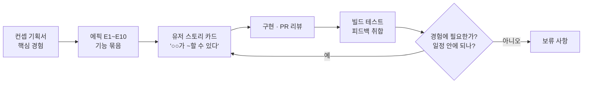
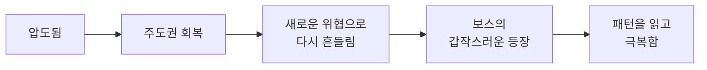
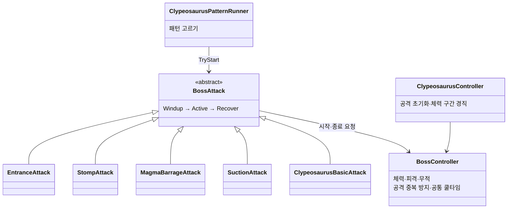
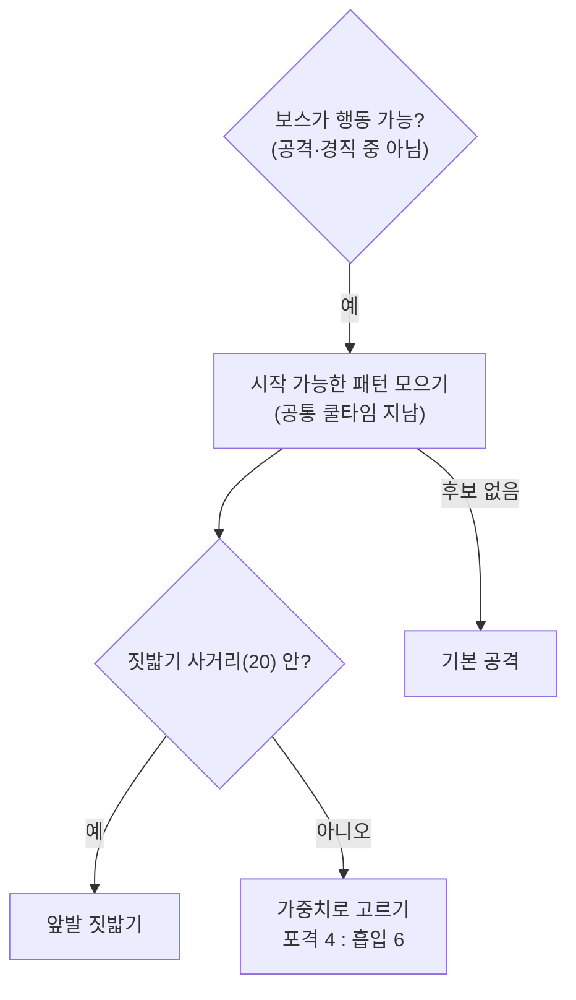

# Hive Purge — 팀 리딩과 보스 시스템

## 1. 개요

| 항목 | 내용 |
|---|---|
| 장르 | 1인칭 군중전과 3인칭 보스전을 잇는 라운드형 액션 슈터 |
| 기간 | 2026-10-15 ~ 2026-11-03 (스프린트 계획 10/19, 아사나 보드 기록 10/15 ~ 11/09) |
| 인원 | 개발 4명 · 내 역할: **팀장**(기획서·작업 카드 작성, 일정 관리, PR 리뷰·병합) + **보스·라운드 개발** |
| 개발 환경 | Unity 6000.3.15f1 (URP) · 작업 관리 Asana · Git(GitHub, Git flow) |
| 링크 | [GitHub](https://github.com/KooHoo-Dev/3rd_3D_1-3D-Project-team_even) · 시연 영상 ✍ |

### What — 무엇을 만들었나

**Hive Purge**는 1인칭으로 사방에서 밀려드는 군중을 상대하다가, 보스가 나타나면 3인칭으로 전환해 보스의 패턴과 공격 범위를 읽고 맞서는 라운드형 액션 슈터입니다.

이 프로젝트에서 저는 두 가지를 맡았습니다.

- **팀 리딩** — 유저 경험을 중심으로 컨셉 기획서를 쓰고, 그 경험을 아사나 작업 카드로 나눠 2주 일정을 관리했습니다. 빌드 테스트 피드백을 판단해 다음 작업으로 바꾸고, 팀원의 PR을 리뷰·병합했습니다(94건).
- **보스 개발** — 모든 보스가 함께 쓰는 공통 클래스(`BossController`·`BossAttack`)와 첫 번째 보스 Clypeosaurus(공격 5종)를 나눠 만들고, 보스 수치를 데이터 표(TSV)와 연결했습니다.

### Why — 무엇을 의도했나

**저는 기획서에 적은 유저 경험을 기준으로 모든 작업과 결정을 기록하고, 그 기록으로 팀이 굴러가게 하는 것을 의도했습니다.** 작업 카드에는 완성되어야 할 경험과 그 최종 책임자를 드러내, 담당자가 스스로 검토하게 했습니다. 테스트 피드백은 "우리가 보여 주려는 경험에 얼마나 필요한가"를 먼저 묻고 남은 일정을 그다음에 따져 판단했습니다.

### 이 문서가 다루는 것

| 장 | 내용 |
|---|---|
| [2. 전체 구조](#2-전체-구조-기획서에서-코드까지) | 컨셉 기획서 → 작업 카드 → 코드 → 빌드 테스트로 이어지는 흐름 |
| [3. 팀 리딩](#3-팀-리딩-유저-경험을-기준으로-나누고-판단하기) | 유저 스토리 카드, 일정 관리, 피드백·보류 판단 |
| [4. 보스 공통 구조](#4-보스-공통-구조-공통-틀과-보스별-구현-나누기) | 공통 보스 클래스와 보스별 클래스 분리, 데이터 연동 |
| [5. Clypeosaurus 패턴](#5-clypeosaurus-패턴-학습용-첫-보스-설계) | 첫 번째 보스의 패턴 선택과 공통 쿨타임 |
| [6. 트러블슈팅](#6-트러블슈팅) | NavMesh 밖에서 보스가 멈춘 문제 |
| [7. 결과 및 회고](#7-결과-및-회고) | 의도를 돌아보기 |

> 팀원이 만든 플레이어·무기, 일반 몬스터·군중, 전장·보급·보상, 두 번째 보스(Tyranopode)는 이 문서에서 다루지 않습니다. 두 번째 보스는 제 공통 클래스를 어떻게 썼는지만 언급합니다.

---

## 2. 전체 구조: 기획서에서 코드까지



컨셉 기획서가 정한 핵심 경험에서 출발해, 이를 에픽(기능 묶음)과 카드로 나누고, 만든 결과를 빌드 테스트로 확인한 뒤 다시 카드로 돌려보내는 순환입니다. 보스 개발도 이 순환 안에서 진행했습니다. 예를 들어 첫 번째 보스의 흡입 패턴과 패턴 선택 조건은 빌드 테스트 피드백에서 나온 카드로 고쳤습니다(→ [5.5](#55-고민과-선택-패턴-간격과-선택-조건)).

---

## 3. 팀 리딩: 유저 경험을 기준으로 나누고 판단하기

### 3.1 개요

| 맡은 일 | 기록 |
|---|---|
| 컨셉 기획서 작성 | 핵심 경험 · 라운드 시나리오 · 보스 패턴 · 성장 설계 |
| 작업 카드 작성 · 배정 | 유저 스토리 형식, 에픽 10개 |
| 통합 · 테스트 | 1차 사전 통합 및 테스트(10/26~10/28), 1·2차 빌드 테스트 정리 |
| 코드 리뷰 · 병합 | PR 94건 병합 |
| 결정 기록 | 보드의 "결정된 사항들" · "보류 사항" 카드 |

### 3.2 구조: 컨셉 기획서의 핵심 경험

기획서는 기능 목록이 아니라 플레이어가 한 라운드에서 겪는 경험에서 시작합니다.

> 플레이어는 압도적인 적의 공세 속에서 극한의 압박감을 마주하며, 전술적 판단으로 이 위기를 정면 돌파해 극적인 성취감을 획득한다. — *압박감은 성취감을 위한 재료이다.*



이 흐름을 기능 묶음 10개로 나눈 것이 에픽입니다.

| 에픽 | 기능 묶음 |
|---|---|
| E1 · E2 | 플레이어 조작·시야·생존 / 무기 사용·강화 효과 |
| E3 · E4 | 일반 몬스터 전투 / 군중 공세·접근 조절 |
| E5 | 보스 등장·전투 |
| E6 · E7 · E8 | 전장 구성 / 공중 보급·획득 / 처치 보상·강화 선택 |
| E9 · E10 | 라운드 진행·반복 / 게임 연출·마무리 |

### 3.3 핵심 동작: 유저 스토리 카드 — 카드의 주체가 곧 책임자

모든 카드 제목은 "**주체**가 ~할 수 있다"로 쓰고, 본문에 "구현 목표"를 적었습니다.

| 카드 제목 (실제) | 주체 → 책임자 |
|---|---|
| 플레이어가 라이플로 조준하고 적에게 사격 피해를 줄 수 있다. | 플레이어 담당 |
| 근접 몬스터가 과밀할 때 대기·선회하고 공간이 생기면 다시 접근할 수 있다. | 몬스터 담당 |
| 보스가 공기 흡입으로 플레이어를 끌어당겨 근거리 전투를 유도할 수 있다. | 보스 담당(나) |

이 형식은 "카드마다 유저의 경험과 책임을 더 분명하게 정의하라"는 피드백을 받고, 방식을 연구해 직접 작성했습니다. 신경 쓴 점은 두 가지입니다.

1. **경험을 전달한다.** 카드 제목의 주체(플레이어, 보스 등)의 입장에서 어떤 경험이 완성되어야 하는지 분명히 씁니다.
2. **최종 책임자를 드러낸다.** "플레이어가 ~"로 시작하는 카드는 플레이어 담당자의 책임입니다. 카드의 동작이 조건에 맞게 완성되었는지 확인하는 것까지 담당자의 몫입니다.

책임이 카드에 드러나니, 팀장이 완료된 작업을 모두 직접 검토하지 않고 담당자가 스스로 검토하게 해 검토 시간을 줄일 수 있었습니다.

### 3.4 세부 기능: 일정 관리 — 스프린트 타임라인 리포트

아사나 보드 기록에서 뽑은 수치입니다(리포트 기준일 2026-11-09).

| 항목 | 값 |
|---|---|
| 전체 작업 / 완료 | 97 / 94 (97%) |
| 목표일 안에 완료 | 77 / 94 (82%) |
| 처음 계획한 일(10/19) | 33개 → 33개 모두 완료 |
| 진행하며 새로 생긴 일 | 45개 (처음의 136%) |
| 작업 하나가 열려 있던 기간 | 평균 2.9일 |
| 담당이 정해진 작업 | 97 / 97 |
| 내 담당 작업 | 31 / 31 완료 |

새로 생긴 일은 10/30(23개)과 11/2(16개)에 몰려 있습니다. 두 날은 1차·2차 빌드 테스트 피드백 회의 직후입니다(→ 3.5).

✍ 리포트의 일정표 화면을 캡처해 `images/timeline.png`로 넣고 ``으로 바꿔 주세요.

### 3.5 고민과 선택: 피드백·보류·파트 사이 약속

#### 결정 ① 빌드 테스트 피드백을 어떻게 작업으로 바꿀 것인가 (큰 결정)

| 방식 | 문제 |
|---|---|
| 피드백을 받은 담당자가 각자 고친다 | 의견이 서로 부딪히거나 의도와 다른 수정이 섞여도 걸러지지 않음 ✍ |
| 피드백을 그대로 모두 카드로 만든다 | 남은 일정 안에 다 소화할 수 없음 ✍ |
| **취합 → 회의 → 팀장 판단 → 카드 배정** | — |

**[최종 결정]** 각자 빌드를 플레이하고 느낀 피드백을 한 문서에 모은 뒤, 그 문서로 회의를 하고, 결정된 사안만 카드로 만들어 배정했습니다.

- **취합 순서**: 팀원들의 공통 의견 → 정반대 의견 → 개별 의견 순으로 정리했습니다.
- **판단 기준**: ① 우리의 의도를 벗어나지 않은 피드백인가, ② 남은 일정 안에 소화할 수 있는 작업인가. 이 두 가지로 팀장이 최종 판단해 승인한 작업만 카드로 만들었습니다.
- **배정**: 기본은 각자 맡은 책임대로(플레이어 피드백은 플레이어 책임자에게) 배정하고, 한 사람에게 일이 몰리면 다른 책임자에게 일부를 위임했습니다.

**[얻은 것]** 2주 중 두 번의 빌드 테스트에서 나온 피드백이 이틀 안에 "구현 목표"가 적힌 카드로 바뀌었습니다. 예를 들어 1차 테스트의 "보스 스폰 시 플레이어가 맵을 뚫고 내려가는 문제"는 다음 카드의 구현 목표("원인 파악부터 한다")가 되었습니다.

**[감수한 대가]** 처음 계획한 33개보다 많은 45개의 일이 새로 생겼고, 목표일 안에 끝낸 비율은 82%였습니다(→ [3.4](#34-세부-기능-일정-관리--스프린트-타임라인-리포트)). ✍ (일이 늘어난 것을 당시 어떻게 받아들였는지, 일정에 어떤 영향이 있었는지)

#### 결정 ② 무엇을 보류할 것인가 (작은 결정)

| 기준 순서 | 질문 |
|---|---|
| 1 | 우리가 보여 주려는 경험을 구현하는 데 얼마나 필요한 피드백인가 |
| 2 | 남은 기간 안에 할 수 있는가 |

회의에서 보류한 항목은 "보류 사항" 카드의 하위 작업으로 남겼습니다(7건). 예를 들어 "보스전 중 일반 몬스터 투입"은 "보스 패턴을 개선한 뒤 느낌을 보고 결정한다"로 보류했고, 패턴 개선 뒤 넣지 않았습니다. 이 밖에 지향 사격/조준 사격 논의, 건물 파괴 이펙트, 프레임 드랍 확인 등이 보류되었습니다. ✍ (보스전 중 몬스터 투입을 최종적으로 넣지 않은 이유)

#### 결정 ③ 보스 등장 시점을 파트 사이에 어떻게 알릴 것인가 (작은 결정)

"결정된 사항들" 카드에 남긴 결정입니다. 라운드 매니저가 보스 등장 시점을 이벤트로 알리고, 플레이어는 이 이벤트를 받아 시점을 전환하며, 보스 스포너는 같은 이벤트를 받아 등장 절차를 시작합니다.

✍ 대안과 선택 이유는 코드와 상황을 다시 확인한 뒤 작성

---

## 4. 보스 공통 구조: 공통 틀과 보스별 구현 나누기

### 4.1 개요

보스는 처음부터 두 마리 이상을 구상했습니다. 그래서 체력·피격·공격 단계처럼 모든 보스에 같은 것은 공통 클래스에, 공격 패턴과 수치처럼 보스마다 다른 것은 보스별 클래스에 두었습니다. 실제로 두 번째 보스 Tyranopode(팀원 담당)는 `BossController`와 `BossAttack`을 그대로 상속해 만들어졌습니다.

### 4.2 구조: 공통 클래스와 Clypeosaurus 클래스

이 그림에서 볼 것: **위 줄(공통)은 보스가 바뀌어도 그대로이고, 아래 줄(Clypeosaurus)만 보스마다 새로 만듭니다.**



| 클래스 | 맡은 일 |
|---|---|
| `BossController` | 체력·피격·사망·무적, 지금 실행 중인 공격 하나만 허용, 공통 쿨타임 |
| `BossAttack` (abstract) | 공격 하나의 단계 진행(준비 → 실행 → 회복)과 취소, 단계 변화 알림 |
| `ClypeosaurusController` | 데이터 표를 읽어 공격 5종 초기화, 등장 공격 시작, 체력 75/50/25% 경직 |
| `ClypeosaurusPatternRunner` | 지금 쓸 수 있는 패턴 중 하나를 고름 (→ [5장](#5-clypeosaurus-패턴-학습용-첫-보스-설계)) |
| 공격 5종 | 등장 낙하 · 앞발 짓밟기 · 마그마 포격 · 공기 흡입 · 기본 공격 |

### 4.3 핵심 동작: 공격 단계 진행 — 준비 · 실행 · 회복

모든 공격은 `BossAttack`이 같은 순서로 진행합니다. 하위 공격은 "각 단계에 들어갈 때 무엇을 할지"만 채웁니다.

```csharp
// BossAttack.cs — 공격 하나를 준비 → 실행 → 회복 순서로 진행한다
private void Update()
{
    if (IsRunning == false) return;
    // (Why) 공격 도중 보스가 죽거나 대상이 사라지면 남은 단계를 진행하지 않는다
    if (Boss.IsAlive == false || Boss.isActiveAndEnabled == false || TargetRoot == null) { Cancel(); return; }

    switch (Phase)
    {
        case SkillPhase.Windup:                       // 예고 시간 (표의 TelegraphTime)
            if (Time.time < phaseEndTime) return;
            Phase = SkillPhase.Active;
            OnActiveStarted();                        // 하위 공격이 구현
            // (Why) 시작하자마자 취소된 공격은 알리지 않는다 (예: 포격 낙하 지점 실패)
            if (Phase == SkillPhase.Active) NotifyPhase();
            break;
        case SkillPhase.Active:
            OnActiveTick(Time.deltaTime);             // 끝나면 하위 공격이 CompleteActive() 호출
            break;
        case SkillPhase.Recover:                      // 플레이어의 반격 시간 (표의 RecoveryTime)
            if (Time.time < phaseEndTime) return;
            Phase = SkillPhase.Idle;
            Boss.EndAttack(this, completed: true);    // 공통 쿨타임 시작
            NotifyPhase();
            break;
    }
}
```

준비 시간은 플레이어가 공격을 읽는 시간, 회복 시간은 공격 뒤 반격할 수 있는 시간입니다. 이 순서는 카드 "보스가 준비·공격·회복을 거치며 공격 패턴을 전환·반복할 수 있다"의 구현 목표를 그대로 옮긴 것이고, 공통 클래스에 두었기 때문에 모든 보스 공격이 같은 순서를 따릅니다.

공격 두 개가 겹치지 않게 하는 것은 `BossController`가 맡습니다. 공격은 시작할 때 보스에게 허락을 받고, 끝날 때 알립니다.

```csharp
// BossController.cs — 공격은 한 번에 하나만, 끝나면 공통 쿨타임
internal bool TryBeginAttack(BossAttack attack)
{
    if (CanStartAttackFor(attack) == false) return false;  // 다른 공격 중·경직 중·쿨타임 중이면 거절
    currentAttack = attack;
    movement.Pause();
    return true;
}

internal void EndAttack(BossAttack attack, bool completed = false)
{
    if (currentAttack != attack) return;
    currentAttack = null;

    // (Why) 끝까지 수행한 패턴만 쿨타임을 건다. 일반 공격은 쿨타임과 별개
    if (completed && attack.UsesPatternCooldown) nextAttackTime = Time.time + Def.PatternCooldown;

    if (IsAlive == false || isActiveAndEnabled == false) movement.Stop();
    else if (IsReacting == false) movement.Resume();
}
```

**사용법 — 새 공격을 추가하려면**

1. `BossAttack`을 상속하고 `OnActiveStarted()`를 구현합니다(필요하면 `OnWindup`·`OnActiveTick`·`OnCancelled`·`MeetsStartCondition`도).
2. 초기화에서 `InitializeAttack(target, 준비 시간, 회복 시간)`을 부릅니다.
3. 실행이 끝나면 `CompleteActive()`를 부릅니다. 이후 회복과 쿨타임은 공통 클래스가 처리합니다.
4. 밖에서는 `CanStart()`로 확인하고 `TryStart()`로 시작합니다.

### 4.4 세부 기능: 보스 수치 데이터 연동

보스 수치는 코드가 아니라 TSV 표에 있습니다. 표를 두 개로 나눴습니다.

| 표 | 들어 있는 값 | 예 |
|---|---|---|
| `BossTable` (공통) | 모든 보스에 있는 값 | Id, MaxHp, MoveSpeed, PatternCooldown, Prefab |
| `ClypeosaurusTable` (보스 전용) | 이 보스의 공격 수치 32칸 | StompDamage 38, StompTelegraphTime 1.8, BarrageRadius 4, SuctionMaxDuration 10 … |

`ClypeosaurusController`는 `DataManager.Clypeosaurus`(전용 표)에서 `BossId`를 읽어 `DataManager.Bosses`(공통 표)의 보스 정의를 찾고, 두 값을 각각 `BossController`와 공격 5종에 넘깁니다.

### 4.5 고민과 선택: 코드와 표를 나누는 기준

#### 결정 ④ 보스 코드를 어떻게 나눌 것인가 (큰 결정)

| 방식 | 장점 | 문제 |
|---|---|---|
| 보스마다 독립된 클래스 ✍ | 보스끼리 영향 없음 | 체력·피격·단계 진행을 보스마다 다시 만듦 |
| **공통 틀(`BossController`·`BossAttack`) + 보스별 구현** | 두 번째 보스가 틀을 그대로 씀 | 공통 틀에 없는 동작은 보스별로 덧붙여야 함 |

**[최종 결정]** 보스를 최소 두 마리 이상 구상했고, 두 번째 보스는 팀원이 만들 예정이었습니다. 그래서 팀원이 같은 틀 위에서 바로 패턴만 만들 수 있도록 공통 부분을 먼저 떼어 냈습니다.

**[얻은 것]** 두 번째 보스 Tyranopode는 `BossController`(체력·피격 이벤트)와 `BossAttack`(패턴 단계)을 그대로 상속해 만들어졌습니다.

**[감수한 대가]** 공통 틀이 첫 번째 보스에 맞춰져 있어, 두 번째 보스에 맞지 않는 부분은 팀원이 덧붙였습니다(→ 4.6).

#### 결정 ⑤ 보스 수치 표를 어떻게 나눌 것인가 (작은 결정)

| 방식 | 문제 |
|---|---|
| 모든 보스를 표 하나에 | 보스마다 패턴이 달라 다른 보스의 칸이 비게 됨 ✍ |
| **공통 표 + 보스별 패턴 표** | 표가 보스 수만큼 늘어남 |

보스를 두 마리 이상 구상했으므로, 모든 보스가 참고할 공통 표와 각 보스가 패턴을 수행할 때 참고할 표를 나눴습니다. 두 번째 보스도 공통 표에 한 줄(`Id 2`)을 추가하고 전용 표를 따로 가졌습니다.

### 4.6 그 선택이 낳은 문제: 공통 틀에 맞지 않는 두 번째 보스

| 공통 틀의 가정 | 두 번째 보스에서 |
|---|---|
| 예고(Windup) 중에는 매 프레임 할 일이 없다 | 예고 중에도 매 프레임 할 일이 있어, 팀원이 `TyranopodeAttack`에 `WindupTick`을 덧붙임 |
| 패턴 간격은 공통 쿨타임 하나로 정한다 | 공격 간격을 전용 표가 정하므로 `BossTable.PatternCooldown`을 0으로 둠 |

✍ 이 차이를 알게 된 시점과, 다시 만든다면 공통 틀을 어떻게 바꿀지(예: 준비 단계 틱을 공통에 넣을지)

---

## 5. Clypeosaurus 패턴: 학습용 첫 보스 설계

### 5.1 개요

첫 번째 보스 Clypeosaurus는 **어렵지는 않지만 충분히 위협적인, 학습용 보스**로 구상했습니다. 플레이어가 "패턴 → 반격 → 패턴"이 반복되는 보스전 자체에 익숙해지게 하는 것이 목적입니다.

| 패턴 | 하는 일 | 주요 수치 (ClypeosaurusTable) |
|---|---|---|
| 등장 낙하 | 그림자로 착지 지점을 예고한 뒤 착지 충격파 | 피해 35, 반경 15 |
| 앞발 짓밟기 | 앞발을 들어 예고한 뒤 원형 충격파 | 피해 38, 예고 1.8초, 반경 13, 회복 3초 |
| 마그마 포격 | 플레이어 주변에 착탄 구역을 표시한 뒤 연속 낙하 | 피해 25, 구역 반경 4, 예고 1.5초, 회복 2.5초 |
| 공기 흡입 | 플레이어를 보스 앞으로 끌어당긴 뒤 공격 | 최대 10초, 피해 38, 위험 반경 10 |
| 기본 공격 | 패턴 쿨타임 사이 근접 공격 | 피해 20, 간격 2초 |

컨셉 기획서의 패턴은 "지면 강타·직선 돌진·포격 구역"이었습니다. 개발 중 직선 돌진을 **공기 흡입**으로 바꿨습니다(→ 5.5 결정 ⑧).

### 5.2 구조: 패턴 고르기 흐름



### 5.3 핵심 동작: 거리에 따라 다른 패턴 고르기

```csharp
// ClypeosaurusPatternRunner.cs — 지금 쓸 수 있는 패턴 중 하나를 고른다
foreach (var attack in attacks)
{
    // 시작할 수 없는 패턴(쿨타임·자체 조건·짓밟기 사거리 20 밖)은 건너뜀
    if (attack == null || attack.gameObject != gameObject || attack.UsesPatternCooldown == false
        || attack.CanStart() == false || candidates.Contains(attack)) continue;

    // (Why) 가까이 있으면 근접 패턴이 가장 자연스럽다 → 짓밟기를 우선한다
    if (attack is StompAttack)
    {
        candidates.Clear();
        candidates.Add(attack);
        break;
    }

    if (GetWeight(attack) > 0f) candidates.Add(attack);
}

if (candidates.Count > 0)
{
    BossAttack selected = SelectPattern();             // 가중치 랜덤
    if (selected.TryStart()) return;
}

// 패턴을 시작하지 못했으면(쿨타임 중 등) 기본 공격
if (basicAttack != null && basicAttack.gameObject == gameObject && basicAttack.UsesPatternCooldown == false)
    basicAttack.TryStart();
```

```csharp
// ClypeosaurusPatternRunner.cs — 사거리 밖 패턴의 가중치 (Inspector에서 조정)
private float GetWeight(BossAttack attack)
{
    if (attack is MagmaBarrageAttack) return Mathf.Max(0f, barrageWeight);  // 4
    // (Why) 멀리서 버티는 플레이를 깨기 위해 흡입을 더 자주
    if (attack is SuctionAttack) return Mathf.Max(0f, suctionWeight);       // 6
    return 1f;
}
```

가까우면 짓밟기, 멀면 포격과 흡입이 나옵니다. 포격과 흡입 중에서는 흡입이 더 자주 나와, 멀리 떨어진 플레이어를 다시 보스 앞으로 데려옵니다.

### 5.4 세부 기능: 흡입 · 착탄 지점 · 등장 · 경직

- **흡입의 구역별 강도** — 보스 근처를 위험 구역(안쪽)과 바깥쪽으로 나눕니다. 바깥은 플레이어가 반대로 달리는 속도보다 훨씬 강하게, 안쪽은 조금 강하게 끌어당깁니다. 10초가 지나거나 위험 구역에 일정 시간 머물면 흡입을 끝내고 공격합니다(`SuctionAttack.OnActiveTick`).
- **마그마 착탄 지점** — 플레이어 주변에서 무작위로 고른 지점에 위에서 아래로 Raycast를 쏴 지면 높이를 찾습니다. 몬스터처럼 피해를 받는 대상에 맞은 지점은 버리고, 착탄 구역끼리 너무 가까우면 다시 고릅니다(`MagmaBarrageAttack.BuildVolleyPlan`).
- **등장 낙하** — 등장 중에는 무적이고, 착지 충격파로 남은 일반 몬스터를 정리합니다(`EntranceAttack`).
- **체력 구간 경직** — 체력이 75%·50%·25% 아래로 내려갈 때마다 공격을 취소하고 경직합니다(`ClypeosaurusController.OnDamaged`).

### 5.5 고민과 선택: 패턴 간격과 선택 조건

이 장의 결정들은 모두 "학습용 첫 보스"라는 기획 의도에서 나왔고, 대부분 빌드 테스트 피드백 회의를 거쳐 카드로 만든 작업입니다. 3장에서 설명한 "경험을 기준으로 판단한다"는 원칙이 코드에 가장 직접 드러난 곳입니다.

#### 결정 ⑥ 패턴 사이 간격을 무엇으로 정할 것인가 (큰 결정)

| 방식 | 문제 |
|---|---|
| 패턴마다 개별 쿨타임 | 패턴마다 진행 시간이 달라, 어떤 패턴은 끝나자마자 다른 패턴이 나오고 어떤 패턴은 끝나고 한참 뒤에 나옴 |
| **보스 하나에 공통 쿨타임** (`BossTable.PatternCooldown`) | 패턴별로 다른 간격을 줄 수 없음 |

**[최종 결정]** 공통 쿨타임으로 바꿨습니다. 첫 번째 보스는 엇박자 패턴이나 격렬한 전투보다, 패턴 → 유저 공격 → 패턴이 반복되는 보스전 자체에 익숙해지게 만드는 것이 목적이었기 때문입니다.

**[얻은 것]** 어느 패턴이 끝나든 다음 패턴까지의 간격이 같아, 플레이어가 반격할 시간을 예상할 수 있습니다. 간격은 표의 값 하나로 조정합니다(10초 → 8초로 조정).

**[감수한 대가]** 패턴별로 간격을 다르게 줄 수 없습니다. 이 가정은 두 번째 보스에 맞지 않았습니다(→ [4.6](#46-그-선택이-낳은-문제-공통-틀에-맞지-않는-두-번째-보스)).

#### 결정 ⑦ 거리 조건을 없앨 것인가, 나눌 것인가 (큰 결정)

| 방식 | 문제 |
|---|---|
| 패턴마다 거리 조건 (흡입은 일정 거리 밖에서만) | 플레이어가 보스와 특정 거리를 유지하면 마그마 포격 하나만 보게 됨 |
| 거리 조건을 모두 없애고 순서대로 | 상황과 상관없이 패턴이 나와 부자연스러움 ✍ |
| **조건을 세분화** (가까우면 짓밟기, 멀면 포격 4 : 흡입 6) | 가중치를 플레이로 맞춰야 함 |

**[최종 결정]** 처음에는 거리 조건을 없애고 패턴을 순차적으로 쓰는 카드를 만들었습니다. 하지만 목적은 다양한 패턴을 보게 하는 것이었지, 거리 조건을 없애는 것 자체가 아니었습니다. 그래서 조건을 없애는 대신, 패턴이 더 자연스러운 상황에 나오도록 조건을 세분화했습니다. 흡입의 최소 거리 조건은 지우고, 사거리 밖의 패턴은 가중치로 고르게 했습니다.

**[얻은 것]** 거리를 유지하는 플레이어도 포격과 흡입을 모두 보게 되고, 흡입에 끌려오면 짓밟기 사거리 안에 들어와 근접 패턴까지 이어집니다.

**[감수한 대가]** 가중치(4 : 6)는 감으로 정한 값이라 플레이 테스트로 계속 맞춰야 합니다. ✍

#### 결정 ⑧ 직선 돌진을 공기 흡입으로 바꾼 이유 (작은 결정)

| 방식 | 문제 |
|---|---|
| 직선 돌진 (기획서) | 덩치가 크고 느린 보스라, 플레이어가 반대로 달려 완전히 떨어진 거리에서 안전하게 공격할 수 있음 |
| **공기 흡입** | 직접 피해가 없어 흡입 뒤 공격과 이어져야 위협이 됨 |

첫 번째 보스는 이동 속도를 느리게 설정했기 때문에, 플레이어가 마음먹으면 보스를 무시하고 멀리서 안전하게 공격할 수 있었습니다. 이는 "충분히 위협적인 학습용 보스"라는 의도와 달랐습니다. 그래서 유저가 너무 멀어지면 보스 앞으로 강제로 끌어와 일정한 거리를 유지시키는 흡입 패턴을 넣었습니다. 플레이 테스트(11/01)에서도 "엄폐물 때문에 보스가 멀리서 쏘기만 하는 구도가 되어 쉬워진다", "흡입이 더 자주 나와도 좋겠다"는 의견이 나와, 흡입 빈도를 높였습니다(결정 ⑦).

---

## 6. 트러블슈팅

### 보스가 멀어진 플레이어를 쫓지 않고 제자리에서 패턴만 쏨

| 단계 | 내용 |
|---|---|
| 증상 | 마그마 포격을 고치던 중, 플레이어가 보스와 일정 거리 이상 멀어지면 보스가 이동을 멈춘 채 패턴만 계속 썼다 |
| 원인 | 이동은 멈췄지만 회전은 그대로 하고 있어, 코드가 아니라 NavMesh 문제라고 판단했다. 직접 확인해 보니 NavMesh가 제대로 구워지지 않은 영역에 들어가면 이 현상이 생겼다 |
| 해결 | ✍ (어떻게 고쳤는지 — 관련 커밋을 찾지 못했습니다. 같은 시기 팀원 커밋에 "Sci-Fi 맵 NavMesh 굽기"(10/30)·"NavMesh 규칙 정리"(10/31)가 있습니다) |
| 결과 | ✍ |
| 배운 점 | 증상에서 "멈춘 것"과 "멈추지 않은 것"(회전)을 나눠 보면, 문제가 코드인지 데이터·환경인지 먼저 가를 수 있다 ✍ 확인 |

✍ 당시 트러블슈팅 과정 자료 추가 예정

---

## 7. 결과 및 회고

### 의도를 돌아보기: 기록으로 굴러가는 팀

| 의도한 것 | 실제 결과 |
|---|---|
| 기획서의 경험을 카드로 나눠, 담당자가 스스로 검토하게 한다 | 담당이 정해진 작업 97 / 97, 끝낸 일에 기록을 남긴 비율 86% |
| 처음 계획을 지킨다 | 처음 계획한 33개 모두 완료 |
| 테스트 피드백을 경험 기준으로 걸러 다음 작업으로 바꾼다 | 두 번의 빌드 테스트 뒤 새 작업 45개, 보류 7건 |
| 일정 안에 끝낸다 | 전체 97개 중 94개 완료(97%), 목표일 안에 완료 82% |

✍ 의도대로 된 것과 달랐던 것, 지금은 어떻게 판단하는지 (예: 목표일을 넘긴 18%는 무엇이었는지)

### 여러 결정에서 공통으로 배운 점

✍ 여러 결정에서 공통으로 배운 점 (예: "목적이 무엇이었는지"로 돌아가면 같은 피드백도 다르게 처리할 수 있다 — 결정 ⑦의 거리 조건, 결정 ②의 보류 기준)

### 아쉬운 점과 개선 계획

| 아쉬운 점 | 개선 계획 |
|---|---|
| ✍ | ✍ |
| 공통 틀이 첫 번째 보스에 맞춰져 두 번째 보스가 덧붙여야 했다 (→ 4.6) | ✍ |
