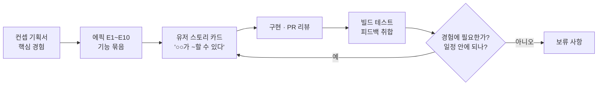
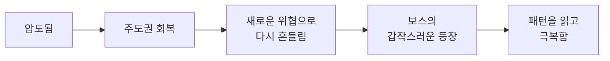
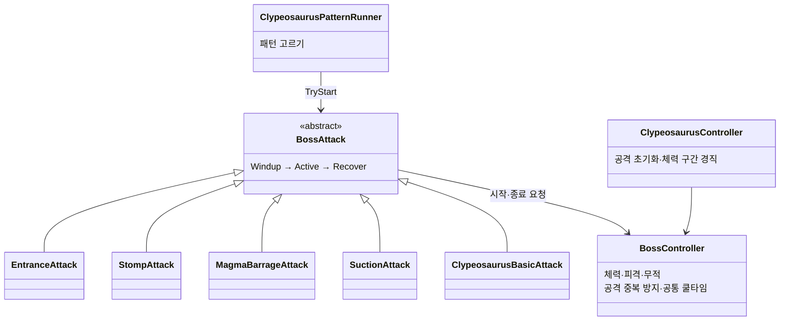
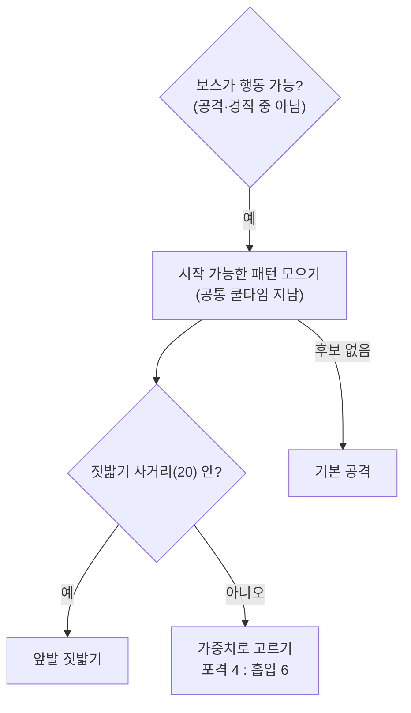

# Hive Purge — 팀 리딩과 보스 시스템

> 📷 **이미지 자리** `images/cover.png` — 대표 화면 1장(3인칭 보스전에서 Clypeosaurus와 플레이어가 함께 보이는 장면). 포트폴리오 문서와 발표 덱 표지에 크게 나옵니다.

## 1. 개요

| 항목 | 내용 |
|---|---|
| 장르 | 1인칭 군중전과 3인칭 보스전을 잇는 라운드형 액션 슈터 |
| 기간 | 2026-10-15 ~ 2026-11-03 (스프린트 계획 10/19, 아사나 보드 기록 10/15 ~ 11/09) |
| 인원 | 개발 4명 · 내 역할: **팀장**(기획서·작업 카드 작성, 일정 관리, PR 리뷰·병합) + **보스·라운드 개발** |
| 개발 환경 | Unity 6000.3.15f1 (URP) · 작업 관리 Asana · Git(GitHub, Git flow) |
| 링크 | [GitHub](https://github.com/KooHoo-Dev/3rd_3D_1-3D-Project-team_even) · 시연 영상 ✍ |

### What — 무엇을 만들었나

**Hive Purge**는 1인칭으로 사방에서 밀려드는 군중을 상대하다가, 보스가 나타나면 3인칭으로 전환해 보스의 패턴과 공격 범위를 읽고 맞서는 라운드형 액션 슈터입니다.

이 프로젝트에서 저는 두 가지를 맡았습니다.

- **팀 리딩** — 유저 경험을 중심으로 컨셉 기획서를 쓰고, 그 경험을 아사나 작업 카드로 나눠 2주 일정을 관리했습니다. 빌드 테스트 피드백을 판단해 다음 작업으로 바꾸고, 팀원의 PR을 리뷰·병합했습니다(94건).
- **보스 개발** — 모든 보스가 함께 쓰는 공통 클래스(`BossController`·`BossAttack`)와 첫 번째 보스 Clypeosaurus(공격 5종)를 나눠 만들고, 보스 수치를 데이터 표(TSV)와 연결했습니다.

### Why — 무엇을 의도했나

**저는 기획서에 적은 유저 경험을 기준으로 모든 작업과 결정을 기록하고, 그 기록으로 팀이 굴러가게 하는 것을 의도했습니다.** 작업 카드에는 완성되어야 할 경험과 그 최종 책임자를 드러내, 담당자가 스스로 검토하게 했습니다. 테스트 피드백은 "우리가 보여 주려는 경험에 얼마나 필요한가"를 먼저 묻고 남은 일정을 그다음에 따져 판단했습니다.

### 이 문서가 다루는 것

| 장 | 내용 |
|---|---|
| [2. 전체 구조](#2-전체-구조-기획서에서-코드까지) | 컨셉 기획서 → 작업 카드 → 코드 → 빌드 테스트로 이어지는 흐름 |
| [3. 팀 리딩](#3-팀-리딩-유저-경험을-기준으로-나누고-판단하기) | 유저 스토리 카드, 작업 규약, 일정 관리, 피드백·보류 판단 |
| [4. 보스 공통 구조](#4-보스-공통-구조-공통-틀과-보스별-구현-나누기) | 공통 보스 클래스와 보스별 클래스 분리, 사용법·예외 처리, 데이터 연동 |
| [5. Clypeosaurus 패턴](#5-clypeosaurus-패턴-학습용-첫-보스-설계) | 첫 번째 보스의 패턴 선택, 마그마 포격·공기 흡입·등장 낙하 구현, 공통 쿨타임 |
| [6. 트러블슈팅](#6-트러블슈팅) | NavMesh 밖에서 보스가 멈춘 문제 |
| [7. 결과 및 회고](#7-결과-및-회고) | 의도를 돌아보기 |

> 팀원이 만든 플레이어·무기, 일반 몬스터·군중, 전장·보급·보상, 두 번째 보스(Tyranopode)는 이 문서에서 다루지 않습니다. 두 번째 보스는 제 공통 클래스를 어떻게 썼는지만 언급합니다.

---

## 2. 전체 구조: 기획서에서 코드까지



컨셉 기획서가 정한 핵심 경험에서 출발해, 이를 에픽(기능 묶음)과 카드로 나누고, 만든 결과를 빌드 테스트로 확인한 뒤 다시 카드로 돌려보내는 순환입니다. 보스 개발도 이 순환 안에서 진행했습니다. 예를 들어 첫 번째 보스의 흡입 패턴과 패턴 선택 조건은 빌드 테스트 피드백에서 나온 카드로 고쳤습니다(→ [5.9](#59-고민과-선택-패턴-간격과-선택-조건)).

---

## 3. 팀 리딩: 유저 경험을 기준으로 나누고 판단하기

### 3.1 개요

| 맡은 일 | 기록 |
|---|---|
| 컨셉 기획서 작성 | 핵심 경험 · 라운드 시나리오 · 보스 패턴 · 성장 설계 |
| 작업 카드 작성 · 배정 | 유저 스토리 형식, 에픽 10개 |
| 통합 · 테스트 | 1차 사전 통합 및 테스트(10/26~10/28), 1·2차 빌드 테스트 정리 |
| 코드 리뷰 · 병합 | PR 94건 병합 |
| 결정 기록 | 보드의 "결정된 사항들" · "보류 사항" 카드 |

### 3.2 구조: 컨셉 기획서의 핵심 경험

기획서는 기능 목록이 아니라 플레이어가 한 라운드에서 겪는 경험에서 시작합니다.

> 플레이어는 압도적인 적의 공세 속에서 극한의 압박감을 마주하며, 전술적 판단으로 이 위기를 정면 돌파해 극적인 성취감을 획득한다. — *압박감은 성취감을 위한 재료이다.*



이 흐름을 기능 묶음 10개로 나눈 것이 에픽입니다.

| 에픽 | 기능 묶음 |
|---|---|
| E1 · E2 | 플레이어 조작·시야·생존 / 무기 사용·강화 효과 |
| E3 · E4 | 일반 몬스터 전투 / 군중 공세·접근 조절 |
| E5 | 보스 등장·전투 |
| E6 · E7 · E8 | 전장 구성 / 공중 보급·획득 / 처치 보상·강화 선택 |
| E9 · E10 | 라운드 진행·반복 / 게임 연출·마무리 |

> 📷 **이미지 자리** `images/asana_board.png` — 아사나 Team Even 보드 화면. 섹션(BackLog → Sprint Backlog → In Progress → Review → Done)과 카드마다 붙은 에픽 색 라벨이 보이게

### 3.3 핵심 동작: 유저 스토리 카드 — 카드의 주체가 곧 책임자

모든 카드 제목은 "**주체**가 ~할 수 있다"로 쓰고, 본문에 "구현 목표"를 적었습니다.

| 카드 제목 (실제) | 주체 → 책임자 |
|---|---|
| 플레이어가 라이플로 조준하고 적에게 사격 피해를 줄 수 있다. | 플레이어 담당 |
| 근접 몬스터가 과밀할 때 대기·선회하고 공간이 생기면 다시 접근할 수 있다. | 몬스터 담당 |
| 보스가 공기 흡입으로 플레이어를 끌어당겨 근거리 전투를 유도할 수 있다. | 보스 담당(나) |

이 형식은 "카드마다 유저의 경험과 책임을 더 분명하게 정의하라"는 피드백을 받고, 방식을 연구해 직접 작성했습니다. 신경 쓴 점은 두 가지입니다.

1. **경험을 전달한다.** 카드 제목의 주체(플레이어, 보스 등)의 입장에서 어떤 경험이 완성되어야 하는지 분명히 씁니다.
2. **최종 책임자를 드러낸다.** "플레이어가 ~"로 시작하는 카드는 플레이어 담당자의 책임입니다. 카드의 동작이 조건에 맞게 완성되었는지 확인하는 것까지 담당자의 몫입니다.

책임이 카드에 드러나니, 팀장이 완료된 작업을 모두 직접 검토하지 않고 담당자가 스스로 검토하게 해 검토 시간을 줄일 수 있었습니다.

> 📷 **이미지 자리** `images/asana_card.png` — 카드 하나를 연 화면(예: "보스가 공기 흡입으로 플레이어를 끌어당겨 근거리 전투를 유도할 수 있다"). 유저 스토리 제목·구현 목표·담당자·에픽·마감일이 한 화면에 보이게

### 3.4 세부 기능: 작업 규약 — 시작 전에 정한 Git·명명·씬 규칙

카드가 "무엇을 만들지"를 정한다면, 작업 규약은 "여러 사람이 같은 레포에서 어떻게 만들지"를 정합니다. 프로젝트 시작 전(10/15~10/19)에 팀 노션에 정리해 공유했습니다.

| 규약 | 정한 내용 | 페이지에 적은 목적 |
|---|---|---|
| Git 브랜치 전략 | Git flow. `main`은 `develop`에서만 병합, 기능은 `feature` 브랜치에서 만들고 병합 뒤 삭제, 긴급 수정은 `hotfix`. **release 브랜치는 이번 프로젝트에서 쓰지 않음** | `main`을 버그 없는 안정 버전으로 유지 |
| 커밋 메시지 | `Add`·`Feat`·`Fix`·`Refactor`·`Chore`·`Remove` 중 하나 + 요약, 본문에 작업 설명 | — |
| 브랜치 이름 | `feat/작업명`, 영어 PascalCase. 포괄적인 이름(`feat/System`) 대신 구체적인 이름(`feat/DialogueSystem`) | 이름만 보고 무슨 작업인지 알 수 있게 |
| 폴더 이름 | 최상위는 에셋 종류(복수형 `Scripts`·`Prefabs`…), 그 안은 기능 단위로 같은 이름(`Scripts/Boss`·`Prefabs/Boss`). `Managers`처럼 범위가 넓은 폴더는 지양 | 담당자가 각 에셋 폴더의 자기 기능 폴더를 중심으로 작업 |
| 네임스페이스 | `프로젝트명.폴더경로` (`Assets`·`Scripts` 제외) | 폴더 구조를 네임스페이스에 그대로 반영 |
| 작업자 사이 씬 분리 | 개인 작업은 메인 씬을 건드리지 않고 테스트 씬에서. 기능은 다른 씬에 놓아도 동작하게. 통합은 공통 씬에 프리팹으로 배치. 다 쓴 임시 씬은 삭제 | 텍스트 병합이 까다로운 씬 파일의 충돌을 막기 위해 |
| Pull Request | GitHub Desktop 기준 절차. **대상 브랜치는 반드시 `develop`**, 설명칸에 브랜치에서 한 작업 목록 | — |

이 규약은 코드에 그대로 남아 있습니다.

> 📷 **이미지 자리** `images/notion_rules.png` — 노션 "3D 하이브리드 슈터" 페이지의 작업 규약 목록(Git 사용 전략·명명 규칙·작업 규칙). 프로젝트 시작 전에 정리했다는 것이 보이게

- 보스 코드의 네임스페이스는 `HybridShooter.Boss`·`HybridShooter.Boss.Clypeosaurus`로, `Assets/Scripts/Boss/Clypeosaurus/` 폴더와 같습니다.
- `ClypeosaurusController.Start`는 라운드가 초기화하지 않았을 때 데이터 표로 직접 초기화합니다(코드 주석: "씬에 직접 배치해서 테스트하는 경우의 초기화"). 테스트 씬에 보스만 놓고 돌려 볼 수 있게 한 것으로, "기능은 다른 씬에 놓아도 동작하게"라는 씬 분리 규약과 같은 방향입니다.
- 브랜치는 `feat/boss-clypeosaurus`·`feat/UiRedesign`처럼 기능 이름으로 만들었고, PR은 `develop`으로 병합했습니다(94건). 다만 케밥 표기(`boss-clypeosaurus`)나 한글 이름(`chore/근접-몬스터-공격-밸런싱`) 같은 브랜치도 섞여 있어, PascalCase 규칙이 끝까지 지켜지지는 않았습니다.

✍ 규약을 정할 때 참고한 것과, 실제로 충돌이나 혼선을 막아 준 사례가 있으면 덧붙여 주세요.

### 3.5 세부 기능: 일정 관리 — 스프린트 타임라인 리포트

아사나 보드 기록에서 뽑은 수치입니다(리포트 기준일 2026-11-09).

| 항목 | 값 |
|---|---|
| 전체 작업 / 완료 | 97 / 94 (97%) |
| 목표일 안에 완료 | 77 / 94 (82%) |
| 처음 계획한 일(10/19) | 33개 → 33개 모두 완료 |
| 진행하며 새로 생긴 일 | 45개 (처음의 136%) |
| 작업 하나가 열려 있던 기간 | 평균 2.9일 |
| 담당이 정해진 작업 | 97 / 97 |
| 내 담당 작업 | 31 / 31 완료 |

새로 생긴 일은 10/30(23개)과 11/2(16개)에 몰려 있습니다. 두 날은 1차·2차 빌드 테스트 피드백 회의 직후입니다(→ 3.6).

> 📷 **이미지 자리** `images/timeline.png` — 스프린트 타임라인 리포트의 "작업 일정표 — 기능 영역별" 중 [E5] 보스 등장·전투 페이지(카드별 시작~완료 막대)

> 📷 **이미지 자리** `images/scope_growth.png` — 리포트의 "처음 계획과 실제"·"일감이 늘어난 모습" 그래프(처음 33개 위로 10/30·11/2에 일이 늘어난 모습)

### 3.6 고민과 선택: 피드백·보류·파트 사이 약속

#### 결정 ① 빌드 테스트 피드백을 어떻게 작업으로 바꿀 것인가 (큰 결정)

| 방식 | 문제 |
|---|---|
| 피드백을 받은 담당자가 각자 고친다 | 의견이 서로 부딪히거나 의도와 다른 수정이 섞여도 걸러지지 않음 ✍ |
| 피드백을 그대로 모두 카드로 만든다 | 남은 일정 안에 다 소화할 수 없음 ✍ |
| **취합 → 회의 → 팀장 판단 → 카드 배정** | — |

**[최종 결정]** 각자 빌드를 플레이하고 느낀 피드백을 한 문서에 모은 뒤, 그 문서로 회의를 하고, 결정된 사안만 카드로 만들어 배정했습니다.

- **취합 순서**: 팀원들의 공통 의견 → 정반대 의견 → 개별 의견 순으로 정리했습니다.
- **판단 기준**: ① 우리의 의도를 벗어나지 않은 피드백인가, ② 남은 일정 안에 소화할 수 있는 작업인가. 이 두 가지로 팀장이 최종 판단해 승인한 작업만 카드로 만들었습니다.
- **배정**: 기본은 각자 맡은 책임대로(플레이어 피드백은 플레이어 책임자에게) 배정하고, 한 사람에게 일이 몰리면 다른 책임자에게 일부를 위임했습니다.

취합 문서(노션 "피드백 회의"·"2차 피드백")는 항목마다 번호를 붙이고, **제안자**와 **세부 의견**(누가 무엇을 말했는지)을 나눠 적었습니다. 여러 명이 같은 말을 하면 "공통:"으로 묶고, 회의에서 정한 결론은 화살표(→)로 그 아래에 달았습니다. 우선순위가 낮은 의견에는 "후순위"를 붙였습니다.

> 📷 **이미지 자리** `images/feedback_doc.png` — 노션 "2차 피드백" 문서 일부. 항목 번호·제안자·세부 의견·후순위 표시가 함께 보이는 부분(예: 1-1 흡입 빈도 증가 ~ 1-3 잡몹 처치 동기)

**[얻은 것]** 2주 중 두 번의 빌드 테스트에서 나온 피드백이 이틀 안에 "구현 목표"가 적힌 카드로 바뀌었습니다. 회의 결론이 거의 그대로 카드의 구현 목표가 됐습니다.

| 피드백 문서 (항목 · 회의 결론) | 만들어진 카드 |
|---|---|
| 1-5 보스가 플레이어를 바라보지 않음 → "시작 후 3초 정도 딜레이 후 패턴 시작" | 보스가 전용 카메라 연출로 등장하고, 플레이어를 바라본 뒤 패턴을 시작할 수 있다. (등장 후 약 3초 대기) |
| 빨아들이기 패턴: 범위를 안쪽 위험 구역과 바깥 안전 구역으로 나눔 | 보스가 공기 흡입의 구역별 강도로 플레이어를 끌어당기고, 위험 구역의 플레이어를 공격할 수 있다. |
| 1-3 보스 이동 시 피드백 부족 (제안자: 이찬영·윤건우) | 플레이어가 보스의 이동을 카메라 흔들림과 발소리로 느낄 수 있다. (카메라 흔들림은 나, 발소리는 윤건우로 하위 작업 분리) |
| 1-11 맵 크기 축소(1/4로) (제안자: 이찬영·윤건우) | 플레이어가 줄어든 맵에서 엄폐물을 활용하며 전투할 수 있다. |
| 2차 1-1 흡입 패턴 빈도 증가 (제안자: 이찬영·윤건우·홍산) → "거리 조건 X, 순차 수행" | 1스테이지 보스가 거리 조건 없이 패턴을 순차적으로 사용해 흡입을 더 자주 쓸 수 있다. (→ 결정 ⑦에서 조건 세분화로 바뀜) |
| 2차 1-3 잡몹 처치 동기 부족 → "적을 일정 수 아래로 처치해야 보스 등장" | 라운드 매니저가 라운드마다 다른 기믹으로 진행하고, 섬멸전에서는 적을 일정 수 아래로 줄여야 보스를 등장시킬 수 있다. |

**[감수한 대가]** 처음 계획한 33개보다 많은 45개의 일이 새로 생겼고, 목표일 안에 끝낸 비율은 82%였습니다(→ [3.5](#35-세부-기능-일정-관리--스프린트-타임라인-리포트)). ✍ (일이 늘어난 것을 당시 어떻게 받아들였는지, 일정에 어떤 영향이 있었는지)

#### 결정 ② 무엇을 보류할 것인가 (작은 결정)

| 기준 순서 | 질문 |
|---|---|
| 1 | 우리가 보여 주려는 경험을 구현하는 데 얼마나 필요한 피드백인가 |
| 2 | 남은 기간 안에 할 수 있는가 |

2차 피드백 문서에서 "후순위"를 붙인 의견은 아래와 같고, 모두 아사나 "보류 사항" 카드로 옮겼습니다.

| 피드백 문서의 "후순위" | 보류 사항 카드 |
|---|---|
| 일부 보스·몬스터 공격이 플레이어 근처에 적중할 때 카메라 쉐이크 | 보스·몬스터 공격 근접 적중 시 카메라 쉐이크 |
| 달빛 같은 은은한 빛을 환경 곳곳에 추가 | 달빛 같은 은은한 환경광 추가 |
| 건물이 부서질 때 파괴 이펙트 추가 | 건물 파괴 이펙트 추가 |
| 웨이브 시작·보스 투사체 생성 시점의 간헐적 프레임 드랍 | 웨이브 시작·보스 투사체 생성 시 프레임 드랍 확인 |

회의에서 보류한 항목은 "보류 사항" 카드의 하위 작업으로 남겼습니다(7건). 예를 들어 "보스전 중 일반 몬스터 투입"은 "보스 패턴을 개선한 뒤 느낌을 보고 결정한다"로 보류했고, 패턴 개선 뒤 넣지 않았습니다. 이 밖에 지향 사격/조준 사격 논의, 건물 파괴 이펙트, 프레임 드랍 확인 등이 보류되었습니다. ✍ (보스전 중 몬스터 투입을 최종적으로 넣지 않은 이유)

> 📷 **이미지 자리** `images/asana_on_hold.png` — 아사나 "보류 사항" 카드와 하위 작업 7건 화면

#### 결정 ③ 보스 등장 시점을 파트 사이에 어떻게 알릴 것인가 (작은 결정)

"결정된 사항들" 카드에 남긴 결정입니다. 라운드 매니저가 보스 등장 시점을 이벤트로 알리고, 플레이어는 이 이벤트를 받아 시점을 전환하며, 보스 스포너는 같은 이벤트를 받아 등장 절차를 시작합니다.

✍ 대안과 선택 이유는 코드와 상황을 다시 확인한 뒤 작성

---

## 4. 보스 공통 구조: 공통 틀과 보스별 구현 나누기

### 4.1 개요

보스는 처음부터 두 마리 이상을 구상했습니다. 그래서 체력·피격·공격 단계처럼 모든 보스에 같은 것은 공통 클래스에, 공격 패턴과 수치처럼 보스마다 다른 것은 보스별 클래스에 두었습니다. 실제로 두 번째 보스 Tyranopode(팀원 담당)는 `BossController`와 `BossAttack`을 그대로 상속해 만들어졌습니다.

### 4.2 구조: 공통 클래스와 Clypeosaurus 클래스

이 그림에서 볼 것: **위 줄(공통)은 보스가 바뀌어도 그대로이고, 아래 줄(Clypeosaurus)만 보스마다 새로 만듭니다.**



| 클래스 | 맡은 일 |
|---|---|
| `BossController` | 체력·피격·사망·무적, 지금 실행 중인 공격 하나만 허용, 공통 쿨타임 |
| `BossAttack` (abstract) | 공격 하나의 단계 진행(준비 → 실행 → 회복)과 취소, 단계 변화 알림 |
| `ClypeosaurusController` | 데이터 표를 읽어 공격 5종 초기화, 등장 공격 시작, 체력 75/50/25% 경직 |
| `ClypeosaurusPatternRunner` | 지금 쓸 수 있는 패턴 중 하나를 고름 (→ [5장](#5-clypeosaurus-패턴-학습용-첫-보스-설계)) |
| 공격 5종 | 등장 낙하 · 앞발 짓밟기 · 마그마 포격 · 공기 흡입 · 기본 공격 |

> 📷 **이미지 자리** `images/boss_components.png` — Clypeosaurus 프리팹의 Inspector. 공통 컴포넌트(`BossController`)와 보스 전용 컴포넌트(`ClypeosaurusController`·`ClypeosaurusPatternRunner`·공격 5종)가 한 오브젝트에 붙어 있는 모습

### 4.3 핵심 동작: 공격 단계 진행 — 준비 · 실행 · 회복

모든 공격은 `BossAttack`이 같은 순서로 진행합니다. 하위 공격은 "각 단계에 들어갈 때 무엇을 할지"만 채웁니다.

```csharp
// BossAttack.cs — 공격 하나를 준비 → 실행 → 회복 순서로 진행한다
private void Update()
{
    if (IsRunning == false) return;
    // (Why) 공격 도중 보스가 죽거나 대상이 사라지면 남은 단계를 진행하지 않는다
    if (Boss.IsAlive == false || Boss.isActiveAndEnabled == false || TargetRoot == null) { Cancel(); return; }

    switch (Phase)
    {
        case SkillPhase.Windup:                       // 예고 시간 (표의 TelegraphTime)
            if (Time.time < phaseEndTime) return;
            Phase = SkillPhase.Active;
            OnActiveStarted();                        // 하위 공격이 구현
            // (Why) 시작하자마자 취소된 공격은 알리지 않는다 (예: 포격 낙하 지점 실패)
            if (Phase == SkillPhase.Active) NotifyPhase();
            break;
        case SkillPhase.Active:
            OnActiveTick(Time.deltaTime);             // 끝나면 하위 공격이 CompleteActive() 호출
            break;
        case SkillPhase.Recover:                      // 플레이어의 반격 시간 (표의 RecoveryTime)
            if (Time.time < phaseEndTime) return;
            Phase = SkillPhase.Idle;
            Boss.EndAttack(this, completed: true);    // 공통 쿨타임 시작
            NotifyPhase();
            break;
    }
}
```

준비 시간은 플레이어가 공격을 읽는 시간, 회복 시간은 공격 뒤 반격할 수 있는 시간입니다. 이 순서는 카드 "보스가 준비·공격·회복을 거치며 공격 패턴을 전환·반복할 수 있다"의 구현 목표를 그대로 옮긴 것이고, 공통 클래스에 두었기 때문에 모든 보스 공격이 같은 순서를 따릅니다.

> 📷 **이미지 자리** `images/boss_phase.gif` — 공격 하나의 세 단계: 바닥에 범위가 표시되는 준비(예고) → 공격 → 보스가 멈춰 있는 회복(반격 시간). 앞발 짓밟기가 가장 잘 보입니다

공격 두 개가 겹치지 않게 하는 것은 `BossController`가 맡습니다. 공격은 시작할 때 보스에게 허락을 받고, 끝날 때 알립니다.

```csharp
// BossController.cs — 공격은 한 번에 하나만, 끝나면 공통 쿨타임
internal bool TryBeginAttack(BossAttack attack)
{
    if (CanStartAttackFor(attack) == false) return false;  // 다른 공격 중·경직 중·쿨타임 중이면 거절
    currentAttack = attack;
    movement.Pause();
    return true;
}

internal void EndAttack(BossAttack attack, bool completed = false)
{
    if (currentAttack != attack) return;
    currentAttack = null;

    // (Why) 끝까지 수행한 패턴만 쿨타임을 건다. 일반 공격은 쿨타임과 별개
    if (completed && attack.UsesPatternCooldown) nextAttackTime = Time.time + Def.PatternCooldown;

    if (IsAlive == false || isActiveAndEnabled == false) movement.Stop();
    else if (IsReacting == false) movement.Resume();
}
```

[`BossAttack.Update` 원문](https://github.com/KooHoo-Dev/3rd_3D_1-3D-Project-team_even/blob/db706ef5ab2280158b830f0b714556cf02ecf6ce/Assets/Scripts/Boss/BossAttack.cs#L87-L118) · [`TryBeginAttack`·`EndAttack` 원문](https://github.com/KooHoo-Dev/3rd_3D_1-3D-Project-team_even/blob/db706ef5ab2280158b830f0b714556cf02ecf6ce/Assets/Scripts/Boss/BossController.cs#L117-L144)

#### `BossAttack` 사용법: 하위 공격이 채우는 칸과 밖에서 부르는 칸

| 호출 | 누가 | 하는 일 |
|---|---|---|
| `InitializeAttack(target, 준비 시간, 회복 시간)` | 하위 공격의 `Initialize` | 대상과 단계 시간을 정함. 대상에 `IDamageable`이 없으면 예외 |
| `MeetsStartCondition()` *(선택)* | 하위 공격 | 공격마다 다른 시작 조건 (예: 짓밟기 사거리, 등장은 한 번만) |
| `OnWindup()` *(선택)* | 하위 공격 | 준비에 들어갈 때 — 범위 표시, 준비 동작 |
| `OnActiveStarted()` *(필수)* | 하위 공격 | 실행에 들어갈 때 — 공격 동작 시작 |
| `OnActiveTick(dt)` *(선택)* | 하위 공격 | 실행 중 매 프레임. 끝나면 `CompleteActive()` 호출 |
| `OnCancelled()` *(선택)* | 하위 공격 | 취소될 때 — 투사체·이펙트 정리 |
| `RaiseImpacted(point)` | 하위 공격 | 땅·대상에 닿은 순간 알림 (사운드가 구독) |
| `CanStart()` / `TryStart()` | 패턴 선택기 | 시작할 수 있는지 확인 / 시작 |
| `PhaseChanged` 이벤트 | 사운드 등 | 단계가 바뀔 때마다 알림 |

새 공격은 `BossAttack`을 상속해 `OnActiveStarted()`만 구현하면 단계 진행·회복·쿨타임·취소 정리를 공통 클래스에서 받습니다. 공격 5종 모두 이 방식으로 만들었습니다.

#### 예외 처리: 공격 도중 경직·사망·비활성

```csharp
// BossController.cs — 피격 경직: 진행 중인 공격을 취소하고 멈춘다
public void StartHitReaction()
{
    if (isActiveAndEnabled == false || IsAlive == false) return;
    if (IsInvulnerable) return;                      // 등장 중에는 경직하지 않음

    // (Why) 공격 취소 중 이동이 재개되지 않도록 먼저 설정한다.
    IsReacting = true;

    currentAttack?.Cancel();                         // → EndAttack: IsReacting이면 이동을 다시 켜지 않음
    movement.Pause();
    view.PlayHit();
}
```

```csharp
// BossAttack.cs — 취소: 하위 공격의 정리가 실패해도 보스는 반드시 풀어 준다
public void Cancel()
{
    // (Why) 이미 종료된 상태에서도 남은 표시를 정리한다.
    Range.Clear();
    if (IsRunning == false) return;

    Phase = SkillPhase.Idle;
    try
    {
        OnCancelled();                               // 하위 공격의 정리
    }
    finally
    {
        Boss.EndAttack(this);                        // completed: false → 쿨타임을 걸지 않음
        NotifyPhase();
    }
}
```

[`StartHitReaction` 원문](https://github.com/KooHoo-Dev/3rd_3D_1-3D-Project-team_even/blob/db706ef5ab2280158b830f0b714556cf02ecf6ce/Assets/Scripts/Boss/BossController.cs#L97-L110) · [`Cancel` 원문](https://github.com/KooHoo-Dev/3rd_3D_1-3D-Project-team_even/blob/db706ef5ab2280158b830f0b714556cf02ecf6ce/Assets/Scripts/Boss/BossAttack.cs#L132-L152)

| 상황 | 처리 |
|---|---|
| 공격 중 보스 사망 | `TakeDamage`가 이동을 멈추고 공격 취소 → 사망 동작 |
| 공격 중 보스 비활성·대상 사라짐 | 다음 `Update`에서 `Cancel` |
| 공격 컴포넌트 비활성 | `OnDisable`에서 `Cancel` |
| 무적(등장) 중 피해·경직 | 피해와 경직을 모두 무시 |
| 취소된 공격 | `completed: false`라 공통 쿨타임을 걸지 않음 |
| 하위 공격의 정리 코드에서 예외 | `finally`로 `EndAttack`은 반드시 실행 → 보스가 "공격 중"에 갇히지 않음 |

### 4.4 세부 기능: 보스 수치 데이터 연동

보스 수치는 코드가 아니라 TSV 표에 있습니다. 표를 두 개로 나눴습니다.

| 표 | 들어 있는 값 | 예 |
|---|---|---|
| `BossTable` (공통) | 모든 보스에 있는 값 | Id, MaxHp, MoveSpeed, PatternCooldown, Prefab |
| `ClypeosaurusTable` (보스 전용) | 이 보스의 공격 수치 32칸 | StompDamage 38, StompTelegraphTime 1.8, BarrageRadius 4, SuctionMaxDuration 10 … |

`ClypeosaurusController`는 `DataManager.Clypeosaurus`(전용 표)에서 `BossId`를 읽어 `DataManager.Bosses`(공통 표)의 보스 정의를 찾고, 두 값을 각각 `BossController`와 공격 5종에 넘깁니다.

> 📷 **이미지 자리** `images/boss_table.png` — 구글 시트의 `BossTable`과 `ClypeosaurusTable` 화면(두 표를 나란히). 공통 값과 보스 전용 공격 수치가 나뉘어 있는 것이 보이게

### 4.5 고민과 선택: 코드와 표를 나누는 기준

#### 결정 ④ 보스 코드를 어떻게 나눌 것인가 (큰 결정)

| 방식 | 장점 | 문제 |
|---|---|---|
| 보스마다 독립된 클래스 ✍ | 보스끼리 영향 없음 | 체력·피격·단계 진행을 보스마다 다시 만듦 |
| **공통 틀(`BossController`·`BossAttack`) + 보스별 구현** | 두 번째 보스가 틀을 그대로 씀 | 공통 틀에 없는 동작은 보스별로 덧붙여야 함 |

**[최종 결정]** 보스를 최소 두 마리 이상 구상했고, 두 번째 보스는 팀원이 만들 예정이었습니다. 그래서 팀원이 같은 틀 위에서 바로 패턴만 만들 수 있도록 공통 부분을 먼저 떼어 냈습니다.

**[얻은 것]** 두 번째 보스 Tyranopode는 `BossController`(체력·피격 이벤트)와 `BossAttack`(패턴 단계)을 그대로 상속해 만들어졌습니다.

> 📷 **이미지 자리** `images/tyranopode.png` — 두 번째 보스 Tyranopode 전투 화면(같은 공통 틀 위에서 만들어진 다른 보스)

**[감수한 대가]** 공통 틀이 첫 번째 보스에 맞춰져 있어, 두 번째 보스에 맞지 않는 부분은 팀원이 덧붙였습니다(→ 4.6).

#### 결정 ⑤ 보스 수치 표를 어떻게 나눌 것인가 (작은 결정)

| 방식 | 문제 |
|---|---|
| 모든 보스를 표 하나에 | 보스마다 패턴이 달라 다른 보스의 칸이 비게 됨 ✍ |
| **공통 표 + 보스별 패턴 표** | 표가 보스 수만큼 늘어남 |

보스를 두 마리 이상 구상했으므로, 모든 보스가 참고할 공통 표와 각 보스가 패턴을 수행할 때 참고할 표를 나눴습니다. 두 번째 보스도 공통 표에 한 줄(`Id 2`)을 추가하고 전용 표를 따로 가졌습니다.

### 4.6 그 선택이 낳은 문제: 공통 틀에 맞지 않는 두 번째 보스

| 공통 틀의 가정 | 두 번째 보스에서 |
|---|---|
| 예고(Windup) 중에는 매 프레임 할 일이 없다 | 예고 중에도 매 프레임 할 일이 있어, 팀원이 `TyranopodeAttack`에 `WindupTick`을 덧붙임 |
| 패턴 간격은 공통 쿨타임 하나로 정한다 | 공격 간격을 전용 표가 정하므로 `BossTable.PatternCooldown`을 0으로 둠 |

✍ 이 차이를 알게 된 시점과, 다시 만든다면 공통 틀을 어떻게 바꿀지(예: 준비 단계 틱을 공통에 넣을지)

---

## 5. Clypeosaurus 패턴: 학습용 첫 보스 설계

### 5.1 개요

첫 번째 보스 Clypeosaurus는 **어렵지는 않지만 충분히 위협적인, 학습용 보스**로 구상했습니다. 플레이어가 "패턴 → 반격 → 패턴"이 반복되는 보스전 자체에 익숙해지게 하는 것이 목적입니다.

| 패턴 | 하는 일 | 주요 수치 (ClypeosaurusTable) |
|---|---|---|
| 등장 낙하 | 그림자로 착지 지점을 예고한 뒤 착지 충격파 | 피해 35, 반경 15 |
| 앞발 짓밟기 | 앞발을 들어 예고한 뒤 원형 충격파 | 피해 38, 예고 1.8초, 반경 13, 회복 3초 |
| 마그마 포격 | 플레이어 주변에 착탄 구역을 표시한 뒤 연속 낙하 | 피해 25, 구역 반경 4, 예고 1.5초, 회복 2.5초 |
| 공기 흡입 | 플레이어를 보스 앞으로 끌어당긴 뒤 공격 | 최대 10초, 피해 38, 위험 반경 10 |
| 기본 공격 | 패턴 쿨타임 사이 근접 공격 | 피해 20, 간격 2초 |

컨셉 기획서의 패턴은 "지면 강타·직선 돌진·포격 구역"이었습니다. 개발 중 직선 돌진을 **공기 흡입**으로 바꿨습니다(→ 5.9 결정 ⑧).

### 5.2 구조: 패턴 고르기 흐름



### 5.3 핵심 동작: 거리에 따라 다른 패턴 고르기

```csharp
// ClypeosaurusPatternRunner.cs — 지금 쓸 수 있는 패턴 중 하나를 고른다
foreach (var attack in attacks)
{
    // 시작할 수 없는 패턴(쿨타임·자체 조건·짓밟기 사거리 20 밖)은 건너뜀
    if (attack == null || attack.gameObject != gameObject || attack.UsesPatternCooldown == false
        || attack.CanStart() == false || candidates.Contains(attack)) continue;

    // (Why) 가까이 있으면 근접 패턴이 가장 자연스럽다 → 짓밟기를 우선한다
    if (attack is StompAttack)
    {
        candidates.Clear();
        candidates.Add(attack);
        break;
    }

    if (GetWeight(attack) > 0f) candidates.Add(attack);
}

if (candidates.Count > 0)
{
    BossAttack selected = SelectPattern();             // 가중치 랜덤
    if (selected.TryStart()) return;
}

// 패턴을 시작하지 못했으면(쿨타임 중 등) 기본 공격
if (basicAttack != null && basicAttack.gameObject == gameObject && basicAttack.UsesPatternCooldown == false)
    basicAttack.TryStart();
```

```csharp
// ClypeosaurusPatternRunner.cs — 사거리 밖 패턴의 가중치 (Inspector에서 조정)
private float GetWeight(BossAttack attack)
{
    if (attack is MagmaBarrageAttack) return Mathf.Max(0f, barrageWeight);  // 4
    // (Why) 멀리서 버티는 플레이를 깨기 위해 흡입을 더 자주
    if (attack is SuctionAttack) return Mathf.Max(0f, suctionWeight);       // 6
    return 1f;
}
```

[`ClypeosaurusPatternRunner` 원문](https://github.com/KooHoo-Dev/3rd_3D_1-3D-Project-team_even/blob/db706ef5ab2280158b830f0b714556cf02ecf6ce/Assets/Scripts/Boss/Clypeosaurus/ClypeosaurusPatternRunner.cs#L24-L85)

가까우면 짓밟기, 멀면 포격과 흡입이 나옵니다. 포격과 흡입 중에서는 흡입이 더 자주 나와, 멀리 떨어진 플레이어를 다시 보스 앞으로 데려옵니다.

> 📷 **이미지 자리** `images/boss_pattern_distance.gif` — 가까이 있을 때 앞발 짓밟기, 멀리 떨어지자 흡입(또는 포격)이 나오는 장면을 이어서

### 5.4 핵심 동작: 마그마 포격 — 착탄 지점 계획과 연속 발사

보스 등의 발사관이 하나씩 점등된 뒤, 켜져 있는 발사관 수만큼 플레이어 주변에 착탄 구역(반경 4)을 표시하고 마그마를 차례로 떨어뜨립니다.

> 📷 **이미지 자리** `images/boss_magma.gif` — 발사관이 점등되고, 플레이어 주변에 착탄 구역이 표시된 뒤 마그마가 차례로 떨어지는 장면

| 단계 | 하는 일 | 코드 |
|---|---|---|
| 준비 (1.5초) | 켜진 발사관을 모으고, 발사관 수 × `BarrageVolleyCount`(2)발을 쏠 계획을 세움 | `OnWindup` |
| 착탄 지점 계획 | 발사관마다 플레이어 주변 반경 6 안에서 지면 위 착탄 지점을 하나씩 고름 | `BuildVolleyPlan` |
| 발사 | 애니메이션 이벤트에서 첫 발, 이후 0.6초(`BarrageInterval`)마다 한 발 | `OnBarrageFire` · `FireNext` |
| 비행 · 착탄 | 2초(`BarrageFlightTime`) 동안 포물선으로 날아가 착탄 지점에서 범위 판정 | `MagmaProjectile` |
| 회복 (2.5초) | 모든 발사가 끝나고 투사체가 모두 사라지면 회복으로 | `OnActiveTick` |

#### 착탄 지점 계획: 지면 위, 서로 겹치지 않게

```csharp
// MagmaBarrageAttack.cs — 발사관마다 플레이어 주변의 착탄 지점을 하나씩 정한다
private bool BuildVolleyPlan()
{
    landingPoints.Clear();
    if (sources.Count == 0 || TargetRoot == null) return false;

    Vector3 center = TargetRoot.position;
    float minimumDistance = data.BarrageRadius * 0.5f;           // 착탄 구역끼리 최소 간격 = 반경의 절반

    for (int i = 0; i < sources.Count; i++)
    {
        bool placed = false;
        for (int attempt = 0; attempt < PlacementAttempts; attempt++)   // 발사관 하나당 최대 100번 시도
        {
            Vector2 offset = UnityEngine.Random.insideUnitCircle * data.BarrageSpreadRadius;
            Vector3 origin = center + new Vector3(offset.x, groundProbeHeight, offset.y);   // 위(50)에서 아래로

            if (Physics.Raycast(origin, Vector3.down, out var hit, groundProbeDistance, groundMask,
                    QueryTriggerInteraction.Ignore) == false) continue;
            // (Why) Damageable 객체를 제외하여 착탄 높이를 지면으로 고정
            if (hit.collider.TryGetDamageable(out _)) continue;
            if (HasOverlap(hit.point, minimumDistance)) continue;

            landingPoints.Add(hit.point);
            placed = true;
            break;
        }
        if (placed == false) return false;                           // 한 곳이라도 못 정하면 포격 취소
    }
    return true;
}
```

[`BuildVolleyPlan` 원문](https://github.com/KooHoo-Dev/3rd_3D_1-3D-Project-team_even/blob/db706ef5ab2280158b830f0b714556cf02ecf6ce/Assets/Scripts/Boss/Clypeosaurus/MagmaBarrageAttack.cs#L93-L126)

착탄 지점은 위에서 아래로 Raycast를 쏴서 찾습니다. 맞은 대상이 몬스터·플레이어처럼 피해를 받는 대상이면 그 지점은 버리고 다시 고릅니다. 이미 고른 지점과 너무 가까워도 다시 고릅니다. `FireNext`는 매 발사 전에 이 계획을 다시 세우므로, 플레이어가 움직이면 다음 묶음은 새 위치 주변에 떨어집니다.

#### 발사 진행: 애니메이션 이벤트에 기대되, 갇히지 않게

```csharp
// MagmaBarrageAttack.cs — 실행 중 매 프레임: 남은 발사 → 투사체 정리 → 끝났는지 확인
protected override void OnActiveTick(float deltaTime)
{
    if (fireStarted && nextShot < totalShots && Time.time >= nextShotTime)
    {
        FireNext();                                                  // 0.6초마다 한 발
        if (Phase != SkillPhase.Active) return;                      // 착탄 지점 실패로 취소됐으면 중단
    }
    // … 끝난 투사체를 목록에서 제거 (생략)

    bool clipFinished = Time.frameCount > animationStartedFrame && view.IsStateFinished(BarrageState);
    if (animationFinished == false && clipFinished)
    {
        // (Why) 이벤트가 누락되어도 Active 상태에 갇히지 않도록 처리
        if (fireStarted == false) { view.PlayIdle(); CompleteActive(); return; }

        if (nextShot < totalShots) PlayBarrageAnimation();           // 남은 발사가 있으면 동작 반복
        else { animationFinished = true; view.PlayIdle(); }
    }

    if (nextShot >= totalShots && animationFinished && projectiles.Count == 0) CompleteActive();
}
```

[`OnActiveTick` 원문](https://github.com/KooHoo-Dev/3rd_3D_1-3D-Project-team_even/blob/db706ef5ab2280158b830f0b714556cf02ecf6ce/Assets/Scripts/Boss/Clypeosaurus/MagmaBarrageAttack.cs#L163-L209)

첫 발은 발사 애니메이션의 이벤트(`OnBarrageFire`)가 시작합니다. 이벤트가 두 번 불려도 발사는 한 번만 시작하고(`fireStarted`), 이벤트가 아예 오지 않으면 애니메이션이 끝나는 순간 공격을 마칩니다. 마지막 투사체가 땅에 닿을 때까지 회복으로 넘어가지 않기 때문에, 회복(반격) 시간은 포격이 완전히 끝난 뒤에 시작됩니다.

#### 투사체: 정해진 시간에 정확히 착탄하는 포물선과 엄폐 판정

```csharp
// MagmaProjectile.cs — 비행 시간(2초) 뒤 정확히 착탄 지점에 닿는 초기 속도
Vector3 arrival = landingPoint + Vector3.up * worldRadius;          // 공의 아랫면이 지면에 닿는 위치
float duration = data.BarrageFlightTime;

// 도착 = 시작 + v·t + ½·g·t²  →  v = (도착 − 시작 − ½·g·t²) / t
initialVelocity = (arrival - startPoint - 0.5f * gravity * duration * duration) / duration;
```

```csharp
// MagmaProjectile.cs — 착탄 지점과 플레이어 사이에 엄폐물이 있으면 피해 없음
private bool HasCover(Vector3 origin, Vector3 destination)
{
    Vector3 difference = destination - origin;
    float distance = difference.magnitude;
    if (distance < 0.001f) return false;

    foreach (var hit in Physics.RaycastAll(origin, difference / distance, distance, coverMask, QueryTriggerInteraction.Ignore))
    {
        if (hit.collider.transform.IsChildOf(owner.transform)) continue;     // 보스 자신은 엄폐물이 아님
        if (hit.collider.TryGetDamageable(out var blocker) && object.ReferenceEquals(blocker, target))
            continue;                                                         // 플레이어 자신도 제외
        return true;
    }
    return false;
}
```

[`MagmaProjectile` 원문](https://github.com/KooHoo-Dev/3rd_3D_1-3D-Project-team_even/blob/db706ef5ab2280158b830f0b714556cf02ecf6ce/Assets/Scripts/Boss/Clypeosaurus/MagmaProjectile.cs#L50-L159)

투사체는 물리 엔진 대신 위 식으로 매 프레임 위치를 계산해, 예고한 시간에 예고한 지점에 떨어집니다. 투사체의 콜라이더는 모두 끄고(코드 주석: "공의 직접 충돌과 피해 판정을 분리한다"), 착탄 순간 플레이어가 반경 안에 있는지와 엄폐물 뒤에 있는지만 따로 판정합니다.

> 📷 **이미지 자리** `images/magma_cover.png` — 착탄 구역 안이지만 엄폐물 뒤에 숨어 피해를 받지 않는 장면(엄폐물·착탄 구역·플레이어가 한 화면에)

### 5.5 핵심 동작: 공기 흡입 — 흡입 API 위에서 끝난 이유로 분기

플레이어를 끌어당기는 속도 계산은 플레이어 담당 팀원이 만든 흡입 API(`InhaleSource`)가 맡습니다. 저는 이 API에 넘길 설정을 표에서 만들고, 흡입이 **왜 끝났는지**에 따라 공격으로 이어갈지 취소할지를 정했습니다.

| `InhaleSettings` 값 | 표의 칸 | 값 |
|---|---|---|
| `NearRadius` (위험 구역 반경) | `SuctionNearRadius` | 19 |
| `FarExtraSpeed` / `NearExtraSpeed` | 바깥·안쪽에서 더하는 당기는 속도 | 3 / 0.5 |
| `MaxDuration` | `SuctionMaxDuration` | 10초 |
| `NearDwellTime` | 위험 구역에 머물면 끝나는 시간 | 2초 |

```csharp
// SuctionAttack.cs — 흡입이 끝난 이유에 따라 공격으로 이어가거나 취소한다
protected override void OnActiveTick(float deltaTime)
{
    if (TargetDamageable.CanBeHitBy(Boss.Faction) == false) { Cancel(); return; }   // 플레이어가 맞을 수 없는 상태

    if (attacking)                                                   // 2) 할퀴기 동작이 끝나면 회복으로
    {
        if (Time.frameCount <= attackStartedFrame) return;
        if (view.IsStateFinished(AttackState) == false) return;
        dangerRange.Clear();
        view.PlayIdle();
        CompleteActive();
        return;
    }

    if (activeInhale == null) { Cancel(); return; }
    if (activeInhale.IsRunning) return;                              // 1) 흡입 중

    InhaleEndReason reason = activeInhale.EndReason;
    StopInhale();
    // 10초가 지났거나(Timeout) 위험 구역에 2초 머물렀을 때(NearDwell)만 공격. 그 밖의 이유는 취소
    if (reason != InhaleEndReason.Timeout && reason != InhaleEndReason.NearDwell) { Cancel(); return; }

    attacking = true;
    attackStartedFrame = Time.frameCount;
    view.PlayState(AttackState);
}
```

[`OnActiveTick` 원문](https://github.com/KooHoo-Dev/3rd_3D_1-3D-Project-team_even/blob/db706ef5ab2280158b830f0b714556cf02ecf6ce/Assets/Scripts/Boss/Clypeosaurus/SuctionAttack.cs#L118-L165)

실행 단계 안이 다시 "흡입 → 할퀴기" 두 단계로 나뉩니다. 피해는 할퀴기 애니메이션의 이벤트(`OnSuctionAttackHit`)에서 위험 반경(10) 안의 플레이어에게 한 번만 줍니다(`hitApplied`). 흡입 API가 "플레이어가 리셋됨", "흡입 중심이 사라짐" 같은 이유로 끝나면 공격하지 않고 취소합니다.

> 📷 **이미지 자리** `images/boss_suction.gif` — 흡입 범위(바깥)와 위험 구역(안쪽)이 표시되고, 반대로 달려도 끌려가다가 할퀴기로 이어지는 장면

### 5.6 핵심 동작: 등장 낙하 — NavMeshAgent를 잠시 떼고 떨어뜨리기

| 단계 | 하는 일 |
|---|---|
| 준비 | 무적 켜기, `NavMeshAgent` 끄기, 착지 지점 위 30m(기본값)로 옮기기, 그림자 표시 |
| 준비 중 매 프레임 | 그림자 반경을 0에서 `EntranceRadius`(15)까지 키움 |
| 낙하 (0.8초, 기본값) | `progress²`로 점점 빨라지며 떨어짐 |
| 착지 | Agent 다시 켜기 → 포효 · 충격파 · 반경 안 플레이어에게 피해 35 |
| 포효가 끝나면 | 무적 끄기 → 회복 |

```csharp
// EntranceAttack.cs — 준비: 무적, Agent 분리, 공중으로 이동, 그림자 예고
protected override void OnWindup()
{
    Boss.SetInvulnerable(true);
    used = true;                                     // 등장은 한 번만 (MeetsStartCondition에서 확인)
    windupStatedAt = Time.time;

    if (fixedLandingPoint == false) landingPoint = transform.position;
    fallStartPoint = landingPoint + Vector3.up * fallHeight;      // 30m 위

    agent.enabled = false;
    agentDetached = true;
    transform.position = fallStartPoint;

    Range.Show(shadowPrefab, landingPoint, 0f, 0.05f);            // 반경 0에서 시작하는 그림자
    view.PlayState(IdleState);
}
```

```csharp
// EntranceAttack.cs — 착지: Agent를 되돌리지 못하면 등장을 취소한다
private void Land()
{
    stage = EntranceStage.Roaring;

    if (RestoreAgent() == false)                     // agent.isOnNavMesh && agent.Warp(landingPoint)
    {
        Debug.LogError("[Entrance] 착지 지점에 navMesh가 없습니다.", this);
        Cancel();
        return;
    }

    Range.Clear();
    view.PlayState(RoarState);
    RaiseImpacted(landingPoint);                     // 사운드 등이 구독하는 착지 순간 알림
    // … 충격파 이펙트 생성 (생략)
    ApplyLandingDamage();                            // 수평 거리 15 안이면 피해 35
}
```

[`EntranceAttack` 원문](https://github.com/KooHoo-Dev/3rd_3D_1-3D-Project-team_even/blob/db706ef5ab2280158b830f0b714556cf02ecf6ce/Assets/Scripts/Boss/Clypeosaurus/EntranceAttack.cs#L79-L171)

실행 단계 안은 `EntranceStage`(낙하 → 포효)로 한 번 더 나뉩니다. 무적은 준비에서 켜고 포효가 끝나야 끕니다. 착지 지점에 NavMesh가 없으면 오류를 남기고 등장을 취소하며, 취소할 때도 `OnCancelled`가 Agent를 되돌립니다. 밖에서 착지 지점을 지정하면(`SetLandingPoint`) 착지 후 Agent가 다시 켜져도 연출 중에는 그 위치를 유지합니다(코드 주석).

> 📷 **이미지 자리** `images/boss_entrance.gif` — 그림자가 커지며 착지 지점을 예고하고, 보스가 떨어져 착지 충격파와 포효가 나오는 장면

### 5.7 세부 기능: 체력 구간 경직 · 공격 범위 표시 · 기본 공격 · 환경 경직

- **체력 구간 경직** — 피해를 받을 때마다 체력 비율이 75%·50%·25%를 처음 넘었는지 확인하고, 넘었으면 `BossController.StartHitReaction()`으로 공격을 취소하고 경직합니다. 한 번에 두 구간을 넘어도 경직은 한 번입니다(`ClypeosaurusController.OnDamaged`).
- **공격 범위 표시** — 각 공격은 `BossAttackRange`로 바닥에 범위를 표시합니다. 회복으로 넘어갈 때(`CompleteActive`)와 취소될 때(`Cancel`) 공통 클래스가 표시를 지웁니다.
- **기본 공격** — `UsesPatternCooldown`을 `false`로 바꿔, 공통 쿨타임과 상관없이 패턴 사이에 씁니다(`ClypeosaurusBasicAttack`, 피해 20, 간격 2초).
- **환경 폭발 경직** — 연료 셀 폭발 같은 환경 충격을 받으면 8초(기본값)에 한 번까지 경직합니다. 등장 중(무적)에는 받지 않습니다(`ClypeosaurusController.TryStagger`).

### 5.8 예외 처리: 공격마다 실패하면 어떻게 끝나는가

| 상황 | 처리 | 위치 |
|---|---|---|
| 착탄 지점을 한 곳이라도 못 찾음 | 경고 후 취소, 1초 동안 포격 후보에서 제외 | `MagmaBarrageAttack.OnWindup` · `FireNext` · `MeetsStartCondition` |
| 발사 애니메이션 이벤트가 오지 않음 | 애니메이션이 끝나면 발사 없이 회복으로 | `MagmaBarrageAttack.OnActiveTick` |
| 이벤트가 두 번 불림 | 발사·피해는 한 번만 (`fireStarted` · `hitApplied`) | `OnBarrageFire` · `OnSuctionAttackHit` |
| 공격 중 취소 | 날아가던 투사체·흡입·그림자·범위 표시를 모두 정리 | 각 공격의 `OnCancelled` |
| 흡입 API를 찾지 못함 | 경고 후 취소 | `SuctionAttack.OnActiveStarted` |
| 착지 지점에 NavMesh 없음 | 오류 후 취소, Agent 복구 | `EntranceAttack.Land` |
| 프리팹·발사관 연결 누락 | 초기화에서 예외로 바로 알림 | 각 공격의 `Initialize` |
| 씬에 보스만 놓고 테스트 | 라운드가 초기화하지 않았으면 `Start`에서 데이터 표로 직접 초기화 | `ClypeosaurusController.Start` |

### 5.9 고민과 선택: 패턴 간격과 선택 조건

이 장의 결정들은 모두 "학습용 첫 보스"라는 기획 의도에서 나왔고, 대부분 빌드 테스트 피드백 회의를 거쳐 카드로 만든 작업입니다. 3장에서 설명한 "경험을 기준으로 판단한다"는 원칙이 코드에 가장 직접 드러난 곳입니다.

#### 결정 ⑥ 패턴 사이 간격을 무엇으로 정할 것인가 (큰 결정)

| 방식 | 문제 |
|---|---|
| 패턴마다 개별 쿨타임 | 패턴마다 진행 시간이 달라, 어떤 패턴은 끝나자마자 다른 패턴이 나오고 어떤 패턴은 끝나고 한참 뒤에 나옴 |
| **보스 하나에 공통 쿨타임** (`BossTable.PatternCooldown`) | 패턴별로 다른 간격을 줄 수 없음 |

**[최종 결정]** 공통 쿨타임으로 바꿨습니다. 첫 번째 보스는 엇박자 패턴이나 격렬한 전투보다, 패턴 → 유저 공격 → 패턴이 반복되는 보스전 자체에 익숙해지게 만드는 것이 목적이었기 때문입니다.

**[얻은 것]** 어느 패턴이 끝나든 다음 패턴까지의 간격이 같아, 플레이어가 반격할 시간을 예상할 수 있습니다. 간격은 표의 값 하나로 조정합니다(10초 → 8초로 조정).

**[감수한 대가]** 패턴별로 간격을 다르게 줄 수 없습니다. 이 가정은 두 번째 보스에 맞지 않았습니다(→ [4.6](#46-그-선택이-낳은-문제-공통-틀에-맞지-않는-두-번째-보스)).

#### 결정 ⑦ 거리 조건을 없앨 것인가, 나눌 것인가 (큰 결정)

| 방식 | 문제 |
|---|---|
| 패턴마다 거리 조건 (흡입은 일정 거리 밖에서만) | 플레이어가 보스와 특정 거리를 유지하면 마그마 포격 하나만 보게 됨 |
| 거리 조건을 모두 없애고 순서대로 | 상황과 상관없이 패턴이 나와 부자연스러움 ✍ |
| **조건을 세분화** (가까우면 짓밟기, 멀면 포격 4 : 흡입 6) | 가중치를 플레이로 맞춰야 함 |

**[최종 결정]** 처음에는 거리 조건을 없애고 패턴을 순차적으로 쓰는 카드를 만들었습니다. 하지만 목적은 다양한 패턴을 보게 하는 것이었지, 거리 조건을 없애는 것 자체가 아니었습니다. 그래서 조건을 없애는 대신, 패턴이 더 자연스러운 상황에 나오도록 조건을 세분화했습니다. 흡입의 최소 거리 조건은 지우고, 사거리 밖의 패턴은 가중치로 고르게 했습니다.

**[얻은 것]** 거리를 유지하는 플레이어도 포격과 흡입을 모두 보게 되고, 흡입에 끌려오면 짓밟기 사거리 안에 들어와 근접 패턴까지 이어집니다.

**[감수한 대가]** 가중치(4 : 6)는 감으로 정한 값이라 플레이 테스트로 계속 맞춰야 합니다. ✍

#### 결정 ⑧ 직선 돌진을 공기 흡입으로 바꾼 이유 (작은 결정)

| 방식 | 문제 |
|---|---|
| 직선 돌진 (기획서) | 덩치가 크고 느린 보스라, 플레이어가 반대로 달려 완전히 떨어진 거리에서 안전하게 공격할 수 있음 |
| **공기 흡입** | 직접 피해가 없어 흡입 뒤 공격과 이어져야 위협이 됨 |

첫 번째 보스는 이동 속도를 느리게 설정했기 때문에, 플레이어가 마음먹으면 보스를 무시하고 멀리서 안전하게 공격할 수 있었습니다. 이는 "충분히 위협적인 학습용 보스"라는 의도와 달랐습니다. 그래서 유저가 너무 멀어지면 보스 앞으로 강제로 끌어와 일정한 거리를 유지시키는 흡입 패턴을 넣었습니다. 플레이 테스트(11/01)에서도 "엄폐물 때문에 보스가 멀리서 쏘기만 하는 구도가 되어 쉬워진다", "흡입이 더 자주 나와도 좋겠다"는 의견이 나와, 흡입 빈도를 높였습니다(결정 ⑦).

---

## 6. 트러블슈팅

### 보스가 멀어진 플레이어를 쫓지 않고 제자리에서 패턴만 쏨

| 단계 | 내용 |
|---|---|
| 증상 | 마그마 포격을 고치던 중, 플레이어가 보스와 일정 거리 이상 멀어지면 보스가 이동을 멈춘 채 패턴만 계속 썼다 |
| 원인 | 이동은 멈췄지만 회전은 그대로 하고 있어, 코드가 아니라 NavMesh 문제라고 판단했다. 직접 확인해 보니 NavMesh가 제대로 구워지지 않은 영역에 들어가면 이 현상이 생겼다 |
| 해결 | ✍ (어떻게 고쳤는지 — 관련 커밋을 찾지 못했습니다. 같은 시기 팀원 커밋에 "Sci-Fi 맵 NavMesh 굽기"(10/30)·"NavMesh 규칙 정리"(10/31)가 있습니다) |
| 결과 | ✍ |
| 배운 점 | 증상에서 "멈춘 것"과 "멈추지 않은 것"(회전)을 나눠 보면, 문제가 코드인지 데이터·환경인지 먼저 가를 수 있다 ✍ 확인 |

> 📷 **이미지 자리** `images/navmesh_stuck.gif` — 플레이어가 멀어졌는데 보스가 이동하지 않고 제자리에서 회전하며 패턴만 쓰는 장면

> 📷 **이미지 자리** `images/navmesh_scene.png` — Scene 뷰의 NavMesh 표시. 보스가 멈춘 영역에 NavMesh가 구워지지 않은 부분이 보이게

✍ 당시 트러블슈팅 과정 자료 추가 예정

---

## 7. 결과 및 회고

### 의도를 돌아보기: 기록으로 굴러가는 팀

| 의도한 것 | 실제 결과 |
|---|---|
| 기획서의 경험을 카드로 나눠, 담당자가 스스로 검토하게 한다 | 담당이 정해진 작업 97 / 97, 끝낸 일에 기록을 남긴 비율 86% |
| 처음 계획을 지킨다 | 처음 계획한 33개 모두 완료 |
| 테스트 피드백을 경험 기준으로 걸러 다음 작업으로 바꾼다 | 두 번의 빌드 테스트 뒤 새 작업 45개, 보류 7건 |
| 일정 안에 끝낸다 | 전체 97개 중 94개 완료(97%), 목표일 안에 완료 82% |

✍ 의도대로 된 것과 달랐던 것, 지금은 어떻게 판단하는지 (예: 목표일을 넘긴 18%는 무엇이었는지)

### 여러 결정에서 공통으로 배운 점

✍ 여러 결정에서 공통으로 배운 점 (예: "목적이 무엇이었는지"로 돌아가면 같은 피드백도 다르게 처리할 수 있다 — 결정 ⑦의 거리 조건, 결정 ②의 보류 기준)

### 아쉬운 점과 개선 계획

| 아쉬운 점 | 개선 계획 |
|---|---|
| ✍ | ✍ |
| 공통 틀이 첫 번째 보스에 맞춰져 두 번째 보스가 덧붙여야 했다 (→ 4.6) | ✍ |
