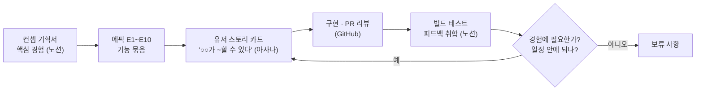
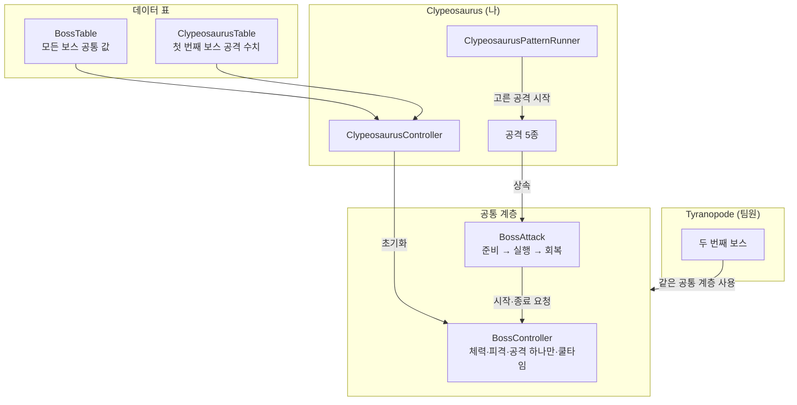
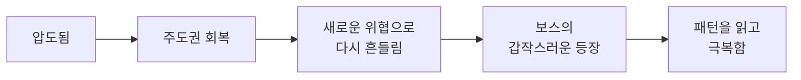
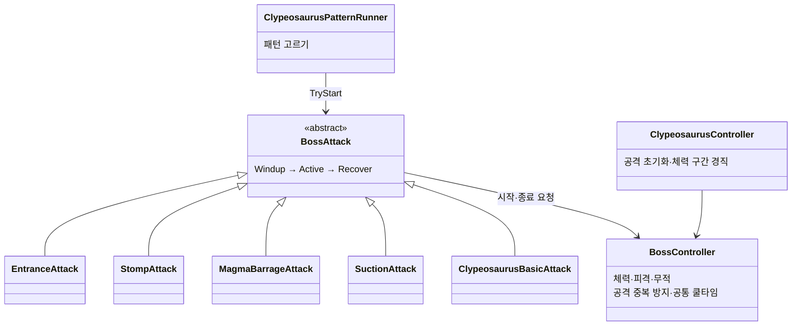
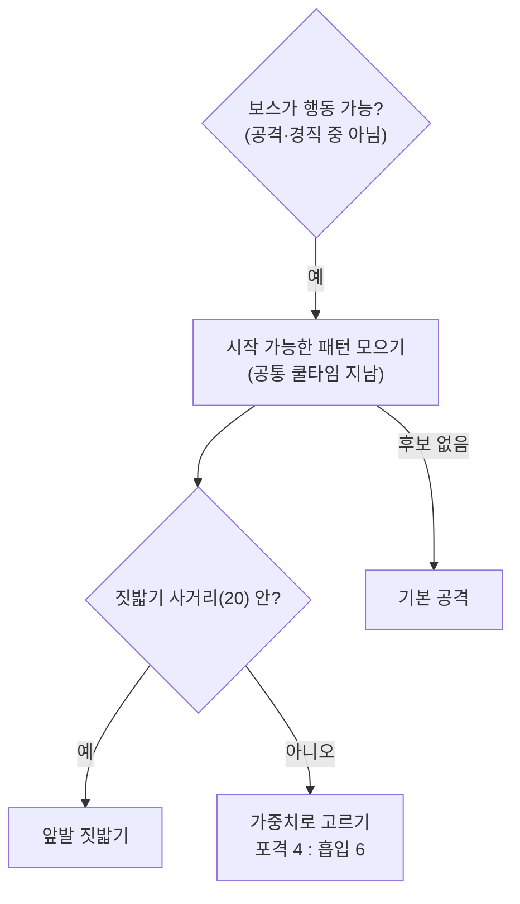

# Hive Purge — 팀 리딩과 보스 시스템

> **1인칭으로 사방에서 밀려드는 군중을 상대하다가, 보스가 나타나면 3인칭으로 전환해 패턴과 공격 범위를 읽고 맞서는 라운드형 액션 슈터**

> 📷 **이미지 자리** `images/cover.png` — 대표 화면 1장(3인칭 보스전에서 Clypeosaurus와 플레이어가 함께 보이는 장면). 포트폴리오 문서와 발표 덱 표지에 크게 나옵니다.

| 항목 | 내용 |
|---|---|
| 장르 | 1인칭 군중전과 3인칭 보스전을 잇는 라운드형 액션 슈터 |
| 개발 기간 | 2026.10.15 ~ 2026.11.03 (스프린트 계획 10/19, 아사나 보드 기록 10/15 ~ 11/09) |
| 인원 | 팀 프로젝트 · 개발 4명 |
| 담당 | **팀장**(기획서·작업 카드 작성, 일정 관리, PR 리뷰·병합) + **보스·라운드 개발** |
| 개발 환경 | Unity 6000.3.15f1 (URP) · 작업 관리 Asana · Git(GitHub, Git flow) |
| 주요 기술 | 공통 보스 클래스(`BossController`·`BossAttack`) 상속 · 보스 수치 TSV 데이터 표 연동 · 거리·가중치 패턴 선택과 공통 쿨타임 · 유저 스토리 작업 카드 |
| 링크 | [GitHub](https://github.com/KooHoo-Dev/3rd_3D_1-3D-Project-team_even) · 시연 영상 ✍ |

## 목차

1. [개요](#1-개요)
2. [전체 구조: 팀 · 작업 흐름 · 보스 시스템](#2-전체-구조-팀--작업-흐름--보스-시스템)
3. [팀 리딩: 유저 경험을 기준으로 나누고 판단하기](#3-팀-리딩-유저-경험을-기준으로-나누고-판단하기)
4. [보스 공통 구조: 공통 틀과 보스별 구현 나누기](#4-보스-공통-구조-공통-틀과-보스별-구현-나누기)
5. [Clypeosaurus 패턴: 학습용 첫 보스 설계](#5-clypeosaurus-패턴-학습용-첫-보스-설계)
6. [트러블슈팅](#6-트러블슈팅)
7. [결과 및 회고](#7-결과-및-회고)

---

## 1. 개요

### 1.1 프로젝트 소개

**What — 무엇을 만들었나**

**Hive Purge**는 1인칭으로 사방에서 밀려드는 군중을 상대하다가, 보스가 나타나면 3인칭으로 전환해 보스의 패턴과 공격 범위를 읽고 맞서는 라운드형 액션 슈터입니다.

이 프로젝트에서 저는 두 가지를 맡았습니다.

- **팀 리딩** — 유저 경험을 중심으로 컨셉 기획서를 쓰고, 그 경험을 아사나 작업 카드로 나눠 2주 일정을 관리했습니다. 빌드 테스트 피드백을 판단해 다음 작업으로 바꾸고, 팀원의 PR을 리뷰·병합했습니다(94건).
- **보스 개발** — 모든 보스가 함께 쓰는 공통 클래스(`BossController`·`BossAttack`)와 첫 번째 보스 Clypeosaurus(공격 5종)를 나눠 만들고, 보스 수치를 데이터 표(TSV)와 연결했습니다.

**Why — 팀 리딩 의도**

**《기획서에 적은 유저 경험을 기준으로 모든 작업과 결정을 기록하고, 그 기록으로 팀이 굴러가게 하는 것을 의도했습니다.》**\
작업 카드에는 완성되어야 할 경험과 그 최종 책임자를 드러내, 담당자가 스스로 검토하게 했습니다. 테스트 피드백은 "우리가 보여 주려는 경험에 얼마나 필요한가"를 먼저 묻고 남은 일정을 그다음에 따져 판단했습니다.

이 문서는 **기획서에서 카드·규약·피드백 판단으로 이어지는 팀 리딩, 공통 보스 클래스와 보스별 클래스를 나눈 구조(사용법·예외 처리·데이터 연동), 첫 번째 보스의 패턴 구현(마그마 포격·공기 흡입·등장 낙하)과 패턴 선택·공통 쿨타임** 세 가지를 중심으로 다룹니다. 트러블슈팅은 병합 중 meta 파일이 빠진 문제와 NavMesh 밖에서 보스가 멈춘 문제를, 회고는 의도를 돌아봅니다.

> 팀원이 만든 플레이어·무기, 일반 몬스터·군중, 전장·보급·보상, 두 번째 보스(Tyranopode)는 이 문서에서 다루지 않습니다. 두 번째 보스는 제 공통 클래스를 어떻게 썼는지만 언급합니다. 직접 만들었지만 이 문서의 중심이 아닌 UI 테마와 라운드 체크포인트도 다루지 않습니다.

---

## 2. 전체 구조: 팀 · 작업 흐름 · 보스 시스템

이 장은 3~5장의 리딩 판단과 코드 판단을 읽기 위한 지도입니다. 누가 무엇을 맡았는지(2.1), 작업이 어떤 순서로 굴러갔는지(2.2), 보스 코드가 어떤 층으로 나뉘는지(2.3~2.5)를 먼저 보여 줍니다.

### 2.1 팀 구성과 역할 분담

| 담당 | 맡은 기능 묶음(에픽) |
|---|---|
| **이찬영(나)** | **팀장** · E5 보스 등장·전투(첫 번째 보스) · E9 라운드 진행·반복 |
| 김민성 | E1 플레이어 조작·시야·생존 · E2 무기 사용·강화 효과 · 두 번째 보스 |
| 홍산 | E3 일반 몬스터 전투 · E4 군중 공세·접근 조절 |
| 윤건우 | E6 전장 구성 · E7 공중 보급·획득 · E8 처치 보상·강화 선택 · 사운드 |

| 도구 | 무엇을 남겼나 |
|---|---|
| 노션 | 컨셉 기획서, 작업 규약, 빌드 테스트 피드백 문서 |
| 아사나 | 유저 스토리 카드, 일정, 결정된 사항·보류 사항 |
| GitHub | 코드, PR 리뷰·병합 |

에픽은 기능 묶음이자 책임 단위입니다. 카드 제목의 주체("플레이어가 ~", "보스가 ~")가 곧 그 에픽 담당자의 책임이 됩니다(→ [3.3](#33-핵심-동작-유저-스토리-카드--카드의-주체가-곧-책임자)).

### 2.2 작업 흐름: 기획서 → 카드 → 빌드 테스트



_빌드 테스트에서 나온 피드백은 두 질문을 거쳐 다시 카드가 되거나 보류 사항으로 갑니다._

컨셉 기획서가 정한 핵심 경험에서 출발해, 이를 에픽과 카드로 나누고, 만든 결과를 빌드 테스트로 확인한 뒤 다시 카드로 돌려보내는 순환입니다. 보스 개발도 이 순환 안에서 진행했습니다. 예를 들어 첫 번째 보스의 흡입 패턴과 패턴 선택 조건은 빌드 테스트 피드백에서 나온 카드로 고쳤습니다(→ [5.9](#59-고민과-선택-패턴-간격과-선택-조건)).

### 2.3 보스 시스템 구조: 데이터 · 공통 계층 · 보스별 계층

이 그림에서 볼 것은 **보스 코드가 데이터 표 → 공통 계층 → 보스별 계층으로 나뉘고, 두 보스가 같은 공통 계층을 쓴다**는 점입니다.



_데이터는 보스별 컨트롤러가 읽어 공통 계층과 공격에 나눠 줍니다. 보스가 바뀌어도 공통 계층은 그대로입니다._

> 📷 **이미지 자리** `images/boss_components.png` — Clypeosaurus 프리팹의 Inspector. 공통 컴포넌트(`BossController`)와 보스 전용 컴포넌트(`ClypeosaurusController`·`ClypeosaurusPatternRunner`·공격 5종)가 한 오브젝트에 붙어 있는 모습

### 2.4 주요 클래스 역할

| 클래스 | 하는 일 | 하지 않는 일 | 자세히 |
|---|---|---|---|
| `BossController` | 체력·피격·무적, 실행 중인 공격을 하나만 허용, 공통 쿨타임, 피격 경직 | 어떤 공격을 할지 고르기, 공격 동작 | [4.3](#43-핵심-동작-공격-단계-진행--준비--실행--회복) |
| `BossAttack` (abstract) | 공격 하나의 준비 → 실행 → 회복 진행과 취소 | 각 단계에서 실제로 할 일(→ 하위 공격) | [4.3](#43-핵심-동작-공격-단계-진행--준비--실행--회복) |
| `ClypeosaurusController` | 데이터 표를 읽어 보스와 공격 5종 초기화, 등장 공격 시작, 체력 구간 경직 | 패턴 고르기 | [4.4](#44-세부-기능-보스-수치-데이터-연동) · [5.7](#57-세부-기능-체력-구간-경직--공격-범위-표시--기본-공격--환경-경직--건물-부수기) |
| `ClypeosaurusPatternRunner` | 거리와 가중치로 다음 패턴을 고름 | 공격 실행 | [5.3](#53-핵심-동작-거리에-따라-다른-패턴-고르기) |
| 공격 5종 (`BossAttack` 상속) | 등장 낙하 · 앞발 짓밟기 · 마그마 포격 · 공기 흡입 · 기본 공격 | 단계 진행·쿨타임(→ 공통 계층) | [5.4](#54-핵심-동작-마그마-포격--착탄-지점-계획과-연속-발사)~[5.6](#56-핵심-동작-등장-낙하--navmeshagent를-잠시-떼고-떨어뜨리기) |
| `BossDef` · `ClypeosaurusDef` | 두 데이터 표를 읽고 값 검증 | 런타임 상태 보관 | [4.4](#44-세부-기능-보스-수치-데이터-연동) |

### 2.5 나누는 기준: 두 번째 보스에도 그대로 필요한가

| 공통 계층에 둔 것 | 보스별 계층에 남긴 것 |
|---|---|
| 체력·피격·무적, 공격 하나만 허용, 공통 쿨타임 | 언제 경직할지, 초기화 순서 |
| 공격의 준비 → 실행 → 회복 진행, 취소와 정리 | 시작 조건, 각 단계에서 할 일 |
| 공통 값 표(`BossTable`) | 공격 수치 표(보스별) |

보스를 최소 두 마리 이상 구상했기 때문에, 모든 보스에 필요한 것은 공통 계층에, 공격과 그 수치는 보스별 계층에 두었습니다. 이 기준이 4장의 결정 ④·⑤입니다(→ [4.5](#45-고민과-선택-코드와-표를-나누는-기준)).

---

## 3. 팀 리딩: 유저 경험을 기준으로 나누고 판단하기

### 3.1 개요

| 맡은 일 | 기록 |
|---|---|
| 컨셉 기획서 작성 | 핵심 경험 · 라운드 시나리오 · 보스 패턴 · 성장 설계 |
| 작업 카드 작성 · 배정 | 유저 스토리 형식, 에픽 10개 |
| 통합 · 테스트 | 1차 사전 통합 및 테스트(10/26~10/28), 1·2차 빌드 테스트 정리 |
| 코드 리뷰 · 병합 | PR 94건 병합 |
| 결정 기록 | 보드의 "결정된 사항들" · "보류 사항" 카드 |

### 3.2 구조: 컨셉 기획서의 핵심 경험

기획서는 기능 목록이 아니라 플레이어가 한 라운드에서 겪는 경험에서 시작합니다.

> 플레이어는 압도적인 적의 공세 속에서 극한의 압박감을 마주하며, 전술적 판단으로 이 위기를 정면 돌파해 극적인 성취감을 획득한다. — *압박감은 성취감을 위한 재료이다.*



이 흐름을 기능 묶음 10개로 나눈 것이 에픽입니다.

| 에픽 | 기능 묶음 |
|---|---|
| E1 · E2 | 플레이어 조작·시야·생존 / 무기 사용·강화 효과 |
| E3 · E4 | 일반 몬스터 전투 / 군중 공세·접근 조절 |
| E5 | 보스 등장·전투 |
| E6 · E7 · E8 | 전장 구성 / 공중 보급·획득 / 처치 보상·강화 선택 |
| E9 · E10 | 라운드 진행·반복 / 게임 연출·마무리 |

> 📷 **이미지 자리** `images/asana_board.png` — 아사나 Team Even 보드 화면. 섹션(BackLog → Sprint Backlog → In Progress → Review → Done)과 카드마다 붙은 에픽 색 라벨이 보이게

### 3.3 핵심 동작: 유저 스토리 카드 — 카드의 주체가 곧 책임자

모든 카드 제목은 "**주체**가 ~할 수 있다"로 쓰고, 본문에 "구현 목표"를 적었습니다.

| 카드 제목 (실제) | 주체 → 책임자 |
|---|---|
| 플레이어가 라이플로 조준하고 적에게 사격 피해를 줄 수 있다. | 플레이어 담당 |
| 근접 몬스터가 과밀할 때 대기·선회하고 공간이 생기면 다시 접근할 수 있다. | 몬스터 담당 |
| 보스가 공기 흡입으로 플레이어를 끌어당겨 근거리 전투를 유도할 수 있다. | 보스 담당(나) |

이 형식은 "카드마다 유저의 경험과 책임을 더 분명하게 정의하라"는 피드백을 받고, 방식을 연구해 직접 작성했습니다. 신경 쓴 점은 두 가지입니다.

1. **경험을 전달한다.** 카드 제목의 주체(플레이어, 보스 등)의 입장에서 어떤 경험이 완성되어야 하는지 분명히 씁니다.
2. **최종 책임자를 드러낸다.** "플레이어가 ~"로 시작하는 카드는 플레이어 담당자의 책임입니다. 카드의 동작이 조건에 맞게 완성되었는지 확인하는 것까지 담당자의 몫입니다.

책임이 카드에 드러나니, 팀장이 완료된 작업을 모두 직접 검토하지 않고 담당자가 스스로 검토하게 해 검토 시간을 줄일 수 있었습니다.

> 📷 **이미지 자리** `images/asana_card.png` — 카드 하나를 연 화면(예: "보스가 공기 흡입으로 플레이어를 끌어당겨 근거리 전투를 유도할 수 있다"). 유저 스토리 제목·구현 목표·담당자·에픽·마감일이 한 화면에 보이게

### 3.4 세부 기능: 작업 규약 — 시작 전에 정한 Git·명명·씬 규칙

카드가 "무엇을 만들지"를 정한다면, 작업 규약은 "여러 사람이 같은 레포에서 어떻게 만들지"를 정합니다. 프로젝트 시작 전(10/15~10/19)에 팀 노션에 정리해 공유했습니다. 내용은 이전 프로젝트들에서 하나씩 쌓아 온 것입니다. Git 관련 규칙은 주로 대학 수업의 팀 프로젝트에서, 씬 분리 같은 유니티 협업 규칙은 학원 프로젝트에서 익혔습니다.

| 규약 | 정한 내용 | 페이지에 적은 목적 |
|---|---|---|
| Git 브랜치 전략 | Git flow. `main`은 `develop`에서만 병합, 기능은 `feature` 브랜치에서 만들고 병합 뒤 삭제, 긴급 수정은 `hotfix`. **release 브랜치는 이번 프로젝트에서 쓰지 않음** | `main`을 버그 없는 안정 버전으로 유지 |
| 커밋 메시지 | `Add`·`Feat`·`Fix`·`Refactor`·`Chore`·`Remove` 중 하나 + 요약, 본문에 작업 설명 | — |
| 브랜치 이름 | `feat/작업명`, 영어 PascalCase. 포괄적인 이름(`feat/System`) 대신 구체적인 이름(`feat/DialogueSystem`) | 이름만 보고 무슨 작업인지 알 수 있게 |
| 폴더 이름 | 최상위는 에셋 종류(복수형 `Scripts`·`Prefabs`…), 그 안은 기능 단위로 같은 이름(`Scripts/Boss`·`Prefabs/Boss`). `Managers`처럼 범위가 넓은 폴더는 지양 | 담당자가 각 에셋 폴더의 자기 기능 폴더를 중심으로 작업 |
| 네임스페이스 | `프로젝트명.폴더경로` (`Assets`·`Scripts` 제외) | 폴더 구조를 네임스페이스에 그대로 반영 |
| 작업자 사이 씬 분리 | 개인 작업은 메인 씬을 건드리지 않고 테스트 씬에서. 기능은 다른 씬에 놓아도 동작하게. 통합은 공통 씬에 프리팹으로 배치. 다 쓴 임시 씬은 삭제 | 텍스트 병합이 까다로운 씬 파일의 충돌을 막기 위해 |
| Pull Request | GitHub Desktop 기준 절차. **대상 브랜치는 반드시 `develop`**, 설명칸에 브랜치에서 한 작업 목록 | — |
| 이벤트 버스와 외부 데이터 적용 기준 (10/22, 진행 중 추가) | 통신 한 건마다 직접 호출·객체 이벤트·전역 EventBus 중 고르는 질문표, 값 하나마다 TSV·Inspector·코드 상수 중 두는 위치 | 특정 패턴을 쓰는 것 자체가 아니라, 구현·수정 비용을 줄이기 위해 (→ 결정 ③) |

이 규약은 코드에 그대로 남아 있습니다.

> 📷 **이미지 자리** `images/notion_rules.png` — 노션 "3D 하이브리드 슈터" 페이지의 작업 규약 목록(Git 사용 전략·명명 규칙·작업 규칙). 프로젝트 시작 전에 정리했다는 것이 보이게

- 보스 코드의 네임스페이스는 `HybridShooter.Boss`·`HybridShooter.Boss.Clypeosaurus`로, `Assets/Scripts/Boss/Clypeosaurus/` 폴더와 같습니다.
- `ClypeosaurusController.Start`는 라운드가 초기화하지 않았을 때 데이터 표로 직접 초기화합니다(코드 주석: "씬에 직접 배치해서 테스트하는 경우의 초기화"). 테스트 씬에 보스만 놓고 돌려 볼 수 있게 한 것으로, "기능은 다른 씬에 놓아도 동작하게"라는 씬 분리 규약과 같은 방향입니다.
- 브랜치는 `feat/boss-clypeosaurus`·`feat/UiRedesign`처럼 기능 이름으로 만들었고, PR은 `develop`으로 병합했습니다(94건). 다만 케밥 표기(`boss-clypeosaurus`)나 한글 이름(`chore/근접-몬스터-공격-밸런싱`) 같은 브랜치도 섞여 있어, PascalCase 규칙이 끝까지 지켜지지는 않았습니다.

### 3.5 세부 기능: 일정 관리 — 스프린트 타임라인 리포트

아사나 보드 기록에서 뽑은 수치입니다(리포트 기준일 2026-11-09).

| 항목 | 값 |
|---|---|
| 전체 작업 / 완료 | 97 / 94 (97%) |
| 목표일 안에 완료 | 77 / 94 (82%) |
| 처음 계획한 일(10/19) | 33개 → 33개 모두 완료 |
| 진행하며 새로 생긴 일 | 45개 (처음의 136%) |
| 작업 하나가 열려 있던 기간 | 평균 2.9일 |
| 담당이 정해진 작업 | 97 / 97 |
| 내 담당 작업 | 31 / 31 완료 |

새로 생긴 일은 10/30(23개)과 11/2(16개)에 몰려 있습니다. 두 날은 1차·2차 빌드 테스트 피드백 회의 직후입니다(→ 3.6).

> 📷 **이미지 자리** `images/timeline.png` — 스프린트 타임라인 리포트의 "작업 일정표 — 기능 영역별" 중 [E5] 보스 등장·전투 페이지(카드별 시작~완료 막대)

> 📷 **이미지 자리** `images/scope_growth.png` — 리포트의 "처음 계획과 실제"·"일감이 늘어난 모습" 그래프(처음 33개 위로 10/30·11/2에 일이 늘어난 모습)

### 3.6 고민과 선택: 피드백·보류·파트 사이 약속

#### 결정 ① 빌드 테스트 피드백을 어떻게 작업으로 바꿀 것인가 (큰 결정)

> **결정 대상** 팀원 4명이 각자 빌드를 플레이하고 낸 피드백을, 무엇을 고칠지 정하고 누구에게 맡길지까지 어떻게 이어 갈 것인가.

**[결정과 이유]** 먼저 각자 플레이하고 느낀 피드백을 쓰게 하고, 그것을 하나의 문서로 취합해 그 문서를 가지고 논의했습니다. 회의에서 결정된 사안만 카드로 만들어 배정했습니다. 흩어진 피드백을 그대로 두고 이야기하면 같은 말이 반복되거나 서로 부딪히는 의견이 정리되지 않기 때문에, 한 문서에 모아 놓고 한 번에 논의하는 것이 가장 낫다고 판단했습니다.

**[취합 방법: 공통 의견 · 정반대 의견 · 개별 의견]** 취합 문서는 의견을 세 갈래로 나눠 정리했습니다. 피드백을 무분별하게 늘어놓고 논의하는 것보다, 의견이 어디서 모이고 어디서 갈리는지를 먼저 보이게 해 조금 더 체계적으로 의견을 주고받으려는 것이었습니다.

| 분류 | 기준 | 1차 취합의 예 |
|---|---|---|
| 1. 공통 의견 | 2명 이상이 제시한 의견. 일치하는 부분을 먼저 적고 그 아래 개인별 세부 의견 | 1-2 보스가 둔하고 위협감 부족 (제안자 3명, "공통: 보스 이동속도 증가") |
| 2. 정반대 의견 | 같은 대상에 서로 반대되는 의견 | 2-1 수류탄·스플래시 무기 운용 방향 (유탄 발사기로 대체 / 수류탄 의존성 강화 / 수류탄 자폭 피해) |
| 3. 에픽별 의견 | 공통 의견을 뺀 나머지를 아사나 에픽(E1~E9)으로 분류 | [E5] 패턴 발동 시 전 영역 시각 피드백 필요 |

항목마다 번호와 **제안자**, **세부 의견**(누가 무엇을 말했는지)을 적고, 회의에서 정한 결론은 화살표(→)로 그 아래에 달았습니다. 우선순위가 낮은 의견에는 "후순위"를 붙였습니다.

> 📷 **이미지 자리** `images/feedback_doc.png` — 1차 피드백 취합 문서 일부. "공통 의견 / 정반대 의견 / 에픽별 의견" 세 갈래와 항목 번호·제안자·세부 의견이 함께 보이는 부분

**[판단과 배정]** 논의한 의견은 ① 우리의 의도를 벗어나지 않은 피드백인가, ② 남은 일정 안에 소화할 수 있는 작업인가를 기준으로 팀장이 최종 판단했고, 승인한 작업만 카드로 만들었습니다. 배정은 기본적으로 각자 맡은 책임대로 했습니다(플레이어 피드백은 플레이어 책임자에게). 한 사람에게 일이 몰리거나 부담이 지나치면 다른 책임자에게 일부를 위임했습니다.

**[결과]** 두 번의 빌드 테스트에서 나온 피드백이 이틀 안에 "구현 목표"가 적힌 카드로 바뀌었고, 회의 결론이 거의 그대로 카드의 구현 목표가 됐습니다. 그 결과 처음 계획한 33개 위로 새 작업 45개가 생겼습니다(→ [3.5](#35-세부-기능-일정-관리--스프린트-타임라인-리포트)).

| 피드백 문서 (항목 · 회의 결론) | 만들어진 카드 |
|---|---|
| 1-5 보스가 플레이어를 바라보지 않음 → "시작 후 3초 정도 딜레이 후 패턴 시작" | 보스가 전용 카메라 연출로 등장하고, 플레이어를 바라본 뒤 패턴을 시작할 수 있다. (등장 후 약 3초 대기) |
| 빨아들이기 패턴: 범위를 안쪽 위험 구역과 바깥 안전 구역으로 나눔 | 보스가 공기 흡입의 구역별 강도로 플레이어를 끌어당기고, 위험 구역의 플레이어를 공격할 수 있다. |
| 1-3 보스 이동 시 피드백 부족 (제안자: 이찬영·윤건우) | 플레이어가 보스의 이동을 카메라 흔들림과 발소리로 느낄 수 있다. (카메라 흔들림은 나, 발소리는 윤건우로 하위 작업 분리) |
| 1-11 맵 크기 축소(1/4로) (제안자: 이찬영·윤건우) | 플레이어가 줄어든 맵에서 엄폐물을 활용하며 전투할 수 있다. |
| 2-1 수류탄·스플래시 무기 운용 방향(정반대 의견) → "수류탄 사용감 개선" | 플레이어가 투사체형 무기를 포함한 무기들을 정상적으로 사용할 수 있다. (구현 목표에 "수류탄 사용감을 개선한다") |
| 2차 1-1 흡입 패턴 빈도 증가 (제안자: 이찬영·윤건우·홍산) → "거리 조건 X, 순차 수행" | 1스테이지 보스가 거리 조건 없이 패턴을 순차적으로 사용해 흡입을 더 자주 쓸 수 있다. (→ 결정 ⑦에서 조건 세분화로 바뀜) |
| 2차 1-3 잡몹 처치 동기 부족 → "적을 일정 수 아래로 처치해야 보스 등장" | 라운드 매니저가 라운드마다 다른 기믹으로 진행하고, 섬멸전에서는 적을 일정 수 아래로 줄여야 보스를 등장시킬 수 있다. |

#### 결정 ② 무엇을 보류할 것인가 (작은 결정)

| 기준 순서 | 질문 |
|---|---|
| 1 | 우리가 보여 주려는 경험을 구현하는 데 얼마나 필요한 피드백인가 |
| 2 | 남은 기간 안에 할 수 있는가 |

2차 피드백 문서에서 "후순위"를 붙인 의견은 아래와 같고, 모두 아사나 "보류 사항" 카드로 옮겼습니다(보류 사항은 모두 7건).

| 피드백 문서의 "후순위" | 보류 사항 카드 |
|---|---|
| 일부 보스·몬스터 공격이 플레이어 근처에 적중할 때 카메라 쉐이크 | 보스·몬스터 공격 근접 적중 시 카메라 쉐이크 |
| 달빛 같은 은은한 빛을 환경 곳곳에 추가 | 달빛 같은 은은한 환경광 추가 |
| 건물이 부서질 때 파괴 이펙트 추가 | 건물 파괴 이펙트 추가 |
| 웨이브 시작·보스 투사체 생성 시점의 간헐적 프레임 드랍 | 웨이브 시작·보스 투사체 생성 시 프레임 드랍 확인 |

**보스전 중 일반 몬스터 투입** — 1차 피드백에서 "보스전에 변화와 재미를 더한다", "도망치는 방향에 잡몹을 뿌려 가장 빠르게 멀어지는 경로를 막는다"는 의견이 나왔고, 회의에서 "보스 패턴을 개선한 뒤 느낌을 보고 추가"로 보류했습니다. 첫 번째 보스는 보스전을 학습하는 보스라, 꾸준한 긴장감보다 적절한 난이도를 유지하는 것이 중요했습니다. 일반 몬스터 난입은 꾸준한 긴장감을 만드는 요소라 후순위로 보았습니다. 패턴만으로 적절한 난이도를 만드는 것을 먼저 하고, 그래도 난이도가 잡히지 않으면 그때 난이도 조절용으로 넣어 보자는 뜻의 보류였습니다. 패턴을 개선한 뒤 패턴만으로 충분하다고 느껴, 최종적으로 넣지 않기로 했습니다.

> 📷 **이미지 자리** `images/asana_on_hold.png` — 아사나 "보류 사항" 카드와 하위 작업 7건 화면

#### 결정 ③ 보스 등장을 다른 파트에 어떻게 알릴 것인가 (작은 결정)

> **결정 대상** 보스가 등장할 때 플레이어 시점 전환, 카메라 흔들림, 사운드, 보스전 보상 집계가 함께 반응해야 한다. 이것을 누가 어떤 방식으로 알릴 것인가.

| | [A] 보스가 플레이어에게 직접 알림 | [B] 라운드가 사건을 이벤트로 발행 ✓ |
|---|---|---|
| 방식 | 보스가 등장하면서 플레이어에게 시점 전환을 요청 | 라운드가 보스 경고·등장을 `BossWarningEvent`·`BossAppearedEvent`로 발행하고, 각 파트가 구독 |
| 문제 | 보스가 플레이어·카메라·사운드·보상처럼 서로 다른 파트를 알고 하나씩 불러야 함 | 이벤트를 누가 받는지 코드만 보고는 한눈에 보이지 않음 |

**[최종 결정]** [B]. 이 결정은 "이벤트 버스와 외부 데이터 적용 기준"(10/22 작성, → [3.4](#34-세부-기능-작업-규약--시작-전에-정한-git명명씬-규칙))에 따른 것입니다. 이 프로젝트에서 중요하게 본 것은 **언제 이벤트를 쓰고 언제 직접 호출을 쓰는가**였고, 그 기준을 미리 정해 두고 필요할 때만 이벤트로 뺐습니다. 요점은 두 객체 사이의 단순한 상호 통신은 직접 호출해도 되지만, 애니메이션·사운드처럼 여러 영역에 걸친 사건은 이벤트로 알린다는 것입니다. 보스 등장은 플레이어·사운드·보상이 각자 다르게 반응하는 사건이라 이벤트에 해당했습니다.

| 기준 문서의 질문 | 보스 등장의 경우 |
|---|---|
| 무엇을 전달하는가? (확정된 사실 / 작업 요청) | "보스가 등장했다"는 확정된 사실 |
| 수신자들의 책임은 독립적인가? | 시점 전환(플레이어)·흔들림(카메라)·BGM(사운드)·보상 집계(강화)가 각자 다른 상태를 가짐 |
| 발행자가 결과를 받아야 하는가? | 아니오. 등장은 반응과 관계없이 이미 일어남 |

**[결과]** 코드에서 `RoundSequencer`가 `BossWarningEvent`를, `RoundBossEncounter`가 보스를 만든 뒤 `BossAppearedEvent`를 발행합니다. 플레이어(카메라 전환·흔들림), `GameSoundRouter`(사운드), `UpgradeManager`(보스전 집계)가 각자 구독합니다. 반대로 보스 내부의 공격 시작·종료처럼 결과가 필요한 통신은 `BossAttack` → `BossController` 직접 호출로 두었습니다(→ [4.3](#43-핵심-동작-공격-단계-진행--준비--실행--회복)).

---

## 4. 보스 공통 구조: 공통 틀과 보스별 구현 나누기

### 4.1 개요

보스는 처음부터 두 마리 이상을 구상했습니다. 그래서 체력·피격·공격 단계처럼 모든 보스에 같은 것은 공통 클래스에, 공격 패턴과 수치처럼 보스마다 다른 것은 보스별 클래스에 두었습니다. 실제로 두 번째 보스 Tyranopode(팀원 담당)는 `BossController`와 `BossAttack`을 그대로 상속해 만들어졌습니다.

### 4.2 구조: 공통 클래스와 Clypeosaurus 클래스

이 그림에서 볼 것: **위 줄(공통)은 보스가 바뀌어도 그대로이고, 아래 줄(Clypeosaurus)만 보스마다 새로 만듭니다.**



_위 그림은 상속과 호출만 추린 것입니다. 주요 클래스의 하는 일과 하지 않는 일은 [2.4 주요 클래스 역할](#24-주요-클래스-역할)에 있습니다._

### 4.3 핵심 동작: 공격 단계 진행 — 준비 · 실행 · 회복

모든 공격은 `BossAttack`이 같은 순서로 진행합니다. 하위 공격은 "각 단계에 들어갈 때 무엇을 할지"만 채웁니다.

```csharp
// BossAttack.cs — 공격 하나를 준비 → 실행 → 회복 순서로 진행한다
private void Update()
{
    if (IsRunning == false) return;
    // (Why) 공격 도중 보스가 죽거나 대상이 사라지면 남은 단계를 진행하지 않는다
    if (Boss.IsAlive == false || Boss.isActiveAndEnabled == false || TargetRoot == null) { Cancel(); return; }

    switch (Phase)
    {
        case SkillPhase.Windup:                       // 예고 시간 (표의 TelegraphTime)
            if (Time.time < phaseEndTime) return;
            Phase = SkillPhase.Active;
            OnActiveStarted();                        // 하위 공격이 구현
            // (Why) 시작하자마자 취소된 공격은 알리지 않는다 (예: 포격 낙하 지점 실패)
            if (Phase == SkillPhase.Active) NotifyPhase();
            break;
        case SkillPhase.Active:
            OnActiveTick(Time.deltaTime);             // 끝나면 하위 공격이 CompleteActive() 호출
            break;
        case SkillPhase.Recover:                      // 플레이어의 반격 시간 (표의 RecoveryTime)
            if (Time.time < phaseEndTime) return;
            Phase = SkillPhase.Idle;
            Boss.EndAttack(this, completed: true);    // 공통 쿨타임 시작
            NotifyPhase();
            break;
    }
}
```

준비 시간은 플레이어가 공격을 읽는 시간, 회복 시간은 공격 뒤 반격할 수 있는 시간입니다. 이 순서는 카드 "보스가 준비·공격·회복을 거치며 공격 패턴을 전환·반복할 수 있다"의 구현 목표를 그대로 옮긴 것이고, 공통 클래스에 두었기 때문에 모든 보스 공격이 같은 순서를 따릅니다.

> 📷 **이미지 자리** `images/boss_phase.gif` — 공격 하나의 세 단계: 바닥에 범위가 표시되는 준비(예고) → 공격 → 보스가 멈춰 있는 회복(반격 시간). 앞발 짓밟기가 가장 잘 보입니다

공격 두 개가 겹치지 않게 하는 것은 `BossController`가 맡습니다. 공격은 시작할 때 보스에게 허락을 받고, 끝날 때 알립니다.

```csharp
// BossController.cs — 공격은 한 번에 하나만, 끝나면 공통 쿨타임
internal bool TryBeginAttack(BossAttack attack)
{
    if (CanStartAttackFor(attack) == false) return false;  // 다른 공격 중·경직 중·쿨타임 중이면 거절
    currentAttack = attack;
    movement.Pause();
    return true;
}

internal void EndAttack(BossAttack attack, bool completed = false)
{
    if (currentAttack != attack) return;
    currentAttack = null;

    // (Why) 끝까지 수행한 패턴만 쿨타임을 건다. 일반 공격은 쿨타임과 별개
    if (completed && attack.UsesPatternCooldown) nextAttackTime = Time.time + Def.PatternCooldown;

    if (IsAlive == false || isActiveAndEnabled == false) movement.Stop();
    else if (IsReacting == false) movement.Resume();
}
```

[`BossAttack.Update` 원문](https://github.com/KooHoo-Dev/3rd_3D_1-3D-Project-team_even/blob/db706ef5ab2280158b830f0b714556cf02ecf6ce/Assets/Scripts/Boss/BossAttack.cs#L87-L118) · [`TryBeginAttack`·`EndAttack` 원문](https://github.com/KooHoo-Dev/3rd_3D_1-3D-Project-team_even/blob/db706ef5ab2280158b830f0b714556cf02ecf6ce/Assets/Scripts/Boss/BossController.cs#L117-L144)

#### `BossAttack` 사용법: 하위 공격이 채우는 칸과 밖에서 부르는 칸

| 호출 | 누가 | 하는 일 |
|---|---|---|
| `InitializeAttack(target, 준비 시간, 회복 시간)` | 하위 공격의 `Initialize` | 대상과 단계 시간을 정함. 대상에 `IDamageable`이 없으면 예외 |
| `MeetsStartCondition()` *(선택)* | 하위 공격 | 공격마다 다른 시작 조건 (예: 짓밟기 사거리, 등장은 한 번만) |
| `OnWindup()` *(선택)* | 하위 공격 | 준비에 들어갈 때 — 범위 표시, 준비 동작 |
| `OnActiveStarted()` *(필수)* | 하위 공격 | 실행에 들어갈 때 — 공격 동작 시작 |
| `OnActiveTick(dt)` *(선택)* | 하위 공격 | 실행 중 매 프레임. 끝나면 `CompleteActive()` 호출 |
| `OnCancelled()` *(선택)* | 하위 공격 | 취소될 때 — 투사체·이펙트 정리 |
| `RaiseImpacted(point)` | 하위 공격 | 땅·대상에 닿은 순간 알림 (사운드가 구독) |
| `CanStart()` / `TryStart()` | 패턴 선택기 | 시작할 수 있는지 확인 / 시작 |
| `PhaseChanged` 이벤트 | 사운드 등 | 단계가 바뀔 때마다 알림 |

새 공격은 `BossAttack`을 상속해 `OnActiveStarted()`만 구현하면 단계 진행·회복·쿨타임·취소 정리를 공통 클래스에서 받습니다. 공격 5종 모두 이 방식으로 만들었습니다.

#### 예외 처리: 공격 도중 경직·사망·비활성

```csharp
// BossController.cs — 피격 경직: 진행 중인 공격을 취소하고 멈춘다
public void StartHitReaction()
{
    if (isActiveAndEnabled == false || IsAlive == false) return;
    if (IsInvulnerable) return;                      // 등장 중에는 경직하지 않음

    // (Why) 공격 취소 중 이동이 재개되지 않도록 먼저 설정한다.
    IsReacting = true;

    currentAttack?.Cancel();                         // → EndAttack: IsReacting이면 이동을 다시 켜지 않음
    movement.Pause();
    view.PlayHit();
}
```

```csharp
// BossAttack.cs — 취소: 하위 공격의 정리가 실패해도 보스는 반드시 풀어 준다
public void Cancel()
{
    // (Why) 이미 종료된 상태에서도 남은 표시를 정리한다.
    Range.Clear();
    if (IsRunning == false) return;

    Phase = SkillPhase.Idle;
    try
    {
        OnCancelled();                               // 하위 공격의 정리
    }
    finally
    {
        Boss.EndAttack(this);                        // completed: false → 쿨타임을 걸지 않음
        NotifyPhase();
    }
}
```

[`StartHitReaction` 원문](https://github.com/KooHoo-Dev/3rd_3D_1-3D-Project-team_even/blob/db706ef5ab2280158b830f0b714556cf02ecf6ce/Assets/Scripts/Boss/BossController.cs#L97-L110) · [`Cancel` 원문](https://github.com/KooHoo-Dev/3rd_3D_1-3D-Project-team_even/blob/db706ef5ab2280158b830f0b714556cf02ecf6ce/Assets/Scripts/Boss/BossAttack.cs#L132-L152)

| 상황 | 처리 |
|---|---|
| 공격 중 보스 사망 | `TakeDamage`가 이동을 멈추고 공격 취소 → 사망 동작 |
| 공격 중 보스 비활성·대상 사라짐 | 다음 `Update`에서 `Cancel` |
| 공격 컴포넌트 비활성 | `OnDisable`에서 `Cancel` |
| 무적(등장) 중 피해·경직 | 피해와 경직을 모두 무시 |
| 취소된 공격 | `completed: false`라 공통 쿨타임을 걸지 않음 |
| 하위 공격의 정리 코드에서 예외 | `finally`로 `EndAttack`은 반드시 실행 → 보스가 "공격 중"에 갇히지 않음 |

### 4.4 세부 기능: 보스 수치 데이터 연동

보스 수치는 코드가 아니라 TSV 표에 있습니다. 표를 두 개로 나눴습니다.

| 표 | 들어 있는 값 | 예 |
|---|---|---|
| `BossTable` (공통) | 모든 보스에 있는 값 | Id, MaxHp, MoveSpeed, PatternCooldown, Prefab |
| `ClypeosaurusTable` (보스 전용) | 이 보스의 공격 수치 32칸 | StompDamage 38, StompTelegraphTime 1.8, BarrageRadius 4, SuctionMaxDuration 10 … |

`ClypeosaurusController`는 `DataManager.Clypeosaurus`(전용 표)에서 `BossId`를 읽어 `DataManager.Bosses`(공통 표)의 보스 정의를 찾고, 두 값을 각각 `BossController`와 공격 5종에 넘깁니다.

> 📷 **이미지 자리** `images/boss_table.png` — 구글 시트의 `BossTable`과 `ClypeosaurusTable` 화면(두 표를 나란히). 공통 값과 보스 전용 공격 수치가 나뉘어 있는 것이 보이게

### 4.5 고민과 선택: 코드와 표를 나누는 기준

#### 결정 ④ 보스 코드를 어떻게 나눌 것인가 (큰 결정)

> **결정 대상** 체력·피격·공격 단계처럼 모든 보스에 필요한 코드와, 공격 패턴처럼 보스마다 다른 코드를 어디에 둘 것인가.

**[결정과 이유]** 처음부터 공통 클래스(`BossController`·`BossAttack`)와 보스별 클래스로 나누어 만들었습니다. 기획상 두 번째 보스가 예정되어 있었고, 그 보스의 담당은 다른 사람이 될 가능성이 컸습니다. 다른 사람이 같은 틀 위에서 바로 자기 보스의 패턴을 만들 수 있도록, 공통 부분을 더 깔끔하게 정리해 두어야 했습니다. 공통 클래스에 무엇을 넣을지는 회의에서 논의한 내용을 바탕으로 정했습니다.

**[결과]** 두 번째 보스 Tyranopode는 `BossController`(체력·피격 이벤트)와 `BossAttack`(패턴 단계)을 그대로 상속해 만들어졌습니다. 공통 틀에 없는 것은 각 보스가 필요에 따라 판단해 덧붙여 쓸 수 있었습니다. 예를 들어 Tyranopode는 준비 단계 중 매 프레임 할 일(`WindupTick`)을 자기 공격 클래스에 더했고, 공격 간격은 공통 쿨타임 대신 자기 표로 정했습니다(`BossTable.PatternCooldown` 0).

> 📷 **이미지 자리** `images/tyranopode.png` — 두 번째 보스 Tyranopode 전투 화면(같은 공통 틀 위에서 만들어진 다른 보스)

#### 결정 ⑤ 보스 수치 표를 어떻게 나눌 것인가 (작은 결정)

**[결정과 이유]** 보스를 최소 두 마리 이상 구상했으므로, 모든 보스가 참고할 공통 표(`BossTable`)와 각 보스가 패턴을 수행할 때 참고할 표(`ClypeosaurusTable`)를 나눴습니다.

**[결과]** 두 번째 보스도 공통 표에 한 줄(`Id 2`)을 추가하고 전용 표를 따로 가졌습니다.

---

## 5. Clypeosaurus 패턴: 학습용 첫 보스 설계

### 5.1 개요

첫 번째 보스 Clypeosaurus는 **어렵지는 않지만 충분히 위협적인, 학습용 보스**로 구상했습니다. 플레이어가 "패턴 → 반격 → 패턴"이 반복되는 보스전 자체에 익숙해지게 하는 것이 목적입니다.

| 패턴 | 하는 일 | 주요 수치 (ClypeosaurusTable) |
|---|---|---|
| 등장 낙하 | 그림자로 착지 지점을 예고한 뒤 착지 충격파 | 피해 35, 반경 15 |
| 앞발 짓밟기 | 앞발을 들어 예고한 뒤 원형 충격파 | 피해 38, 예고 1.8초, 반경 13, 회복 3초 |
| 마그마 포격 | 플레이어 주변에 착탄 구역을 표시한 뒤 연속 낙하 | 피해 25, 구역 반경 4, 예고 1.5초, 회복 2.5초 |
| 공기 흡입 | 플레이어를 보스 앞으로 끌어당긴 뒤 공격 | 최대 10초, 피해 38, 위험 반경 10 |
| 기본 공격 | 패턴 쿨타임 사이 근접 공격 | 피해 20, 간격 2초 |

컨셉 기획서의 패턴은 "지면 강타·직선 돌진·포격 구역"이었습니다. 개발 중 직선 돌진을 **공기 흡입**으로 바꿨습니다(→ 5.9 결정 ⑧).

### 5.2 구조: 패턴 고르기 흐름



### 5.3 핵심 동작: 거리에 따라 다른 패턴 고르기

```csharp
// ClypeosaurusPatternRunner.cs — 지금 쓸 수 있는 패턴 중 하나를 고른다
foreach (var attack in attacks)
{
    // 시작할 수 없는 패턴(쿨타임·자체 조건·짓밟기 사거리 20 밖)은 건너뜀
    if (attack == null || attack.gameObject != gameObject || attack.UsesPatternCooldown == false
        || attack.CanStart() == false || candidates.Contains(attack)) continue;

    // (Why) 가까이 있으면 근접 패턴이 가장 자연스럽다 → 짓밟기를 우선한다
    if (attack is StompAttack)
    {
        candidates.Clear();
        candidates.Add(attack);
        break;
    }

    if (GetWeight(attack) > 0f) candidates.Add(attack);
}

if (candidates.Count > 0)
{
    BossAttack selected = SelectPattern();             // 가중치 랜덤
    if (selected.TryStart()) return;
}

// 패턴을 시작하지 못했으면(쿨타임 중 등) 기본 공격
if (basicAttack != null && basicAttack.gameObject == gameObject && basicAttack.UsesPatternCooldown == false)
    basicAttack.TryStart();
```

```csharp
// ClypeosaurusPatternRunner.cs — 사거리 밖 패턴의 가중치 (Inspector에서 조정)
private float GetWeight(BossAttack attack)
{
    if (attack is MagmaBarrageAttack) return Mathf.Max(0f, barrageWeight);  // 4
    // (Why) 멀리서 버티는 플레이를 깨기 위해 흡입을 더 자주
    if (attack is SuctionAttack) return Mathf.Max(0f, suctionWeight);       // 6
    return 1f;
}
```

[`ClypeosaurusPatternRunner` 원문](https://github.com/KooHoo-Dev/3rd_3D_1-3D-Project-team_even/blob/db706ef5ab2280158b830f0b714556cf02ecf6ce/Assets/Scripts/Boss/Clypeosaurus/ClypeosaurusPatternRunner.cs#L24-L85)

가까우면 짓밟기, 멀면 포격과 흡입이 나옵니다. 포격과 흡입 중에서는 흡입이 더 자주 나와, 멀리 떨어진 플레이어를 다시 보스 앞으로 데려옵니다.

> 📷 **이미지 자리** `images/boss_pattern_distance.gif` — 가까이 있을 때 앞발 짓밟기, 멀리 떨어지자 흡입(또는 포격)이 나오는 장면을 이어서

### 5.4 핵심 동작: 마그마 포격 — 착탄 지점 계획과 연속 발사

보스 등의 발사관이 하나씩 점등된 뒤, 켜져 있는 발사관 수만큼 플레이어 주변에 착탄 구역(반경 4)을 표시하고 마그마를 차례로 떨어뜨립니다.

> 📷 **이미지 자리** `images/boss_magma.gif` — 발사관이 점등되고, 플레이어 주변에 착탄 구역이 표시된 뒤 마그마가 차례로 떨어지는 장면

| 단계 | 하는 일 | 코드 |
|---|---|---|
| 준비 (1.5초) | 켜진 발사관을 모으고, 발사관 수 × `BarrageVolleyCount`(2)발을 쏠 계획을 세움 | `OnWindup` |
| 착탄 지점 계획 | 발사관마다 플레이어 주변 반경 6 안에서 지면 위 착탄 지점을 하나씩 고름 | `BuildVolleyPlan` |
| 발사 | 애니메이션 이벤트에서 첫 발, 이후 0.6초(`BarrageInterval`)마다 한 발 | `OnBarrageFire` · `FireNext` |
| 비행 · 착탄 | 2초(`BarrageFlightTime`) 동안 포물선으로 날아가 착탄 지점에서 범위 판정 | `MagmaProjectile` |
| 회복 (2.5초) | 모든 발사가 끝나고 투사체가 모두 사라지면 회복으로 | `OnActiveTick` |

#### 착탄 지점 계획: 지면 위, 서로 겹치지 않게

```csharp
// MagmaBarrageAttack.cs — 발사관마다 플레이어 주변의 착탄 지점을 하나씩 정한다
private bool BuildVolleyPlan()
{
    landingPoints.Clear();
    if (sources.Count == 0 || TargetRoot == null) return false;

    Vector3 center = TargetRoot.position;
    float minimumDistance = data.BarrageRadius * 0.5f;           // 착탄 구역끼리 최소 간격 = 반경의 절반

    for (int i = 0; i < sources.Count; i++)
    {
        bool placed = false;
        for (int attempt = 0; attempt < PlacementAttempts; attempt++)   // 발사관 하나당 최대 100번 시도
        {
            Vector2 offset = UnityEngine.Random.insideUnitCircle * data.BarrageSpreadRadius;
            Vector3 origin = center + new Vector3(offset.x, groundProbeHeight, offset.y);   // 위(50)에서 아래로

            if (Physics.Raycast(origin, Vector3.down, out var hit, groundProbeDistance, groundMask,
                    QueryTriggerInteraction.Ignore) == false) continue;
            // (Why) Damageable 객체를 제외하여 착탄 높이를 지면으로 고정
            if (hit.collider.TryGetDamageable(out _)) continue;
            if (HasOverlap(hit.point, minimumDistance)) continue;

            landingPoints.Add(hit.point);
            placed = true;
            break;
        }
        if (placed == false) return false;                           // 한 곳이라도 못 정하면 포격 취소
    }
    return true;
}
```

[`BuildVolleyPlan` 원문](https://github.com/KooHoo-Dev/3rd_3D_1-3D-Project-team_even/blob/db706ef5ab2280158b830f0b714556cf02ecf6ce/Assets/Scripts/Boss/Clypeosaurus/MagmaBarrageAttack.cs#L93-L126)

착탄 지점은 위에서 아래로 Raycast를 쏴서 찾습니다. 맞은 대상이 몬스터·플레이어처럼 피해를 받는 대상이면 그 지점은 버리고 다시 고릅니다. 이미 고른 지점과 너무 가까워도 다시 고릅니다. `FireNext`는 매 발사 전에 이 계획을 다시 세우므로, 플레이어가 움직이면 다음 묶음은 새 위치 주변에 떨어집니다.

#### 발사 진행: 애니메이션 이벤트에 기대되, 갇히지 않게

```csharp
// MagmaBarrageAttack.cs — 실행 중 매 프레임: 남은 발사 → 투사체 정리 → 끝났는지 확인
protected override void OnActiveTick(float deltaTime)
{
    if (fireStarted && nextShot < totalShots && Time.time >= nextShotTime)
    {
        FireNext();                                                  // 0.6초마다 한 발
        if (Phase != SkillPhase.Active) return;                      // 착탄 지점 실패로 취소됐으면 중단
    }
    // … 끝난 투사체를 목록에서 제거 (생략)

    bool clipFinished = Time.frameCount > animationStartedFrame && view.IsStateFinished(BarrageState);
    if (animationFinished == false && clipFinished)
    {
        // (Why) 이벤트가 누락되어도 Active 상태에 갇히지 않도록 처리
        if (fireStarted == false) { view.PlayIdle(); CompleteActive(); return; }

        if (nextShot < totalShots) PlayBarrageAnimation();           // 남은 발사가 있으면 동작 반복
        else { animationFinished = true; view.PlayIdle(); }
    }

    if (nextShot >= totalShots && animationFinished && projectiles.Count == 0) CompleteActive();
}
```

[`OnActiveTick` 원문](https://github.com/KooHoo-Dev/3rd_3D_1-3D-Project-team_even/blob/db706ef5ab2280158b830f0b714556cf02ecf6ce/Assets/Scripts/Boss/Clypeosaurus/MagmaBarrageAttack.cs#L163-L209)

첫 발은 발사 애니메이션의 이벤트(`OnBarrageFire`)가 시작합니다. 이벤트가 두 번 불려도 발사는 한 번만 시작하고(`fireStarted`), 이벤트가 아예 오지 않으면 애니메이션이 끝나는 순간 공격을 마칩니다. 마지막 투사체가 땅에 닿을 때까지 회복으로 넘어가지 않기 때문에, 회복(반격) 시간은 포격이 완전히 끝난 뒤에 시작됩니다.

#### 투사체: 정해진 시간에 정확히 착탄하는 포물선과 엄폐 판정

```csharp
// MagmaProjectile.cs — 비행 시간(2초) 뒤 정확히 착탄 지점에 닿는 초기 속도
Vector3 arrival = landingPoint + Vector3.up * worldRadius;          // 공의 아랫면이 지면에 닿는 위치
float duration = data.BarrageFlightTime;

// 도착 = 시작 + v·t + ½·g·t²  →  v = (도착 − 시작 − ½·g·t²) / t
initialVelocity = (arrival - startPoint - 0.5f * gravity * duration * duration) / duration;
```

```csharp
// MagmaProjectile.cs — 착탄 지점과 플레이어 사이에 엄폐물이 있으면 피해 없음
private bool HasCover(Vector3 origin, Vector3 destination)
{
    Vector3 difference = destination - origin;
    float distance = difference.magnitude;
    if (distance < 0.001f) return false;

    foreach (var hit in Physics.RaycastAll(origin, difference / distance, distance, coverMask, QueryTriggerInteraction.Ignore))
    {
        if (hit.collider.transform.IsChildOf(owner.transform)) continue;     // 보스 자신은 엄폐물이 아님
        if (hit.collider.TryGetDamageable(out var blocker) && object.ReferenceEquals(blocker, target))
            continue;                                                         // 플레이어 자신도 제외
        return true;
    }
    return false;
}
```

[`MagmaProjectile` 원문](https://github.com/KooHoo-Dev/3rd_3D_1-3D-Project-team_even/blob/db706ef5ab2280158b830f0b714556cf02ecf6ce/Assets/Scripts/Boss/Clypeosaurus/MagmaProjectile.cs#L50-L159)

투사체는 물리 엔진 대신 위 식으로 매 프레임 위치를 계산해, 예고한 시간에 예고한 지점에 떨어집니다. 투사체의 콜라이더는 모두 끄고(코드 주석: "공의 직접 충돌과 피해 판정을 분리한다"), 착탄 순간 플레이어가 반경 안에 있는지와 엄폐물 뒤에 있는지만 따로 판정합니다.

> 📷 **이미지 자리** `images/magma_cover.png` — 착탄 구역 안이지만 엄폐물 뒤에 숨어 피해를 받지 않는 장면(엄폐물·착탄 구역·플레이어가 한 화면에)

### 5.5 핵심 동작: 공기 흡입 — 흡입 API 위에서 끝난 이유로 분기

플레이어를 끌어당기는 속도 계산은 플레이어 담당 팀원이 만든 흡입 API(`InhaleSource`)가 맡습니다. 저는 이 API에 넘길 설정을 표에서 만들고, 흡입이 **왜 끝났는지**에 따라 공격으로 이어갈지 취소할지를 정했습니다.

| `InhaleSettings` 값 | 표의 칸 | 값 |
|---|---|---|
| `NearRadius` (위험 구역 반경) | `SuctionNearRadius` | 19 |
| `FarExtraSpeed` / `NearExtraSpeed` | 바깥·안쪽에서 더하는 당기는 속도 | 3 / 0.5 |
| `MaxDuration` | `SuctionMaxDuration` | 10초 |
| `NearDwellTime` | 위험 구역에 머물면 끝나는 시간 | 2초 |

```csharp
// SuctionAttack.cs — 흡입이 끝난 이유에 따라 공격으로 이어가거나 취소한다
protected override void OnActiveTick(float deltaTime)
{
    if (TargetDamageable.CanBeHitBy(Boss.Faction) == false) { Cancel(); return; }   // 플레이어가 맞을 수 없는 상태

    if (attacking)                                                   // 2) 할퀴기 동작이 끝나면 회복으로
    {
        if (Time.frameCount <= attackStartedFrame) return;
        if (view.IsStateFinished(AttackState) == false) return;
        dangerRange.Clear();
        view.PlayIdle();
        CompleteActive();
        return;
    }

    if (activeInhale == null) { Cancel(); return; }
    if (activeInhale.IsRunning) return;                              // 1) 흡입 중

    InhaleEndReason reason = activeInhale.EndReason;
    StopInhale();
    // 10초가 지났거나(Timeout) 위험 구역에 2초 머물렀을 때(NearDwell)만 공격. 그 밖의 이유는 취소
    if (reason != InhaleEndReason.Timeout && reason != InhaleEndReason.NearDwell) { Cancel(); return; }

    attacking = true;
    attackStartedFrame = Time.frameCount;
    view.PlayState(AttackState);
}
```

[`OnActiveTick` 원문](https://github.com/KooHoo-Dev/3rd_3D_1-3D-Project-team_even/blob/db706ef5ab2280158b830f0b714556cf02ecf6ce/Assets/Scripts/Boss/Clypeosaurus/SuctionAttack.cs#L118-L165)

실행 단계 안이 다시 "흡입 → 할퀴기" 두 단계로 나뉩니다. 피해는 할퀴기 애니메이션의 이벤트(`OnSuctionAttackHit`)에서 위험 반경(10) 안의 플레이어에게 한 번만 줍니다(`hitApplied`). 흡입 API가 "플레이어가 리셋됨", "흡입 중심이 사라짐" 같은 이유로 끝나면 공격하지 않고 취소합니다.

> 📷 **이미지 자리** `images/boss_suction.gif` — 흡입 범위(바깥)와 위험 구역(안쪽)이 표시되고, 반대로 달려도 끌려가다가 할퀴기로 이어지는 장면

### 5.6 핵심 동작: 등장 낙하 — NavMeshAgent를 잠시 떼고 떨어뜨리기

| 단계 | 하는 일 |
|---|---|
| 준비 | 무적 켜기, `NavMeshAgent` 끄기, 착지 지점 위 30m(기본값)로 옮기기, 그림자 표시 |
| 준비 중 매 프레임 | 그림자 반경을 0에서 `EntranceRadius`(15)까지 키움 |
| 낙하 (0.8초, 기본값) | `progress²`로 점점 빨라지며 떨어짐 |
| 착지 | Agent 다시 켜기 → 포효 · 충격파 · 반경 안 플레이어에게 피해 35 |
| 포효가 끝나면 | 무적 끄기 → 회복 |

```csharp
// EntranceAttack.cs — 준비: 무적, Agent 분리, 공중으로 이동, 그림자 예고
protected override void OnWindup()
{
    Boss.SetInvulnerable(true);
    used = true;                                     // 등장은 한 번만 (MeetsStartCondition에서 확인)
    windupStatedAt = Time.time;

    if (fixedLandingPoint == false) landingPoint = transform.position;
    fallStartPoint = landingPoint + Vector3.up * fallHeight;      // 30m 위

    agent.enabled = false;
    agentDetached = true;
    transform.position = fallStartPoint;

    Range.Show(shadowPrefab, landingPoint, 0f, 0.05f);            // 반경 0에서 시작하는 그림자
    view.PlayState(IdleState);
}
```

```csharp
// EntranceAttack.cs — 착지: Agent를 되돌리지 못하면 등장을 취소한다
private void Land()
{
    stage = EntranceStage.Roaring;

    if (RestoreAgent() == false)                     // agent.isOnNavMesh && agent.Warp(landingPoint)
    {
        Debug.LogError("[Entrance] 착지 지점에 navMesh가 없습니다.", this);
        Cancel();
        return;
    }

    Range.Clear();
    view.PlayState(RoarState);
    RaiseImpacted(landingPoint);                     // 사운드 등이 구독하는 착지 순간 알림
    // … 충격파 이펙트 생성 (생략)
    ApplyLandingDamage();                            // 수평 거리 15 안이면 피해 35
}
```

[`EntranceAttack` 원문](https://github.com/KooHoo-Dev/3rd_3D_1-3D-Project-team_even/blob/db706ef5ab2280158b830f0b714556cf02ecf6ce/Assets/Scripts/Boss/Clypeosaurus/EntranceAttack.cs#L79-L171)

실행 단계 안은 `EntranceStage`(낙하 → 포효)로 한 번 더 나뉩니다. 무적은 준비에서 켜고 포효가 끝나야 끕니다. 착지 지점에 NavMesh가 없으면 오류를 남기고 등장을 취소하며, 취소할 때도 `OnCancelled`가 Agent를 되돌립니다. 밖에서 착지 지점을 지정하면(`SetLandingPoint`) 착지 후 Agent가 다시 켜져도 연출 중에는 그 위치를 유지합니다(코드 주석).

> 📷 **이미지 자리** `images/boss_entrance.gif` — 그림자가 커지며 착지 지점을 예고하고, 보스가 떨어져 착지 충격파와 포효가 나오는 장면

### 5.7 세부 기능: 체력 구간 경직 · 공격 범위 표시 · 기본 공격 · 환경 경직 · 건물 부수기

- **체력 구간 경직** — 피해를 받을 때마다 체력 비율이 75%·50%·25%를 처음 넘었는지 확인하고, 넘었으면 `BossController.StartHitReaction()`으로 공격을 취소하고 경직합니다. 한 번에 두 구간을 넘어도 경직은 한 번입니다(`ClypeosaurusController.OnDamaged`).
- **공격 범위 표시** — 각 공격은 `BossAttackRange`로 바닥에 범위를 표시합니다. 회복으로 넘어갈 때(`CompleteActive`)와 취소될 때(`Cancel`) 공통 클래스가 표시를 지웁니다.
- **기본 공격** — `UsesPatternCooldown`을 `false`로 바꿔, 공통 쿨타임과 상관없이 패턴 사이에 씁니다(`ClypeosaurusBasicAttack`, 피해 20, 간격 2초).
- **환경 폭발 경직** — 연료 셀 폭발 같은 환경 충격을 받으면 8초(기본값)에 한 번까지 경직합니다. 등장 중(무적)에는 받지 않습니다(`ClypeosaurusController.TryStagger`).
- **건물 부수기** — 0.1초마다 보스의 몸통·다리 콜라이더와 겹친 건물을 찾아, 파괴 이펙트를 남기고 없앱니다(`BossBuildingBreaker` → `BreakableBuilding.Break`). 공통 계층에 두어 다른 보스에도 붙일 수 있습니다.

### 5.8 예외 처리: 공격마다 실패하면 어떻게 끝나는가

| 상황 | 처리 | 위치 |
|---|---|---|
| 착탄 지점을 한 곳이라도 못 찾음 | 경고 후 취소, 1초 동안 포격 후보에서 제외 | `MagmaBarrageAttack.OnWindup` · `FireNext` · `MeetsStartCondition` |
| 발사 애니메이션 이벤트가 오지 않음 | 애니메이션이 끝나면 발사 없이 회복으로 | `MagmaBarrageAttack.OnActiveTick` |
| 이벤트가 두 번 불림 | 발사·피해는 한 번만 (`fireStarted` · `hitApplied`) | `OnBarrageFire` · `OnSuctionAttackHit` |
| 공격 중 취소 | 날아가던 투사체·흡입·그림자·범위 표시를 모두 정리 | 각 공격의 `OnCancelled` |
| 흡입 API를 찾지 못함 | 경고 후 취소 | `SuctionAttack.OnActiveStarted` |
| 착지 지점에 NavMesh 없음 | 오류 후 취소, Agent 복구 | `EntranceAttack.Land` |
| 프리팹·발사관 연결 누락 | 초기화에서 예외로 바로 알림 | 각 공격의 `Initialize` |
| 씬에 보스만 놓고 테스트 | 라운드가 초기화하지 않았으면 `Start`에서 데이터 표로 직접 초기화 | `ClypeosaurusController.Start` |

### 5.9 고민과 선택: 패턴 간격과 선택 조건

이 장의 결정들은 모두 "학습용 첫 보스"라는 기획 의도에서 나왔고, 대부분 빌드 테스트 피드백 회의를 거쳐 카드로 만든 작업입니다. 3장에서 설명한 "경험을 기준으로 판단한다"는 원칙이 코드에 가장 직접 드러난 곳입니다.

#### 결정 ⑥ 패턴 사이 간격을 무엇으로 정할 것인가 (큰 결정)

| 방식 | 문제 |
|---|---|
| 패턴마다 개별 쿨타임 | 패턴마다 진행 시간이 달라, 어떤 패턴은 끝나자마자 다른 패턴이 나오고 어떤 패턴은 끝나고 한참 뒤에 나옴 |
| **보스 하나에 공통 쿨타임** (`BossTable.PatternCooldown`) | 패턴별로 다른 간격을 줄 수 없음 |

**[최종 결정]** 공통 쿨타임으로 바꿨습니다. 첫 번째 보스는 엇박자 패턴이나 격렬한 전투보다, 패턴 → 유저 공격 → 패턴이 반복되는 보스전 자체에 익숙해지게 만드는 것이 목적이었기 때문입니다.

**[얻은 것]** 어느 패턴이 끝나든 다음 패턴까지의 간격이 같아, 플레이어가 반격할 시간을 예상할 수 있습니다. 간격은 표의 값 하나로 조정합니다(10초 → 8초로 조정).

**[감수한 대가]** 패턴별로 간격을 다르게 줄 수 없습니다. 그래서 공격 간격을 따로 정해야 했던 두 번째 보스는 공통 쿨타임을 0으로 두고 자기 표를 썼습니다(→ [결정 ④](#결정-④-보스-코드를-어떻게-나눌-것인가-큰-결정)).

#### 결정 ⑦ 패턴마다 걸린 거리 조건을 어떻게 풀 것인가 (큰 결정)

> **결정 대상** 패턴마다 따로 걸려 있던 거리 조건(흡입은 일정 거리 밖에서만, 짓밟기는 가까울 때만) 때문에 생긴 문제를 어떻게 해결할 것인가.

**[문제]** 패턴마다 거리 조건이 따로 걸려 있어, 패턴이 실행되는 간격이 제각각이었습니다. 플레이어가 보스를 파악하기 어려웠고, 보스와 특정 거리를 유지하며 싸우면 마그마 포격 하나만 보게 됐습니다. 2차 피드백에서도 "흡입 패턴 빈도 증가"가 공통 의견으로 나왔습니다.

**[결정과 이유]** 처음에는 거리 조건을 없애고 패턴을 순차적으로 쓰는 카드를 만들었습니다. 하지만 목적은 다양한 패턴을 보게 하는 것이었지, 거리 조건을 없애는 것 자체가 아니었습니다. 그래서 조건을 없애는 대신, 패턴이 더 자연스러운 상황에 나오도록 조건을 세분화했습니다.

- 흡입의 최소 거리 조건은 지웠습니다.
- 짓밟기 사거리(20) 안이면 짓밟기를 우선합니다.
- 사거리 밖이면 포격 4 : 흡입 6 가중치로 고릅니다(Inspector에서 조정).

**[결과]** 거리를 유지하는 플레이어도 포격과 흡입을 모두 보게 되고, 흡입에 끌려오면 짓밟기 사거리 안에 들어와 근접 패턴까지 이어집니다(→ [5.3](#53-핵심-동작-거리에-따라-다른-패턴-고르기)).

#### 결정 ⑧ 직선 돌진을 공기 흡입으로 바꾼 이유 (작은 결정)

| 방식 | 문제 |
|---|---|
| 직선 돌진 (기획서) | 덩치가 크고 느린 보스라, 플레이어가 반대로 달려 완전히 떨어진 거리에서 안전하게 공격할 수 있음 |
| **공기 흡입** | 직접 피해가 없어 흡입 뒤 공격과 이어져야 위협이 됨 |

첫 번째 보스는 이동 속도를 느리게 설정했기 때문에, 플레이어가 마음먹으면 보스를 무시하고 멀리서 안전하게 공격할 수 있었습니다. 이는 "충분히 위협적인 학습용 보스"라는 의도와 달랐습니다. 그래서 유저가 너무 멀어지면 보스 앞으로 강제로 끌어와 일정한 거리를 유지시키는 흡입 패턴을 넣었습니다. 플레이 테스트(11/01)에서도 "엄폐물 때문에 보스가 멀리서 쏘기만 하는 구도가 되어 쉬워진다", "흡입이 더 자주 나와도 좋겠다"는 의견이 나와, 흡입 빈도를 높였습니다(결정 ⑦).

---

## 6. 트러블슈팅

| 위치 | 문제 | 원인 | 해결 |
|---|---|---|---|
| [§6.1](#a-병합-중-meta-파일이-빠져-에셋-참조가-깨지던-문제) | 외부 에셋의 meta 2,581개가 빠져 참조가 깨짐 | 팀원의 로컬 병합에서 meta가 빠진 채 PR로 `develop`에 들어감 | 이전 커밋에서 meta를 되살리고, `.gitignore` 수정과 함께 모든 브랜치에 병합 |
| [§6.1](#b-같은-시기의-다른-레포-문제) | `Plasma.mp3`가 꼬임 | LFS 대상인 `.mp3`가 포인터가 아닌 실제 파일로 커밋됨 | LFS 포인터로 바로잡음 |
| [§6.1](#b-같은-시기의-다른-레포-문제) | 바이너리 씬·프리팹 손상 (팀원 윤건우) | `.prefab`·`.unity`를 무조건 텍스트로 취급해 줄바꿈 변환으로 깨짐 | `.gitattributes`를 `text=auto`로 |
| [§6.2](#62-보스가-멀어진-플레이어를-쫓지-않던-문제) | 보스가 멀어진 플레이어를 쫓지 않음 | NavMesh가 구워지지 않은 구간(추정) | 고저차를 줄인 라운드 맵에서 재발 없음 |

### 6.1 협업 레포의 에셋 깨짐 문제

#### (a) 병합 중 meta 파일이 빠져 에셋 참조가 깨지던 문제

**증상** 작업자마다 다르게 깨졌습니다. 문제가 생긴 작업자의 화면에서는 에셋의 머티리얼이 날아가 맵 전체가 하얗게 보였습니다. 다른 작업자들은 브랜치를 바꿀 때마다 meta 파일 수천 개가 Git 변경 목록에 잡혀, 매번 번거롭게 되돌리기(discard)를 해야 했습니다.

**원인** 10/23 11:07, 팀원이 로컬에서 자기 브랜치를 병합하면서([`2f9d900`](https://github.com/KooHoo-Dev/3rd_3D_1-3D-Project-team_even/commit/2f9d900e4)) 외부 에셋의 `.meta` 2,581개가 빠졌습니다. `.fbx` 같은 에셋 파일은 그대로 남았습니다. 이 브랜치가 11:18 PR #15로 `develop`에 병합되면서 팀 전체로 퍼졌습니다.

| 빠진 `.meta` | 개수 |
|---|---|
| PROTOFACTOR 애니메이션 에셋 | 2,488 |
| FinalIK 아이콘 | 93 |

유니티는 에셋끼리 `.meta` 안의 GUID로 참조합니다. `.meta`가 없으면 PC마다 새 GUID를 만들기 때문에, 애니메이터·프리팹이 가리키던 클립이 서로 다른 GUID를 갖게 되어 참조가 끊깁니다.

**원인을 찾은 과정** 같은 레포를 받았는데 작업자마다 다르게 올라가고 다르게 보였기 때문에, 처음에는 `.gitignore` 설정에 문제가 있다고 생각했습니다. 10/21에 패키지의 일부 파일이 반복적으로 충돌을 일으켜 그 파일을 무시하려 했는데, 파일이 아니라 `ProjectSettings/Packages/` 폴더 전체를 무시하도록 적었기 때문입니다. 그래서 12:56에 그 줄을 먼저 지웠고([`dd2ca30`](https://github.com/KooHoo-Dev/3rd_3D_1-3D-Project-team_even/commit/dd2ca3069)), 이어서 병합 과정에서 `.meta`가 빠진 것을 찾았습니다.

**해결** 13:34, 이전 커밋에서 빠진 `.meta`를 되살려 다시 올렸습니다([`0c5345f`](https://github.com/KooHoo-Dev/3rd_3D_1-3D-Project-team_even/commit/0c5345f29)). 수정한 `.gitignore`와 복구한 `.meta`를 커밋한 뒤, 팀원 모두에게 각자의 브랜치에 병합하도록 지시했습니다.

**결과** 모든 브랜치가 같은 `.meta`와 `.gitignore`를 갖게 되었습니다.

**배운 점** 패키지 설정이 팀 안에서 공유되지 않으면 문제가 생긴다는 것을 알게 됐습니다. 충돌을 일으키는 파일 하나를 무시하려다 폴더 전체를 무시해 버렸는데, 패키지 폴더가 어떤 역할을 하는지 정확히 모르고 있었기 때문입니다. 이번 일로 그 역할을 제대로 알게 되었고, `.gitignore`는 무엇을 무시하는지 정확히 알고 신중하게 작성해야 한다는 것을 배웠습니다.

> 📷 **이미지 자리** `images/pr15_files.png` — PR #15의 변경 파일 화면. 삭제된 `.meta` 파일이 대량으로 보이게

#### (b) 같은 시기의 다른 레포 문제

| 문제 | 원인 | 해결 |
|---|---|---|
| 사운드 에셋이 꼬임 (10/29) | `.mp3`는 LFS로 올리도록 정했는데, `Plasma.mp3`가 LFS 포인터가 아닌 실제 파일(약 20KB)로 커밋돼 있었음 | LFS 포인터(130바이트)로 바로잡음([`01b5ddf`](https://github.com/KooHoo-Dev/3rd_3D_1-3D-Project-team_even/commit/01b5ddf1e)) |
| 바이너리 씬·프리팹 손상 (10/29, 팀원 윤건우) | `.prefab`·`.unity`를 무조건 텍스트로 취급하게 해, 바이너리로 저장된 외부 에셋이 체크아웃 때 줄바꿈 변환으로 깨짐("Invalid serialized file header") | `.gitattributes`를 `text=auto`로 바꿔 Git이 바이너리를 알아보게 함([`4f9ccea`](https://github.com/KooHoo-Dev/3rd_3D_1-3D-Project-team_even/commit/4f9ccea4b)) |

### 6.2 보스가 멀어진 플레이어를 쫓지 않던 문제

**증상** 플레이어가 보스와 일정 거리 이상 멀어지면, 보스가 이동을 멈추고 제자리에서 회전만 했습니다.

**원인을 찾은 과정** 회전은 내 코드(`BossMovement`)가 NavMesh와 상관없이 돌리고, 이동은 팀원의 `NavMeshMoveExecutor`가 플레이어 위치를 NavMesh 위로 보정한 뒤 경로를 잡습니다. 회전은 되는데 이동만 멈췄으므로, 문제를 코드가 아니라 NavMesh 쪽으로 좁혔습니다.

**원인** 경사·단차가 큰 곳에 NavMesh가 구워지지 않아, 그 위의 플레이어 위치를 보정하지 못한 것으로 추정합니다.

**해결** 테스트 맵이라 따로 고치지 않았습니다. 이후 라운드 맵은 고저차가 심한 구간을 줄여 구성했습니다.

**결과** 다시 구운 라운드 맵에서는 같은 현상이 나오지 않았습니다.

> 📷 **이미지 자리** `images/navmesh_stuck.gif` — 플레이어가 멀어졌는데 보스가 이동하지 않고 제자리에서 회전만 하는 장면

✍ 당시 트러블슈팅 과정 자료 추가 예정

---

## 7. 결과 및 회고

### 7.1 리딩 돌아보기: 어떻게 관리하려 했고, 실제로 어떻게 진행됐나

| 관리하려 한 방식 | 실제 진행 | 자세히 |
|---|---|---|
| 기획서의 경험을 에픽과 유저 스토리 카드로 나누고, 카드의 주체를 책임자로 둔다 | 에픽 E1~E10 아래 카드 97개 모두 담당자가 정해졌고, 94개를 마쳤다 | [3.3](#33-핵심-동작-유저-스토리-카드--카드의-주체가-곧-책임자) · [3.5](#35-세부-기능-일정-관리--스프린트-타임라인-리포트) |
| 협업 규칙을 시작 전에 정해 둔다 | 10/15~10/19에 Git·명명·씬 규약을 노션에 정리했고, 진행 중(10/22)에 이벤트·외부 데이터 기준을 더했다. PR 94건을 모두 `develop`으로 병합했다 | [3.4](#34-세부-기능-작업-규약--시작-전에-정한-git명명씬-규칙) |
| 빌드 테스트 피드백을 한 문서로 모아 논의하고, 경험 기준으로 판단한 것만 카드로 만든다 | 두 번의 빌드 테스트 피드백이 이틀 안에 카드가 됐고(새 작업 45개), 경험에 덜 필요한 의견은 보류 7건으로 남겼다 | [결정 ①](#결정-①-빌드-테스트-피드백을-어떻게-작업으로-바꿀-것인가-큰-결정) · [결정 ②](#결정-②-무엇을-보류할-것인가-작은-결정) |
| 공통 보스 틀을 만들어 두 번째 보스 담당자에게 넘긴다 | 두 번째 보스 Tyranopode가 같은 공통 틀을 상속해 만들어졌다 | [결정 ④](#결정-④-보스-코드를-어떻게-나눌-것인가-큰-결정) |

✍ 위 표를 보고 덧붙일 판단

### 7.2 아쉬운 점과 개선 계획

| # | 아쉬운 점 | 개선 계획 |
|---|---|---|
| ✍ | ✍ | ✍ |

### 7.3 배운 점

✍ 여러 사례에서 같은 문제가 반복된 것에서 얻은 배운 점
